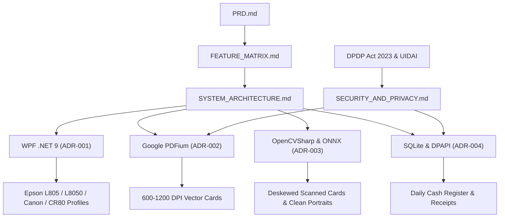

# Knowledge Graph Report — PVC Studio Pro

**Date:** 2026-11-18  
**Generated By:** Graphify Knowledge Architecture Service  
**Total Entities:** 32  
**Total Relationships:** 78  

---

## 1. Core Knowledge Clusters (Communities)

### Community 1: Requirements & Product Definition (Govt. e-Sevai Focus)
- **God Nodes:** `PRD.md`, `SRS.md`, `FEATURE_MATRIX.md`, `PRODUCT_VISION.md`
- **Connected Entities:** Aadhaar Vector Crop, UIDAI Masking (`XXXX-XXXX-1234`), NSDL PAN, Voter ID (e-EPIC), TN Smart Ration Card, Ayushman PM-JAY.
- **Key Relationships:**
  - `PRD.md` defines `FEATURE_MATRIX.md`
  - `FEATURE_MATRIX.md` maps directly to `SYSTEM_ARCHITECTURE.md`
  - `INDIA_REGULATORY_RESEARCH.md` enforces `SECURITY_AND_PRIVACY.md`

### Community 2: Hardware Printing & Tray Engine
- **God Nodes:** `SYSTEM_ARCHITECTURE.md`, `PRINTER_PROFILE`, `ADR-001`
- **Connected Entities:** Epson L805 (2-card tray), Epson L8050 / L18050, Canon G-Series, CR80 Direct Card Printers, Dragon Sheet (Mirror Mode), Millimeter Calibration Wizard.
- **Key Relationships:**
  - `ADR-001` justifies WPF `System.Printing` over WinUI 3
  - `PRINTER_PROFILE` stores hardware X/Y millimeter offsets
  - Calibration Wizard updates `PRINTER_PROFILE` dynamically

### Community 3: Vision, AI & Vector Rendering Engines
- **God Nodes:** `ADR-002`, `ADR-003`, `DEPENDENCY_REGISTER.md`
- **Connected Entities:** Google PDFium (600 DPI vector), OpenCVSharp4 (contour quad detection & perspective deskew), Microsoft.ML.OnnxRuntime (local AI portrait matting), SixLabors.ImageSharp.
- **Key Relationships:**
  - `PdfService` consumes `PDFiumSharp`
  - `VisionService` consumes `OpenCvSharp4`
  - `AiPhotoService` consumes `Microsoft.ML.OnnxRuntime`

### Community 4: Persistence, Privacy & Business Ledger
- **God Nodes:** `DATABASE_SCHEMA.md`, `ADR-004`, `SECURITY_AND_PRIVACY.md`
- **Connected Entities:** SQLite 3 (`pvc_studio.db`), Windows DPAPI Encryption, In-Memory MemoryStream, Daily Register, Customer Receipts.
- **Key Relationships:**
  - `SECURITY_AND_PRIVACY.md` requires DPAPI field-level encryption in `DATABASE_SCHEMA.md`
  - `LedgerService` aggregates data for `DAILY_REGISTER`

---

## 2. Graph Connectivity Map

