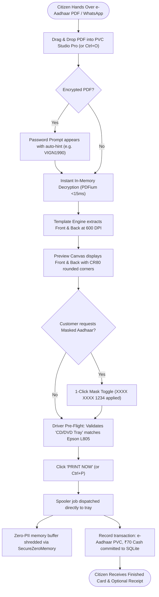
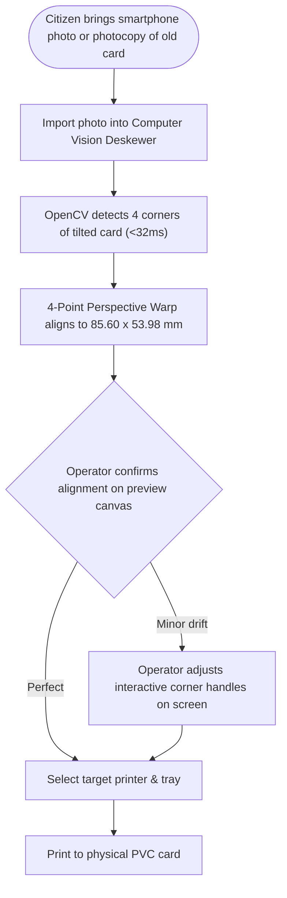
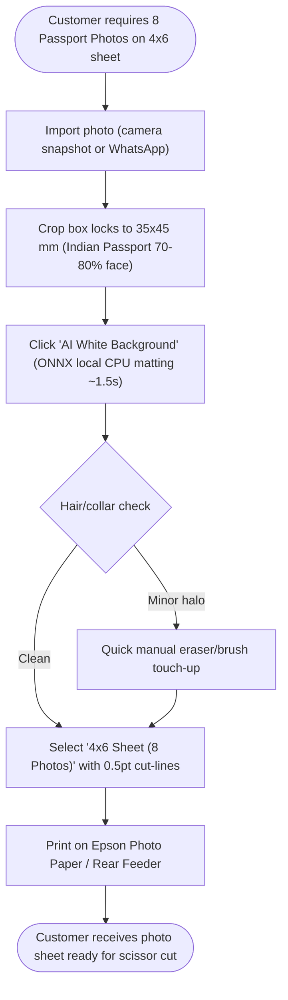

# User Flows & Operator Interaction Paths — PVC Studio Pro

**Target Audience:** Commercial e-Sevai Maiyam & Cyber Café Operators  
**Primary Goal:** Complete common customer print jobs in under 20 seconds with zero errors  
**Date:** 2026-11-18  

---

## 1. High-Velocity Flow: e-Aadhaar PDF to Dual-Card Tray Print

**Target Execution Time:** **12 to 18 seconds** total operator interaction.

---

## 2. High-Velocity Flow: Smartphone Camera Photo of Physical Card

---

## 3. High-Velocity Flow: Passport Photo Studio with Local AI Matting

