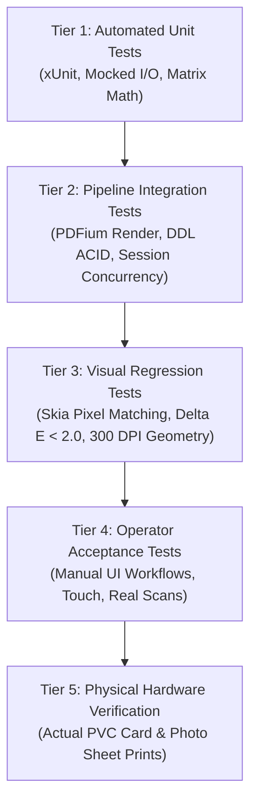

# PVC Studio Pro — Acceptance Test Plan & Quality Gates (Phase 0.3 Validated)
**Definitive Verification Protocol: Tiered Evidence Architecture & Acceptance Gates**

- **Document:** `docs/ACCEPTANCE_TEST_PLAN.md`
- **Revision:** Phase 0.3 Validated
- **Date:** 2026-11-19
- **Auditor:** Senior Windows Desktop Systems & Print Engine Architect
- **Quality Mandate:** Unit tests alone do not establish completion. Claims of "100% universal accuracy" are prohibited. Verification requires demonstrable evidence across five distinct testing tiers.

---

## 1. Five-Tier Verification Architecture

Every capability in PVC Studio Pro must be verified against its appropriate evidence tier:

### Tier Definitions & Evidence Standards
1. **Tier 1 (Automated Unit Tests):**
   - Scope: Pure algorithms, mathematical transforms, reference counting, coordinate conversions, integer paise math.
   - Requirement: 100% passing tests via `dotnet test`. Zero warnings treated as acceptable.
2. **Tier 2 (Pipeline Integration Tests):**
   - Scope: Multi-step workflows including PDFium decoding, SQLite schema migrations, and session management.
   - Requirement: Passes cleanly without unmanaged memory leaks or concurrency exceptions.
3. **Tier 3 (Automated Visual Regression Tests):**
   - Scope: Rendered SkiaSharp surfaces compared against golden baseline vector images.
   - Requirement: Pixel difference threshold $\le 0.5\%$, Color Delta $E \le 2.0$.
   - Coordinate Standards at 300 DPI ($1\text{ mm} = 11.811\text{ px}$):
     - CR80 Width: $85.60\text{ mm} \times 11.811 = 1011\text{ px}$.
     - CR80 Height: $53.98\text{ mm} \times 11.811 = 638\text{ px}$.
4. **Tier 4 (Operator Acceptance Tests):**
   - Scope: Human interaction across light/dark themes, display scalings (100%, 125%, 150%, 200%), and keyboard navigation.
   - Requirement: Ergonomic, responsive UI with zero control clipping, zero text contrast failures, and smooth pan/zoom.
5. **Tier 5 (Physical Hardware Verification):**
   - Scope: Actual physical prints onto PVC card stock or photo paper using real hardware (Epson L8050 / PVC ID card tray).
   - Requirement: Digital caliper measurement of printed card: Width $85.60 \pm 0.25\text{ mm}$, Height $53.98 \pm 0.25\text{ mm}$.

---

## 2. End-to-End Acceptance Test Scripts

### Test Suite 0: Native Memory Lifecycle & Asset Ownership (Tier 1 — Phase 1A Gate)
- **Objective:** Verify absolute memory safety, idempotent disposal, atomic ref-counting, quota eviction, and non-disposable read-only surface enforcement before any session or UI integration.
- **Automated Test Cases (`NativeAssetLifecycleTests.cs`):**
  1. `DoubleDisposal_OfAssetOwner_IsIdempotent`: Calling `.Dispose()` multiple times on `SafeNativeBitmap` does not throw exceptions or double-free native memory.
  2. `DoubleDisposal_OfLease_IsIdempotent`: Calling `.Dispose()` multiple times on `IAssetLease` decrements ref-count exactly once.
  3. `AcquireLease_AfterOwnerDisposal_ThrowsObjectDisposedException`: Calling `AcquireLease()` after owner disposal immediately throws `ObjectDisposedException`.
  4. `ConcurrentAcquisition_AndOwnerDisposal_IsThreadSafe`: 20 parallel tasks acquiring leases while another thread calls `Dispose()`. Zero memory corruptions, zero crashes.
  5. `OwnerDisposal_WhileLeaseHeld_KeepsResourceAlive`: Disposing owner while a lease is active keeps unmanaged bitmap alive; resource is released only when the lease is disposed.
  6. `ExceptionAndCancellation_InRenderingPipeline_ReleasesLeaseCleanly`: An exception or cancellation thrown during rendering releases the lease in `finally`.
  7. `UndoRedo_RetentionAndEviction_DisposesEvictedNativeBuffers`: Pushing 16 revisions into an undo manager with depth limit 15 evicts Revision 0, immediately releasing its native memory.
  8. `MemoryQuota_Enforcement_EvictsOldestRevisionsWhenExceeding250MB`: Allocating 300 MB of native revision buffers triggers FIFO eviction and disposal when exceeding the 250 MB ceiling.
  9. `NoUseAfterFree_OrNativeResourceLeak`: 1,000 rapid acquire/release cycles across 4 threads complete with 0 unmanaged leaks and baseline working set.
- **Pass Criteria:** 100% passed xUnit tests with zero native memory access violations.

---

### Test Suite 1: Centralized Crop Engine Acceptance Test (Tiers 1, 3 & 4)
- **Objective:** Verify zoom, pan, fit-to-window, 100% zoom, 8 drag handles, aspect-ratio locking, perspective quad correction, rotation, numeric millimeter adjustment, undo/redo, and cross-workspace state propagation.
- **Step-by-Step Procedure:**
  1. Open PVC Studio Pro and navigate to `Production Studio`.
  2. Click `Open Document (Ctrl+O)` and load high-resolution test scan `Synthetic_Aadhaar_300DPI.png`.
  3. Verify image is automatically fitted to window (`FitToWindow`).
  4. Click `Adjust Crop` to launch the unified crop engine (`InteractiveCropCanvas`).
  5. Test Zoom & Pan:
     - Use mouse scroll-wheel over citizen photo: confirm smooth zoom from $1.0\times$ to $3.5\times$ centered on mouse cursor.
     - Click and drag with middle-mouse or Spacebar+Left-Click: verify smooth panning without stutter.
     - Click `[100% Zoom]`: confirm canvas renders 1 native image pixel to 1 screen DIP.
     - Click `[Fit to Window]`: confirm canvas instantly snaps back to full page overview.
  6. Test Drag Handles & Aspect Ratio Lock:
     - Verify 8 handles (4 corner handles + 4 edge handles) are clearly visible.
     - Drag top-right corner handle: verify bounding box resizes smoothly while strictly maintaining the CR80 aspect ratio ($1.5858$).
     - Move the crop box by dragging from its center: confirm coordinates update smoothly.
  7. Test Numeric & Angle Adjustments:
     - Type exact numeric values into millimeter boxes ($X: 20.0\text{ mm}, Y: 220.0\text{ mm}, W: 85.6\text{ mm}, H: 54.0\text{ mm}$): confirm visual handles snap immediately.
     - Click `[Rotate 90°]`: confirm image and crop box rotate clockwise.
  8. Test Perspective Quad Warp:
     - Toggle `[Perspective Mode ☑]`: confirm 4 corner pins appear. Drag top-left pin to simulate keystone distortion correction.
  9. Test Undo / Redo:
     - Click `[Undo]` (or Ctrl+Z): confirm previous crop rectangle is restored.
  10. Test Commit & Cross-Workspace Observation:
      - Click `[Apply Crop]`.
      - Confirm the extracted card is normalized to exactly $1011 \times 638\text{ px}$ ($85.60 \times 53.98\text{ mm}$ @ 300 DPI).
      - Navigate to `Document Desk` and `Crop Studio`: confirm the identical cropped card is immediately displayed with matching dimensions without reloading.
- **Pass Criteria:** Zero pixel jumping, aspect ratio strictly maintained, identical state reflected across all workspaces.

---

### Test Suite 2: Adaptive Aadhaar Auto-Extraction & Alignment Acceptance Test (Tiers 2, 3 & 4)
- **Objective:** Verify multi-factor Aadhaar detection, boundary refinement, low-confidence fallback, dual-card extraction, and manual fine-tuning.
- **Step-by-Step Procedure:**
  1. Load password-protected test e-Aadhaar PDF.
  2. Verify in-place password banner appears with text field and show/hide toggle.
  3. Enter password and press Enter: verify document decrypts cleanly.
  4. Observe auto-detection badge: must display `UIDAI E-AADHAAR • AUTO-DETECTED (Confidence >95%)`.
  5. Inspect the center physical sheet canvas: confirm Front Card and Back Card appear mounted side-by-side on the A4 portrait sheet.
  6. Inspect Front Card: citizen photo, name, DOB, and gender must be 100% inside the card boundary with zero edge clipping.
  7. Inspect Back Card: address block and secure QR code must be fully visible with zero truncation.
  8. **Low-Confidence Fallback Test:** Load an intentionally skewed / non-standard scanned Aadhaar ($<85\%$ confidence).
     - Confirm software **does not silently crop wrong coordinates**.
     - Confirm amber warning displays: `⚠️ Low Detection Confidence (68%) — Please Confirm Card Bounds`.
     - Confirm crop drawer opens automatically with calibrated guides.
     - Nudge crop box $2\text{ mm}$ down and click `[Confirm & Apply]`.
     - Click `[Save as Custom Profile]`: save as `Shop_Scanner_Aadhaar`.
  9. Click `Rotate Cards 90°`: confirm both cards rotate clockwise and sheet layout recalculates.
  10. Click `Swap Faces`: confirm Front and Back card positions exchange on the physical sheet.
- **Pass Criteria:** Both sides extracted accurately without manual ratio adjustments; zero aspect-ratio squishing; zero silent miscrops on low confidence.

---

### Test Suite 3: True Physical Print, Spooling & Linked Reprint Acceptance Test (Tiers 3, 4 & 5)
- **Objective:** Verify that on-screen sheet preview, exported PDF, and physical print spooling are mathematically identical, with complete 6-stage lifecycle verification and linked reprint tracking.
- **Step-by-Step Procedure:**
  1. In `Production Studio`, select layout: `A4 Single Side (Side-by-Side)`.
  2. Verify on-screen physical sheet displays full A4 paper ($210 \times 297\text{ mm}$) fitted to window with zero scrolling required.
  3. Toggle `Cut Marks ☑`: confirm 0.2 mm hairline crop marks appear at the four corners of each card.
  4. Toggle `Mirror Mode ☑`: confirm cards flip horizontally (essential for thermal dragon sheet lamination).
  5. Click `Nudge Offset [►]` (+0.1 mm X): confirm live millimeter readout updates to `X: +0.1 mm`.
  6. Click `Export PDF`: save as `A4_Print_Verification.pdf`.
  7. Open `A4_Print_Verification.pdf` in a vector viewer: measure card positions. Front Card must be at $X=15.1\text{ mm}$, $Y=20.0\text{ mm}$; Back Card must be at $X=109.5\text{ mm}$, $Y=20.0\text{ mm}$.
  8. Select target printer `Microsoft Print to PDF` and click `START PRINTING`.
  9. Verify print job lifecycle:
     - Status transitions: `SubmittedToSpooler` $\rightarrow$ `AcceptedBySpooler` $\rightarrow$ `SpoolerProcessingCompleted`.
     - System creates row in `print_job_attempts` (Attempt 1, `is_billable = 1`).
     - UI presents verification dialog: `Did the card print correctly? [Confirmed] [Reprint Needed]`.
  10. **Defective Print & Linked Reprint Test:**
      - Operator clicks `[Reprint Needed]` and selects defect reason: `RibbonScuff`.
      - System updates Attempt 1: `physical_verification_status = 'DefectiveOutput'`, `defect_reason = 'RibbonScuff'`.
      - Operator clicks `[Start Reprint]`.
      - System generates Attempt 2 (`attempt_number = 2`, `is_billable = 0`).
      - Spooler processes Attempt 2. Operator clicks `[Confirmed]`.
      - System updates Attempt 2: `physical_verification_status = 'ConfirmedSuccessful'`.
      - Check Invoice: Customer is billed for exactly 1 card (₹70.00). Attempt 2 incurred ₹0 extra customer fee.
      - Check Material Wastage Report: Exactly 1 blank card is logged as spoiled.
- **Pass Criteria:** Sub-millimeter parity across preview and print; linked reprint tracked without customer over-billing.

---

### Test Suite 4: Passport Photo Studio & Biometric Engine Acceptance Test (Tiers 2, 3 & 4)
- **Objective:** Verify ICAO 9303 compliance, clean GrabCut background removal without bottom scalloping, interactive face positioning, and genuine print spooling.
- **Step-by-Step Procedure:**
  1. Navigate to `Passport Photo Studio`.
  2. Click `Import Portrait` and load customer test portrait `Portrait_Raw.jpg`.
  3. Verify automatic face detection places the subject's crown and chin within the ICAO guidelines ($70\%–80\%$ head coverage).
  4. Inspect the bottom edge of the subject's shirt: **the bottom border must be completely straight and clean, with zero wavy scallops or undulating edge artifacts**.
  5. Click `Studio Blue`: confirm background replaces cleanly behind hair strands without blue haloing.
  6. Click and drag portrait in preview: confirm operator can intuitively nudge face alignment and zoom head size.
  7. Select layout: `4x6 Photo Paper (8-Up)`.
  8. Verify 8-up sheet composer renders 8 identical $35 \times 45\text{ mm}$ photos with dashed cut guides.
  9. Click `PRINT PHOTO SHEET`.
  10. Open Windows Print Queue: confirm a real print job named `Passport_Photo_Sheet_8UP` is queued and spooled.
  11. Operator verifies physical sheet output and confirms transaction.
- **Pass Criteria:** Zero wavy artifacts at bottom, real print job dispatched to Windows queue, financial ledger updated.

---

### Test Suite 5: Business Ledger, IST Boundaries & Transactional Payment Consistency (Tiers 1, 2 & 4)
- **Objective:** Verify integer paise precision, IST business day boundaries, transactional payment constraints, and total Test Mode sandbox isolation.
- **Step-by-Step Procedure:**
  1. **Test Mode Sandbox Isolation Check:**
     - Toggle `Test Mode` in application header.
     - Verify permanent amber warning banner appears: `⚠️ TEST MODE ACTIVE — SIMULATION SANDBOX ONLY`.
     - Print 2 test cards for ₹140.00 (`14000` paise).
     - Open `JobLedgerView`: verify 2 test transactions appear with prefix `TEST-0001`.
     - Click `Reset Test Sandbox`: confirm test records are wiped to 0.
     - Toggle back to `Production Mode` (confirming safety prompt).
     - Open `JobLedgerView`: confirm production database contains 0 test records and is completely uncorrupted.
  2. **Scenario 1: ₹100 cash receipt and ₹20 cash refund:**
     - Record ₹100 cash receipt (`10000` paise) and ₹20 cash refund (`2000` paise).
     - Verify Daily Cash Drawer query yields exactly ₹80.00 (`8000` paise).
  3. **Scenario 2: ₹100 cash + ₹40 UPI split payment:**
     - Record ₹140 invoice with Payment 1 = ₹100 cash, Payment 2 = ₹40 UPI.
     - Verify status is `PAID` with balance = 0.
  4. **Scenario 3: ₹140 invoice with ₹100 paid and ₹40 outstanding:**
     - Verify status is `PARTIAL` and balance due = ₹40.00 (`4000` paise).
  5. **Scenario 4: Older outstanding invoice paid today:**
     - Collect ₹40 cash on an older invoice.
     - Verify today's cash drawer includes the ₹40 inflow while the invoice retains its original creation date.
  6. **Scenario 5: Voided invoice with previous payment and refund:**
     - Void a ₹70 transaction and record refund.
     - Verify net cash contribution is 0 and invoice is excluded from revenue reports.
  7. **IST Midnight Boundary Verification:**
     - Insert transaction at `2026-11-18 23:59:50 IST` (`2026-11-18T18:29:50Z`). Verify it falls into Day 1 ledger.
     - Insert transaction at `2026-11-19 00:00:10 IST` (`2026-11-18T18:30:10Z`). Verify it falls into Day 2 ledger.
     - Insert transaction at `2026-11-19 04:30:00 IST` (`2026-11-18T23:00:00Z`). Verify it falls into Day 2 ledger (confirming rejection of raw SQLite `date('now')`).
  8. **Transactional Payment Consistency & Safety Rules:**
     - Attempt to refund ₹120 on a ₹100 payment: verify `RefundExceedsCollectedException` is thrown and operation rolls back.
     - Attempt to pay ₹150 on a ₹140 bill without credit flag: verify `OverpaymentNotPermittedException` is thrown and operation rolls back.
     - Attempt to record a test payment against a production invoice: verify `SecurityIsolationException` is thrown and operation rolls back.
- **Pass Criteria:** Zero test data leakage into production, 100% mathematical precision in integer paise, all 5 scenarios reconciled, IST day boundaries verified, payment constraints enforced.
