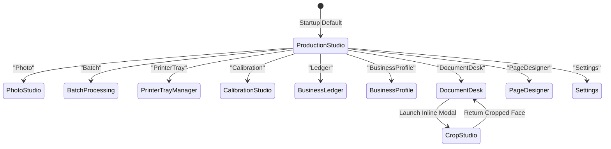

# PVC Studio Pro — Current Architecture Map
**Forensic Blueprint: Component Topography, Lifetimes, Navigation & Data Flows**

- **Date:** 2026-11-19
- **Auditor:** Senior Windows Desktop Systems & Print Engine Architect
- **Target Repository:** `PVCStudioPro` (.NET 8 WPF x64)

---

## 1. High-Level Component Topology

The following diagram maps the actual components currently wired in `src/PVCStudioPro.App/` and `src/PVCStudioPro.Core/`:

```mermaid
graph TD
    subgraph UI_Layer["UI Presentation Layer (WPF / XAML)"]
        MW["MainWindow.xaml"]
        PWV["ProductionWorkspaceView"]
        DDV["DocumentDeskView"]
        CSV["CropStudioView"]
        PDV["PageDesignerView"]
        PPAV["PrintPreviewApprovalView"]
        PSV["PhotoStudioView"]
        BPV["BusinessProfileView"]
        JLV["JobLedgerView"]
    end

    subgraph ViewModel_Layer["MVVM ViewModel Layer (All Registered as Singletons)"]
        MVM["MainViewModel"]
        PWVM["ProductionWorkspaceViewModel"]
        DDVM["DocumentDeskViewModel"]
        CSVM["CropStudioViewModel"]
        DPDVM["DocumentPageDesignerViewModel"]
        PPAVM["PrintPreviewApprovalViewModel"]
        PSVM["PhotoStudioViewModel"]
        BPVM["BusinessProfileViewModel"]
        JLVM["JobLedgerViewModel"]
    end

    subgraph Core_Services["Core Business Logic & Hardware Services"]
        DIS["DocumentImportService"]
        PDS["PdfService (Docnet / PDFium)"]
        DTS["DocumentTypeDetectionService"]
        CDS["CardDetectionService (Static Slicing)"]
        MCS["ManualCropService"]
        TS["TemplateService (29 Templates)"]
        VS["VisionService (OpenCvSharp / GrabCut)"]
        PPRS["PhysicalPageRenderService (SkiaSharp)"]
        PPrS["PrintPreviewService"]
        PrS["PrintService (System.Drawing.Printing)"]
        PDiscS["PrinterDiscoveryService"]
        PTS["PrinterTrayService"]
        JLS["JobLedgerService (Dapper / SQLite)"]
        BPS["BusinessProfileService"]
        BS["BackupService"]
    end

    subgraph Data_Storage["Physical Storage & Drivers"]
        DB[("pvc_studio.db (SQLite)")]
        CFG["JSON Configs (profiles, trays)"]
        SPOOL["Windows Print Spooler (GDI+/Win32)"]
    end

    MW --> MVM
    MVM --> PWVM
    MVM --> DDVM
    MVM --> PSVM
    MVM --> JLVM

    PWVM --> DIS
    PWVM --> PDS
    PWVM --> DTS
    PWVM --> CDS
    PWVM --> PPRS
    PWVM --> PrS
    PWVM --> JLS
    PWVM -.->|INJECTED BUT UNUSED| TS

    DDVM --> DIS
    DDVM --> PDS
    DDVM --> DTS
    DDVM --> CSVM

    CSVM --> MCS

    PSVM --> VS
    PSVM --> JLS
    PSVM -.->|NEVER CALLED| PrS

    PPAVM --> PPrS
    PPAVM --> PPRS
    PPAVM --> PrS
    PPAVM --> PDiscS
    PPAVM --> JLS

    JLS --> DB
    BPS --> CFG
    PTS --> CFG
    PrS --> SPOOL
```



---

## 2. Dependency Injection & Service Lifetimes

All application services and ViewModels are configured in `src/PVCStudioPro.App/App.xaml.cs` inside `ConfigureServices`. 

### Key Observations on Service Lifetimes:
1. **100% Singleton Registration:**
   Every single ViewModel (`MainViewModel`, `ProductionWorkspaceViewModel`, `DocumentDeskViewModel`, `CropStudioViewModel`, etc.) and every Core service is registered as `ServiceLifetime.Singleton`.
2. **Consequence of Singleton ViewModels:**
   - ViewModels retain their internal state throughout the entire application lifecycle.
   - However, because they are distinct singleton instances that **do not share a common session store**, their individual states drift out of sync.
   - For example: loading a document in `ProductionWorkspaceViewModel` populates its private `_cachedPageBitmap`. If the operator navigates to `CropStudioView` or `DocumentDeskView`, those ViewModels still have their private `_pageBitmap` as `null`.

---

## 3. Navigation Topology

Navigation is controlled centrally by `MainViewModel.cs` using the `Navigate(string destination)` RelayCommand.



### Navigation Architecture Defects:
1. **No Deep-Linking or Context Passing:**
   `Navigate(string destination)` simply swaps the `CurrentView` property of `MainViewModel`. It passes **zero arguments, zero document pointers, and zero state**.
2. **Crop Studio Navigation Trap:**
   `CropStudioViewModel` was designed to be launched exclusively as a child of `DocumentDeskViewModel` using callback delegates (`ReturnToDeskAction`). It cannot be navigated to cleanly from `ProductionWorkspaceViewModel`.

---

## 4. Data Storage & Persistence Topology

```
%LOCALAPPDATA%\PVCStudioPro\
  ├── data\
  │    └── pvc_studio.db              <-- SQLite Database (Dapper ORM)
  │         ├── print_jobs            <-- Financial records (Insert-only)
  │         └── printer_profiles      <-- Offset profiles (Single default seed)
  └── config\
       ├── business_profile.json      <-- Shop branding & GSTIN
       └── printer_profiles.json      <-- Factory tray definitions
```

### Data Storage Architecture Defects:
1. **Unprotected Financial Database:**
   All transactions (production and testing) are written to the single SQLite database `pvc_studio.db`.
2. **Missing Transaction Statuses & Adjustments:**
   `print_jobs` table lacks columns for discounts, cancellations, partial payments, operator notes, or correction parent links.

---

## 5. Primary Operator Workflows vs. Architecture Reality

### Workflow 1: The PVC Card Production Journey
- **Expected:** `Import PDF -> Auto-Detect -> Decrypt -> Extract CR80 Faces -> Inspect Full A4 -> Spool Hardware -> Record Ledger`.
- **Actual Reality:**
  1. Operator opens PDF in `ProductionWorkspaceView`.
  2. PDF password prompt unlocks via `PdfService`.
  3. `CardDetectionService` slices static rectangular boxes at hardcoded coordinates without contour detection.
  4. If alignment is slightly shifted, user clicks "Adjust Crop". This opens a modal with four numeric text boxes (`CropX`, `CropY`, `CropWidth`, `CropHeight`), requiring the user to manually type pixel values instead of intuitively dragging a visual bounding box.
  5. Sheet renders in center canvas via SkiaSharp.
  6. Operator clicks "START PRINTING". Job spools to default printer and writes row to `print_jobs`.

### Workflow 2: The Passport Photo Journey
- **Expected:** `Import Portrait -> Face Detection -> Align & Crop -> Remove/Change BG -> Compose 4x6 Sheet -> Spool -> Record Ledger`.
- **Actual Reality:**
  1. Operator opens portrait in `PhotoStudioView`.
  2. `VisionService.ProcessPassportPhotoAsync` runs GrabCut. Because GrabCut marks bottom 5% as background, the bottom of the citizen's shirt is scalloped with wavy artifacts.
  3. Face cannot be interactively scaled or positioned within the ICAO 9303 frame.
  4. Sheet is generated into an `SKBitmap` in memory.
  5. Operator clicks "PRINT PHOTO SHEET". **Nothing is printed.** The method only inserts a row into the database and updates a text label.
