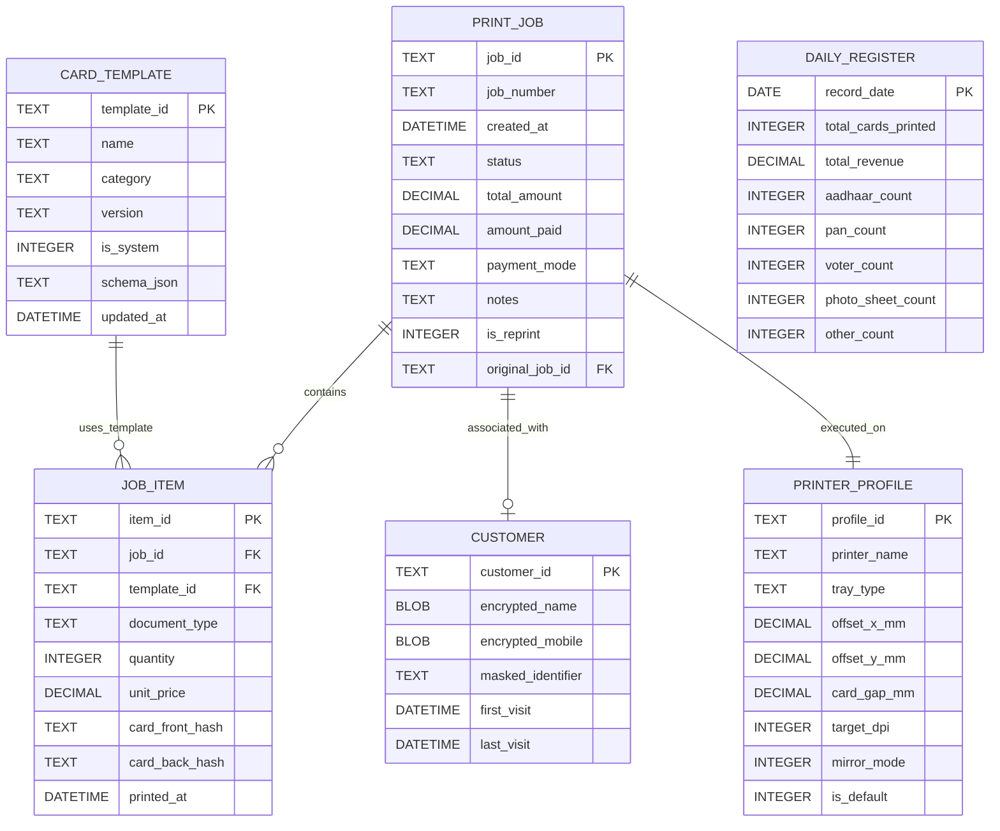

# Database Schema Specification — SQLite

**Database Name:** `pvc_studio.db`  
**Storage Location:** `%LOCALAPPDATA%\PVCStudioPro\data\pvc_studio.db`  
**Encryption:** Windows DPAPI field-level encryption for sensitive citizen PII  
**Engine:** SQLite 3 (WAL mode enabled for concurrent read/write performance)  

---

## 1. Entity-Relationship Diagram



---

## 2. Table Definitions & Constraints

### 2.1 Table: `PRINT_JOB`
Logs every card or photo printing operation dispatched to the Windows Print Spooler.
```sql
CREATE TABLE print_jobs (
    job_id TEXT PRIMARY KEY,
    job_number TEXT NOT NULL UNIQUE,
    customer_id TEXT REFERENCES customers(customer_id) ON DELETE SET NULL,
    profile_id TEXT NOT NULL REFERENCES printer_profiles(profile_id),
    status TEXT NOT NULL CHECK(status IN ('PENDING', 'PRINTING', 'COMPLETED', 'FAILED', 'CANCELLED')),
    total_amount NUMERIC(10,2) NOT NULL DEFAULT 0.00,
    amount_paid NUMERIC(10,2) NOT NULL DEFAULT 0.00,
    payment_mode TEXT CHECK(payment_mode IN ('CASH', 'UPI', 'CARD', 'CREDIT', 'FREE')),
    is_reprint INTEGER NOT NULL DEFAULT 0 CHECK(is_reprint IN (0, 1)),
    original_job_id TEXT REFERENCES print_jobs(job_id),
    created_at DATETIME NOT NULL DEFAULT CURRENT_TIMESTAMP,
    completed_at DATETIME
);
CREATE INDEX idx_jobs_created_at ON print_jobs(created_at);
CREATE INDEX idx_jobs_status ON print_jobs(status);
```

### 2.2 Table: `CUSTOMER` (Encrypted at Rest)
Stores optional customer information for receipts and repeat printing. Sensitive fields (`encrypted_name`, `encrypted_mobile`) are ciphertext encrypted via DPAPI.
```sql
CREATE TABLE customers (
    customer_id TEXT PRIMARY KEY,
    encrypted_name BLOB,
    encrypted_mobile BLOB,
    masked_identifier TEXT, -- e.g. "Aadhaar XXXX-1234"
    created_at DATETIME NOT NULL DEFAULT CURRENT_TIMESTAMP,
    updated_at DATETIME NOT NULL DEFAULT CURRENT_TIMESTAMP
);
CREATE INDEX idx_customers_masked_id ON customers(masked_identifier);
```

### 2.3 Table: `PRINTER_PROFILE`
Maintains hardware offsets and tray configurations independently for each connected printer.
```sql
CREATE TABLE printer_profiles (
    profile_id TEXT PRIMARY KEY,
    profile_name TEXT NOT NULL,
    printer_device_name TEXT NOT NULL,
    tray_type TEXT NOT NULL CHECK(tray_type IN ('EPSON_2CARD_TRAY', 'CANON_MULTI_TRAY', 'CR80_DIRECT_CARD', 'PVC_DRAGON_SHEET', 'CUSTOM')),
    offset_x_mm REAL NOT NULL DEFAULT 0.0,
    offset_y_mm REAL NOT NULL DEFAULT 0.0,
    card_gap_mm REAL NOT NULL DEFAULT 5.60,
    target_dpi INTEGER NOT NULL DEFAULT 600,
    mirror_mode INTEGER NOT NULL DEFAULT 0 CHECK(mirror_mode IN (0, 1)),
    is_default INTEGER NOT NULL DEFAULT 0 CHECK(is_default IN (0, 1)),
    created_at DATETIME NOT NULL DEFAULT CURRENT_TIMESTAMP,
    updated_at DATETIME NOT NULL DEFAULT CURRENT_TIMESTAMP
);
```

### 2.4 Table: `CARD_TEMPLATE`
Stores the dynamic bounding boxes, anchor keywords, and layout rules for government and custom cards in JSON format.
```sql
CREATE TABLE card_templates (
    template_id TEXT PRIMARY KEY,
    name TEXT NOT NULL,
    category TEXT NOT NULL, -- 'AADHAAR', 'PAN', 'VOTER', 'AYUSHMAN', 'STATE_GOVT', 'CUSTOM'
    version TEXT NOT NULL DEFAULT '1.0',
    is_system INTEGER NOT NULL DEFAULT 1 CHECK(is_system IN (0, 1)),
    schema_json TEXT NOT NULL,
    created_at DATETIME NOT NULL DEFAULT CURRENT_TIMESTAMP,
    updated_at DATETIME NOT NULL DEFAULT CURRENT_TIMESTAMP
);
```

### 2.5 Table: `DAILY_REGISTER` (Business Summary)
Aggregated daily statistics for instant e-Sevai revenue dashboards.
```sql
CREATE TABLE daily_register (
    record_date DATE PRIMARY KEY,
    total_cards_printed INTEGER NOT NULL DEFAULT 0,
    total_revenue NUMERIC(10,2) NOT NULL DEFAULT 0.00,
    aadhaar_count INTEGER NOT NULL DEFAULT 0,
    pan_count INTEGER NOT NULL DEFAULT 0,
    voter_count INTEGER NOT NULL DEFAULT 0,
    ayushman_count INTEGER NOT NULL DEFAULT 0,
    photo_sheet_count INTEGER NOT NULL DEFAULT 0,
    other_count INTEGER NOT NULL DEFAULT 0,
    updated_at DATETIME NOT NULL DEFAULT CURRENT_TIMESTAMP
);
```
