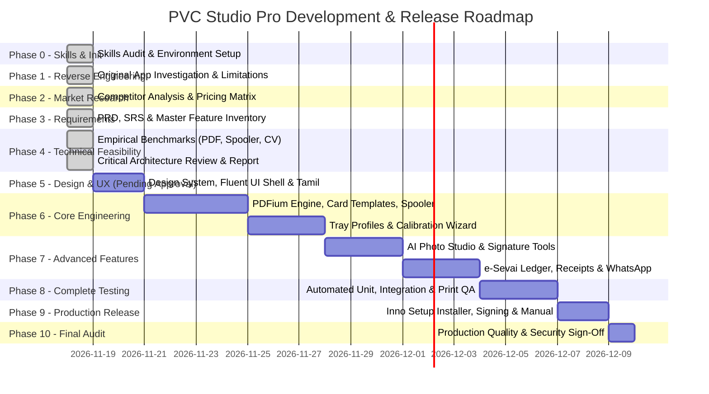

# Development Roadmap & Execution Strategy — PVC Studio Pro (Revised 2.0)

---

## 1. Governance Gate Status

- **Phase 0 (Skills & Environment):** COMPLETED & VERIFIED
- **Phase 1 (Reverse Engineering):** COMPLETED & BASELINED
- **Phase 2 (Market & Competitor Research):** COMPLETED & FACT-CHECKED
- **Phase 3 (Product Requirements & Legal):** COMPLETED & HARDENED
- **Phase 4 (Technical Feasibility & Architecture Review):** COMPLETED WITH REAL BENCHMARKS
- **Phase 5 (UI/UX Prototype & Design System):** **PENDING USER EXPLICIT APPROVAL**

*Full Review Artifacts:*
- [ARCHITECTURE_REVIEW_REPORT.md](file:///d:/pvc card pro/docs/ARCHITECTURE_REVIEW_REPORT.md)
- [TECHNICAL_FEASIBILITY_RESULTS.md](file:///d:/pvc card pro/testing/TECHNICAL_FEASIBILITY_RESULTS.md)
- [HARDWARE_VALIDATION_PLAN.md](file:///d:/pvc card pro/testing/HARDWARE_VALIDATION_PLAN.md)
- [OPEN_RISKS_REGISTER.md](file:///d:/pvc card pro/docs/OPEN_RISKS_REGISTER.md)
- [FINAL_APPROVAL_CHECKLIST.md](file:///d:/pvc card pro/docs/FINAL_APPROVAL_CHECKLIST.md)
