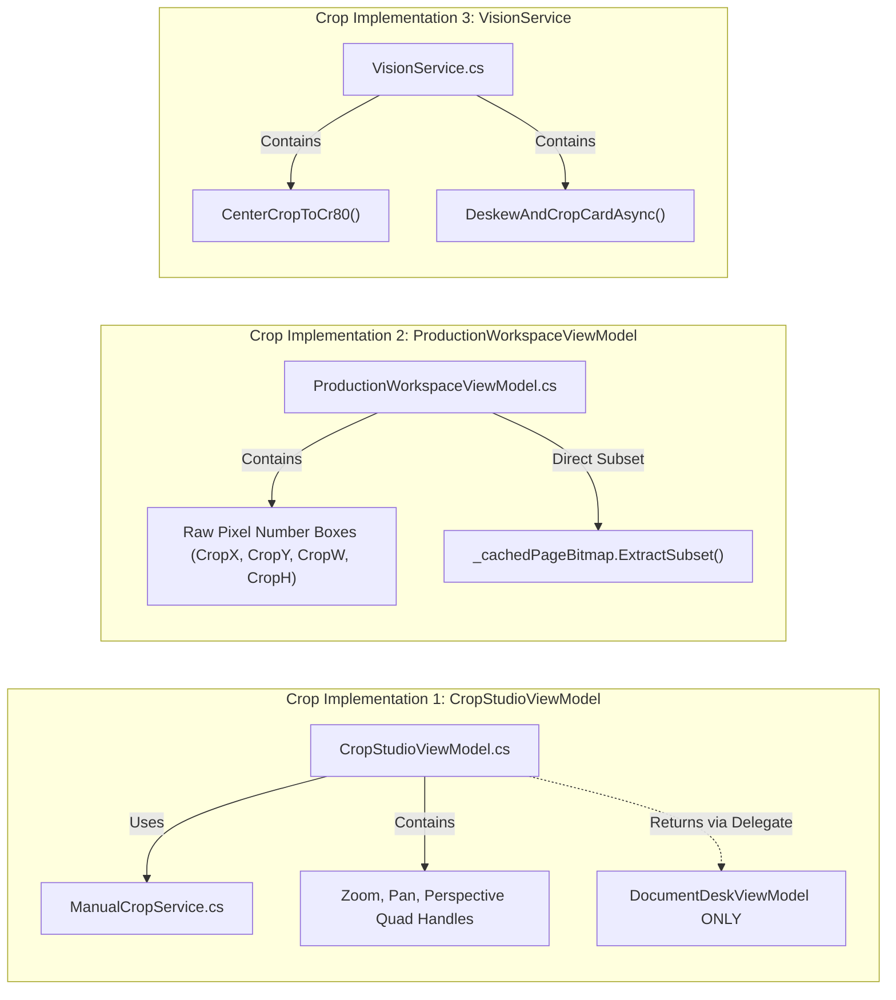
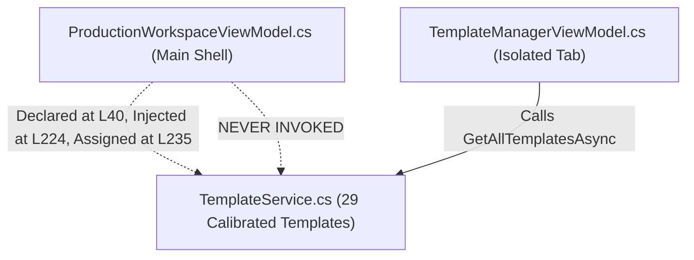

# PVC Studio Pro — Duplicated & Disconnected Features Audit
**Deep Architectural Analysis of Subsystem Isolation, Redundancies & State Breaks**

- **Date:** 2026-11-19
- **Auditor:** Senior Windows Desktop Systems & Print Engine Architect
- **Focus:** Systemic Code Duplication, Broken State Propagation, and Unwired Implementations

---

## 1. Overview of Architectural Disconnects

A forensic audit of the codebase reveals that multiple features were developed as **isolated prototypes** rather than as a cohesive system. This has produced:
1. **Three competing crop engines** operating on divergent coordinate spaces.
2. **Two competing document import pipelines** (`DocumentDeskViewModel` vs. `ProductionWorkspaceViewModel`).
3. **Three separate physical layout builders** (`ProductionWorkspaceViewModel`, `PrintPreviewApprovalViewModel`, `DocumentPageDesignerViewModel`).
4. **An orphaned template registry** (`TemplateService.cs`) with 29 templates that are completely unreachable from the main production workspace.
5. **A mocked print command** in `PhotoStudioViewModel.cs` that simulates hardware spooling while performing zero I/O.

---

## 2. Detailed Subsystem Disconnects & Duplications

### A. Crop Engine Fragmentation



#### Forensic Evidence:
1. **`CropStudioViewModel.cs` (lines 35–62):**
   - Implements `ZoomFactor`, `PanOffsetX`, `PanOffsetY`, `CropX`, `CropY`, `CropWidth`, `CropHeight`, and quadrilateral corner points (`Corner1X` through `Corner4Y`).
   - Uses `ManualCropService.CropAndScaleBitmap`.
   - Wired **only** to `DocumentDeskViewModel` via `public Action<SKBitmap, bool>? ReturnToDeskAction`.
   - Completely inaccessible from `ProductionWorkspaceViewModel`.
2. **`ProductionWorkspaceViewModel.cs` (lines 180–189, 520–555):**
   - Ignores `CropStudioViewModel` and `ManualCropService`.
   - Implements its own isolated crop drawer with four raw integer text boxes (`CropX`, `CropY`, `CropWidth`, `CropHeight`).
   - Slices the bitmap using `_cachedPageBitmap.ExtractSubset()`.
   - Does not support interactive drag handles, zoom, pan, or aspect-ratio locked mouse gestures.
3. **`VisionService.cs` (lines 15–73):**
   - Contains a third independent contour-based crop implementation (`DeskewAndCropCardAsync`) that is never invoked by either `CropStudioViewModel` or `ProductionWorkspaceViewModel`.

---

### B. Template Service Isolation



#### Forensic Evidence:
- In `src/PVCStudioPro.Core/Services/Implementations/TemplateService.cs`, 29 Indian identity card templates are defined with exact coordinates (Child Aadhaar, mAadhaar, NSDL PAN, UTI PAN, Instant PAN, Voter ID, Ayushman PM-JAY, Ayushman BIS 2.0, UMID, e-PRAN, UDID, Pravasi Card, Senior Citizen, Jan-Aadhaar, Co-WIN Vaccination, Kerala Ration, WB Ration, etc.).
- In `src/PVCStudioPro.App/ViewModels/ProductionWorkspaceViewModel.cs`:
  - Line 40: `private readonly ITemplateService _templateService;`
  - Line 224: Injected via constructor parameter.
  - Line 235: Assigned to field `_templateService = templateService;`.
  - **Lines 236–974: The identifier `_templateService` NEVER appears again in the file.**
- **Impact:** When a user opens any secondary document in `ProductionWorkspaceView`, the application cannot match or apply any of the 29 templates. It falls back to a crude switch statement on the basic `DocumentKind` enum.

---

### C. Physical Page Layout Pipeline Fragmentation


#### Forensic Evidence:
1. **`ProductionWorkspaceViewModel.cs` (lines 520–680):**
   - Contains an inline switch statement hardcoding millimeter positions for `SingleSideA4` ($X_1=15.0, X_2=109.4$), `CenterFoldA4` ($X=62.2, Y_1=20.0, Y_2=76.0$), `Epson2CardTray` ($X=27.2, Y_1=18.0, Y_2=110.0$), etc.
2. **`PrintPreviewApprovalViewModel.cs` (lines 140–210):**
   - Implements a separate layout generator calling `IPrintPreviewService.GenerateVirtualTrayPreviewAsync`, querying driver offsets independently.
3. **`PhotoStudioViewModel.cs` (lines 141, 192–245):**
   - Completely bypasses `PageLayoutModel` and `PhysicalPageRenderService`.
   - Delegates sheet generation to `VisionService.ComposePassportPhotoSheet`, which draws directly onto an uncalibrated pixel canvas in memory without applying driver margins or physical printer offsets.

---

### D. Mocked Printing in Photo Studio

#### Forensic Evidence:
In `src/PVCStudioPro.App/ViewModels/PhotoStudioViewModel.cs`:
```csharp
[RelayCommand]
public async Task PrintPhotoSheetAsync()
{
    if (_composedSheet == null)
    {
        StatusMessage = "No photo sheet generated to print.";
        return;
    }

    try
    {
        IsProcessing = true;
        StatusMessage = $"Spooled {PhotoCount}-up photo sheet to printer queue...";

        // Record transaction in ledger
        await _jobLedger.RecordJobAsync(new PrintJobRecord
        {
            DocumentType = $"PHOTO_STUDIO_{PhotoCount}UP",
            Quantity = 1,
            TotalAmount = SheetPrice,
            PaymentMode = PaymentMode,
            PrinterName = "Default Photo Printer",
            Status = "COMPLETED"
        });

        StatusMessage = $"Passport photo sheet ({PhotoCount}-up) successfully spooled! (Logged in Ledger: ₹{SheetPrice})";
    }
    // ...
}
```
- **The print command is a complete placeholder.**
- `IPrintService` is injected into `PhotoStudioViewModel` at line 66, but **is never called** inside `PrintPhotoSheetAsync`.
- The user is told "successfully spooled", but nothing is sent to the printer queue.

---

### E. Business Ledger & Accounting Disconnect

#### Forensic Evidence:
1. **`JobLedgerService.cs`:**
   - Only implements `RecordJobAsync` (SQL `INSERT`) and `GetRecentJobsAsync` (SQL `SELECT`).
   - Lacks methods for updating records, adjusting charges, voiding transactions, or applying discounts.
2. **`BusinessLedgerViewModel.cs` & `JobLedgerView.xaml`:**
   - Bound to an immutable data grid. If an operator mistakenly records ₹70 instead of ₹50, the operator cannot correct it.
3. **No Test Isolation:**
   - There is no test mode flag. Automated verification tests and operator trial runs write directly to `pvc_studio.db`, corrupting commercial bookkeeping.

---

## 3. Disconnection & Duplication Register

| Subsystem | Primary Working Location | Duplicate / Orphaned Location | Architectural Fix Required |
| :--- | :--- | :--- | :--- |
| **Crop Engine** | `CropStudioViewModel.cs` (UI handles) & `ProductionWorkspaceViewModel.cs` (Modal) | `ManualCropService.cs` vs. `VisionService.DeskewAndCropCardAsync` | Merge into single authoritative `ICropEngine` service and shared `CropSessionModel`. |
| **Document Session** | `ProductionWorkspaceViewModel.cs` (Private `_cachedPageBitmap`) | `DocumentDeskViewModel.cs` (Private `_pageBitmap`) | Extract into singleton `IDocumentSessionManager`. |
| **Card Templates** | `TemplateService.cs` (29 templates in Core) | `ProductionWorkspaceViewModel.cs` (hardcoded switch) | Wire `TemplateService` into `ProductionWorkspaceViewModel` with an interactive template selector. |
| **Sheet Layout** | `ProductionWorkspaceViewModel.cs` (Inline switch) | `PrintPreviewApprovalViewModel.cs` & `VisionService.ComposePassportPhotoSheet` | Enforce single source of truth using `IPhysicalPageLayoutEngine`. |
| **Photo Spooling** | Missing / Mocked in `PhotoStudioViewModel.cs` | Working in `ProductionWorkspaceViewModel.cs` | Unify both workspaces through `IPrintService.SpoolPageAsync`. |
| **Ledger System** | `JobLedgerService.cs` (Insert-only) | Missing audit trail / correction pipeline | Implement full transaction lifecycle (Edit, Void, Partial, Audit Trail, Test Mode). |
