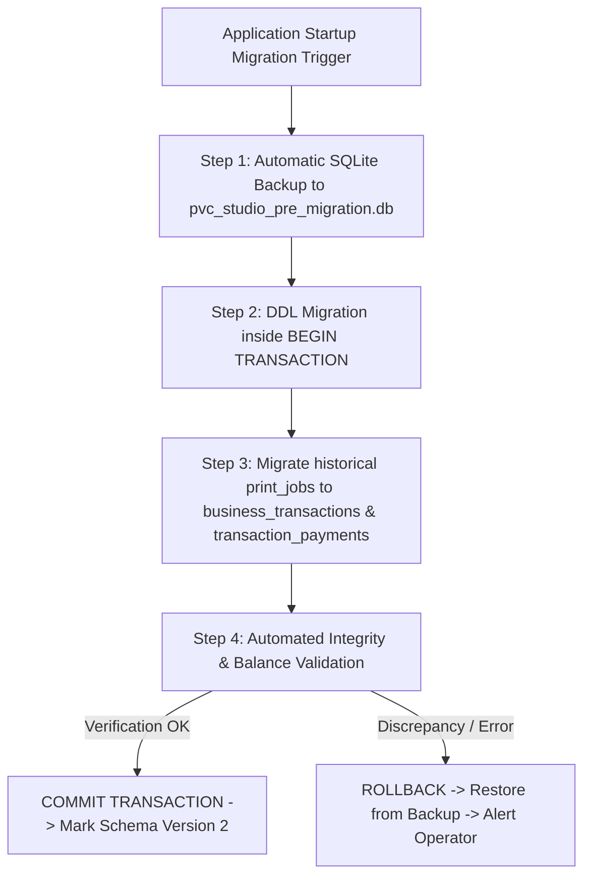

# PVC Studio Pro — Business Ledger & Complete Test Mode Specification (Phase 0.1 Revised)
**Enterprise Financial Ledger, Normalized Multi-Payment Architecture & Total Environment Sandbox Isolation**

- **Document:** `docs/LEDGER_AND_TEST_MODE_SPEC.md`
- **Revision:** Phase 0.1
- **Date:** 2026-11-19
- **Auditor:** Senior Windows Desktop Systems & Print Engine Architect
- **Status:** Architectural Specification (Awaiting Review & Phase 1 Authorization)

---

## 1. Normalized Financial Ledger Architecture

To support real-world commercial shop operations, financial tracking is separated into a **Master-Detail Normalized Architecture**:

```
┌────────────────────────────────────────────────────────┐
│              business_transactions (Master)            │
│  - transaction_id (PK)         - invoice_number (INV)  │
│  - document_type               - template_id           │
│  - quantity                    - unit_price            │
│  - discount_amount             - net_total_amount      │
│  - amount_paid                 - balance_due           │
│  - status (DRAFT/PAID/PARTIAL/VOID/REFUNDED)           │
│  - is_reprint (0/1)            - reprint_reason        │
│  - created_at                  - updated_at            │
└───────────────────────────┬────────────────────────────┘
                            │ 1 : N
                            ▼
┌────────────────────────────────────────────────────────┐
│           transaction_payments (Individual Entries)    │
│  - payment_id (PK)             - transaction_id (FK)   │
│  - payment_method (CASH/UPI/CARD/CHEQUE)               │
│  - amount                      - collected_at          │
│  - reference_note (UPI ref ID) - operator_id           │
│  - is_refund (0/1)                                     │
└────────────────────────────────────────────────────────┘
                            │ 1 : N
                            ▼
┌────────────────────────────────────────────────────────┐
│       transaction_audit_trail (Immutable Log)          │
│  - audit_id (PK)               - transaction_id (FK)   │
│  - action_type (EDIT/VOID/PARTIAL/REFUND/REPRINT)      │
│  - field_changed               - old_value             │
│  - new_value                   - mandatory_reason      │
│  - operator_id                 - timestamp             │
└────────────────────────────────────────────────────────┘
```

---

## 2. DDL Schema Definition (SQLite)

### Table 1: `business_transactions`
```sql
CREATE TABLE IF NOT EXISTS business_transactions (
    transaction_id TEXT PRIMARY KEY,               -- UUID format (N)
    invoice_number TEXT NOT NULL UNIQUE,          -- Format: INV-YYYYMMDD-XXXX
    customer_token TEXT,                          -- Optional counter token / phone
    document_type TEXT NOT NULL,                  -- AADHAAR_CR80, PAN_NSDL, PHOTO_8UP, etc.
    template_id TEXT,                             -- Reference to TemplateRegistry ID
    printer_name TEXT NOT NULL,                   -- Windows spooler queue name
    quantity INTEGER NOT NULL DEFAULT 1,          -- Number of physical units
    unit_price NUMERIC NOT NULL DEFAULT 0.00,     -- Standard card/photo price
    discount_amount NUMERIC NOT NULL DEFAULT 0.00,-- Promotional waiver / discount
    net_total_amount NUMERIC NOT NULL DEFAULT 0.00,-- (quantity * unit_price) - discount_amount
    amount_paid NUMERIC NOT NULL DEFAULT 0.00,    -- Sum of all non-refund payment entries
    balance_due NUMERIC NOT NULL DEFAULT 0.00,    -- net_total_amount - amount_paid
    status TEXT NOT NULL DEFAULT 'DRAFT',         -- DRAFT, PAID, PARTIAL, VOID, REFUNDED
    is_reprint INTEGER NOT NULL DEFAULT 0,        -- 1 if complimentary hardware reprint
    reprint_reason TEXT,                          -- Paper Jam, Ribbon Scuff, Alignment Error
    notes TEXT,                                   -- Operator remarks
    created_at DATETIME NOT NULL DEFAULT CURRENT_TIMESTAMP,
    updated_at DATETIME NOT NULL DEFAULT CURRENT_TIMESTAMP
);

CREATE INDEX IF NOT EXISTS idx_trans_created ON business_transactions(created_at);
CREATE INDEX IF NOT EXISTS idx_trans_status ON business_transactions(status);
CREATE INDEX IF NOT EXISTS idx_trans_invoice ON business_transactions(invoice_number);
```

### Table 2: `transaction_payments` (Independent Payment Entries)
```sql
CREATE TABLE IF NOT EXISTS transaction_payments (
    payment_id TEXT PRIMARY KEY,                  -- UUID format (N)
    transaction_id TEXT NOT NULL,                 -- Foreign key to business_transactions
    payment_method TEXT NOT NULL,                 -- CASH, UPI, CARD, OTHER
    amount NUMERIC NOT NULL DEFAULT 0.00,         -- Positive for receipts, negative for refunds
    is_refund INTEGER NOT NULL DEFAULT 0,         -- 1 if refund payout
    reference_note TEXT,                          -- UPI transaction ID / Card Auth code
    operator_id TEXT NOT NULL DEFAULT 'Admin',    -- Cashier ID
    collected_at DATETIME NOT NULL DEFAULT CURRENT_TIMESTAMP,
    FOREIGN KEY(transaction_id) REFERENCES business_transactions(transaction_id) ON DELETE RESTRICT
);

CREATE INDEX IF NOT EXISTS idx_pay_trans ON transaction_payments(transaction_id);
CREATE INDEX IF NOT EXISTS idx_pay_method ON transaction_payments(payment_method);
CREATE INDEX IF NOT EXISTS idx_pay_collected ON transaction_payments(collected_at);
```

### Table 3: `transaction_audit_trail` (Immutable Change History)
```sql
CREATE TABLE IF NOT EXISTS transaction_audit_trail (
    audit_id TEXT PRIMARY KEY,                    -- UUID format (N)
    transaction_id TEXT NOT NULL,
    action_type TEXT NOT NULL,                    -- INVOICE_CREATED, FEE_ADJUSTED, PAYMENT_ADDED, VOIDED, REFUNDED, REPRINTED
    field_changed TEXT,                          -- e.g. 'net_total_amount', 'discount_amount', 'status'
    old_value TEXT,
    new_value TEXT,
    mandatory_reason TEXT NOT NULL,               -- Mandatory explanation input by operator
    operator_id TEXT NOT NULL DEFAULT 'Admin',
    timestamp DATETIME NOT NULL DEFAULT CURRENT_TIMESTAMP,
    FOREIGN KEY(transaction_id) REFERENCES business_transactions(transaction_id) ON DELETE RESTRICT
);

CREATE INDEX IF NOT EXISTS idx_audit_trans ON transaction_audit_trail(transaction_id);
```

---

## 3. Daily Cashier Reconciliation & Derived Reporting

Instead of trusting a single mutable string field, end-of-day balances are **derived mathematically from immutable payment rows**:

### Accurate End-of-Day SQL Reconciliation:
```sql
-- 1. Total Net Cash in Drawer Today
SELECT COALESCE(SUM(amount), 0.00) AS TotalCashInDrawer
FROM transaction_payments
WHERE payment_method = 'CASH'
  AND is_refund = 0
  AND date(collected_at) = date('now');

-- 2. Total Net Digital UPI Received Today
SELECT COALESCE(SUM(amount), 0.00) AS TotalUpiReceived
FROM transaction_payments
WHERE payment_method = 'UPI'
  AND is_refund = 0
  AND date(collected_at) = date('now');

-- 3. Total Cash Refunds Paid Out
SELECT COALESCE(SUM(ABS(amount)), 0.00) AS TotalCashRefunded
FROM transaction_payments
WHERE payment_method = 'CASH'
  AND is_refund = 1
  AND date(collected_at) = date('now');

-- 4. Total Outstanding Unpaid Customer Balances
SELECT COALESCE(SUM(balance_due), 0.00) AS TotalCreditOutstanding
FROM business_transactions
WHERE status = 'PARTIAL'
  AND date(created_at) = date('now');
```

---

## 4. Database Migration, Backup & Rollback Protocol

To transition seamlessly from the existing `print_jobs` flat schema without data loss:



### Migration Verification Script:
1. Verifies that `COUNT(business_transactions)` matches original `COUNT(print_jobs)`.
2. Verifies that `SUM(amount) FROM transaction_payments` equals original `SUM(amount_paid)`.
3. Verifies zero orphaned payment records.
4. If validation passes, updates `PRAGMA user_version = 2`.
5. If validation fails, triggers automatic restore from `pvc_studio_pre_migration.db` and logs detailed forensic error.

---

## 5. Total Environment Test Mode Sandbox Isolation

### 5.1 Physical Separation Architecture
Test Mode is not a database column; it is a **completely isolated file sandbox**:

| Asset Category | Production Mode Path / Resource | Test Mode Sandbox Path / Resource |
| :--- | :--- | :--- |
| **Financial Database** | `%LOCALAPPDATA%\PVCStudioPro\data\pvc_studio_prod.db` | `%LOCALAPPDATA%\PVCStudioPro\data\pvc_studio_test.db` |
| **Shop Settings** | `config\business_profile.json` | `config\business_profile_test.json` |
| **Printer Calibration** | `config\printer_offsets_prod.json` | `config\printer_offsets_test.json` |
| **Invoice Numbers** | Sequence: `INV-YYYYMMDD-0001` (Permanent) | Sequence: `TEST-0001` (Disposable) |
| **Exported Files** | `%USERPROFILE%\Documents\PVC Studio Pro\Exports\` | `%LOCALAPPDATA%\PVCStudioPro\temp_test_exports\` |

### 5.2 Test Mode UI & Operational Guardrails
- **Unmistakable Banner:** Permanent bright amber header (`#D97706` background, bold white text) with flashing warning icon:  
  `⚠️ TEST MODE ACTIVE — SIMULATION SANDBOX ONLY | ZERO FINANCIAL IMPACT [RESET TEST DATA]`.
- **Accidental Switch Protection:** Clicking "Switch to Test Mode" or "Switch to Production" presents a modal confirmation requiring explicit acknowledgment (`Enter` or `Yes`).
- **Reset Test Sandbox:** Clicking `[Reset Test Data]` wipes only `pvc_studio_test.db` and `temp_test_exports\`. It is physically impossible for this command to touch `pvc_studio_prod.db`.
