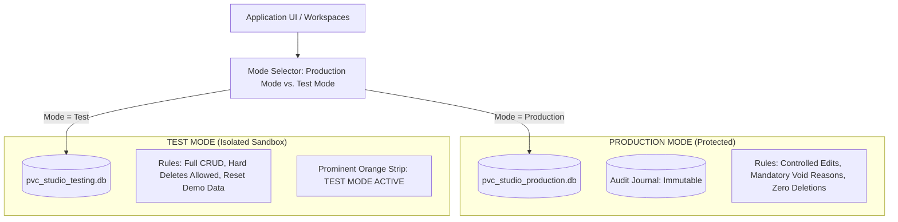

# PVC Studio Pro — Business Ledger & Test Mode Specification
**Enterprise Transaction Lifecycle, Auditable Corrections & Strict Data Isolation**

- **Date:** 2026-11-19
- **Auditor:** Senior Windows Desktop Systems & Print Engine Architect
- **Focus:** Financial Integrity, Operational Correction Workflows, and Test Isolation

---

## 1. The Core Accounting Dilemma in e-Sevai Shops

In daily shop operations, errors inevitably occur:
- An operator enters ₹70 for a card when the customer was quoted ₹50.
- A customer pays ₹50 in cash and promises ₹20 later via UPI (partial payment).
- A card jams in the printer, requiring a free reprint that must not inflate daily sales.
- An operator mistakenly records a transaction under CASH instead of UPI.
- A job is cancelled before printing, or a test card is printed to calibrate offsets.

In the current prototype, `JobLedgerService.cs` is **insert-only** and **read-only**. Once a record is written, it can never be altered. Consequently:
- Cashiers cannot balance their physical cash drawer at the end of the day.
- Erroneous entries permanently distort monthly tax/revenue reports.
- Automated tests or developer verifications permanently pollute the live database.

---

## 2. Dual-Mode Operating Model: Strict Isolation Architecture

To guarantee absolute safety, PVC Studio Pro introduces two **physically separated operating environments**:



### Physical Isolation Rules:
1. **Separate SQLite Database Files:**
   - Production Database: `%LOCALAPPDATA%\PVCStudioPro\data\pvc_studio_prod.db`
   - Test Mode Database: `%LOCALAPPDATA%\PVCStudioPro\data\pvc_studio_test.db`
2. **Distinct Connection Strings:**
   The DI container resolves an `IDataModeProvider`. When `IsTestMode == true`, all ledger queries, profile saves, and recent job queries bind exclusively to `pvc_studio_test.db`.
3. **Accidental Switch Protection:**
   Switching between modes requires an explicit confirmation dialog.
4. **Visual Indicator:**
   When in Test Mode, an unmissable orange banner (`#D97706`) is pinned to the application header reading:  
   `⚠️ TEST MODE ACTIVE — TRANSACTIONS DO NOT AFFECT BUSINESS RECORDS [RESET TEST DATA]`.

---

## 3. Database Schema: Auditable Transaction Lifecycle

The upgraded SQLite schema supports immutable audit journaling, partial payments, discounts, reprints, and auditable corrections.

### Table 1: `business_transactions` (Master Ledger)
```sql
CREATE TABLE IF NOT EXISTS business_transactions (
    transaction_id TEXT PRIMARY KEY,               -- UUID (N format)
    invoice_number TEXT NOT NULL UNIQUE,          -- INV-YYYYMMDD-XXXX
    customer_ref TEXT,                            -- Optional token / customer name
    document_type TEXT NOT NULL,                  -- AADHAAR_CR80, PAN_NSDL, PHOTO_8UP, etc.
    template_id TEXT,                             -- Template used for printing
    printer_name TEXT NOT NULL,                   -- Target hardware queue
    quantity INTEGER NOT NULL DEFAULT 1,          -- Number of cards/sheets
    unit_price NUMERIC NOT NULL DEFAULT 0.00,     -- Standard rate
    discount_amount NUMERIC NOT NULL DEFAULT 0.00,-- Discount or fee waiver
    total_amount NUMERIC NOT NULL DEFAULT 0.00,   -- Net payable: (quantity * unit_price) - discount
    amount_paid NUMERIC NOT NULL DEFAULT 0.00,    -- Total collected so far
    balance_due NUMERIC NOT NULL DEFAULT 0.00,    -- Remaining unpaid balance
    payment_mode TEXT NOT NULL DEFAULT 'CASH',    -- CASH, UPI, CARD, SPLIT
    status TEXT NOT NULL DEFAULT 'PAID',          -- PAID, PARTIAL, VOID, REFUNDED
    is_reprint INTEGER NOT NULL DEFAULT 0,        -- 1 if hardware reprint (0 revenue)
    reprint_reason TEXT,                          -- Jam, Ribbon Snapped, Alignment Error
    notes TEXT,                                   -- Operator remarks
    created_at DATETIME NOT NULL DEFAULT CURRENT_TIMESTAMP,
    updated_at DATETIME NOT NULL DEFAULT CURRENT_TIMESTAMP
);

CREATE INDEX IF NOT EXISTS idx_trans_created ON business_transactions(created_at);
CREATE INDEX IF NOT EXISTS idx_trans_status ON business_transactions(status);
CREATE INDEX IF NOT EXISTS idx_trans_inv ON business_transactions(invoice_number);
```

### Table 2: `transaction_audit_trail` (Immutable Change History)
Every edit, void, or correction automatically records a row:
```sql
CREATE TABLE IF NOT EXISTS transaction_audit_trail (
    audit_id TEXT PRIMARY KEY,
    transaction_id TEXT NOT NULL,
    action_type TEXT NOT NULL,                     -- CREATED, EDITED, PAYMENT_ADDED, VOIDED, REFUNDED
    field_changed TEXT,                           -- e.g. 'amount_paid', 'total_amount', 'payment_mode'
    old_value TEXT,
    new_value TEXT,
    change_reason TEXT NOT NULL,                  -- Operator mandatory explanation
    operator_name TEXT NOT NULL DEFAULT 'Admin',
    timestamp DATETIME NOT NULL DEFAULT CURRENT_TIMESTAMP,
    FOREIGN KEY(transaction_id) REFERENCES business_transactions(transaction_id)
);
```

---

## 4. Operational Workflows & Business Rules

### Workflow A: Editing an Inadvertent Error
1. Operator notices a job was recorded for ₹70 instead of ₹50.
2. Operator clicks `[Edit]` on the Ledger row.
3. A modal opens with the current values. Operator modifies:
   - Total Amount: ₹50.00
   - Reason: "Customer availed promotional discount voucher".
4. System executes an auditable update:
   - Updates `business_transactions.total_amount` to ₹50.00.
   - Updates `business_transactions.updated_at` to `CURRENT_TIMESTAMP`.
   - Inserts audit row into `transaction_audit_trail` documenting who changed what, the timestamp, and the mandatory reason.

### Workflow B: Partial Payments & Outstanding Balance
1. Customer prints 2 cards (Total: ₹140). Customer only has ₹100 cash.
2. Operator inputs:
   - Quantity: 2
   - Unit Price: ₹70.00 (Total: ₹140.00)
   - Amount Paid: ₹100.00
3. System automatically calculates `balance_due = ₹40.00` and marks `status = 'PARTIAL'`.
4. When customer returns later and pays ₹40 via UPI, operator clicks `[Add Payment]`:
   - Adds ₹40.00 with mode `UPI`.
   - `amount_paid` becomes ₹140.00, `balance_due` becomes ₹0.00, `status` becomes `PAID`.

### Workflow C: Cancellation / Void
1. Card fails or customer cancels before printing.
2. Operator clicks `[Void]`.
3. Operator selects cancellation reason:
   - `CUSTOMER_CANCELLED`
   - `PRINTER_HARDWARE_FAILURE`
   - `INCORRECT_FILE_LOADED`
   - `OPERATOR_TEST_ENTRY`
4. The transaction is marked `status = 'VOID'`.
5. Net revenue from this transaction is excluded from the daily closing calculation, while preserving the invoice number in sequence so there are no missing gaps in the financial audit log.

---

## 5. Daily Reconciliation & Closing Report

At the end of each business shift, the operator clicks **[Daily Cash Reconciliation]**:
- **Total Invoices Issued:** Count of valid transactions.
- **Physical Cash Expected:** Sum of all `CASH` payments collected today.
- **Digital UPI Expected:** Sum of all `UPI` payments collected today.
- **Outstanding Credit Given:** Total `balance_due` across partial transactions.
- **Cancelled / Void Volume:** Count and theoretical value of voided jobs.
- **Export Capabilities:** 1-click export to CSV / Excel spreadsheet.
- **Thermal POS Slip:** Print a compact 80mm summary slip on thermal receipt printer for shop bookkeeping.
