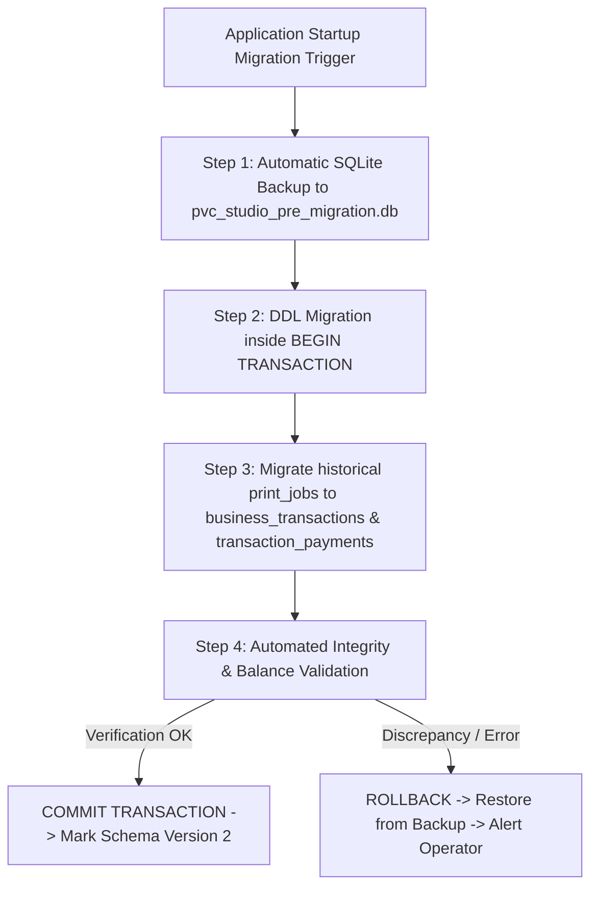

# PVC Studio Pro — Business Ledger & Complete Test Mode Specification (Phase 0.2 Validated)
**Enterprise Financial Ledger, Normalized Multi-Payment Architecture & Total Environment Sandbox Isolation**

- **Document:** `docs/LEDGER_AND_TEST_MODE_SPEC.md`
- **Revision:** Phase 0.2 Validated
- **Date:** 2026-11-19
- **Status:** Architectural Specification (Pre-Implementation Gate)

---

## 1. Normalized Financial Ledger Architecture

To support commercial e-Sevai operations without financial drift or rounding discrepancies, financial tracking is structured as a **Master-Detail Normalized Architecture**:

```
┌────────────────────────────────────────────────────────┐
│              business_transactions (Master)            │
│  - transaction_id (PK)         - invoice_number (INV)  │
│  - customer_name               - customer_phone        │
│  - document_type               - template_id           │
│  - quantity                    - unit_price_paise      │
│  - discount_paise              - net_total_paise       │
│  - paid_paise                  - balance_paise         │
│  - status (PENDING/PAID/PARTIAL/VOID)                  │
│  - is_test_mode (0/1)                                  │
│  - created_at                  - updated_at            │
└───────────────────────────┬────────────────────────────┘
                            │ 1 : N
                            ▼
┌────────────────────────────────────────────────────────┐
│           transaction_payments (Individual Entries)    │
│  - payment_id (PK)             - transaction_id (FK)   │
│  - payment_method (CASH/UPI/CARD/OTHER)                │
│  - amount_paise                - is_refund (0/1)       │
│  - reference_number            - is_test_mode (0/1)    │
│  - collected_at                                        │
└────────────────────────────────────────────────────────┘
                            │ 1 : N
                            ▼
┌────────────────────────────────────────────────────────┐
│       transaction_audit_trail (Immutable Log)          │
│  - audit_id (PK)               - transaction_id (FK)   │
│  - action_type (CREATE/PAYMENT/VOID/REFUND/REPRINT)    │
│  - field_changed               - old_value             │
│  - new_value                   - mandatory_reason      │
│  - operator_id                 - timestamp             │
└────────────────────────────────────────────────────────┘
```

---

## 2. DDL Schema Definition (SQLite)

All currency fields are strictly stored in **integer paise** (64-bit integer, where ₹1.00 = 100 paise) to prevent floating-point rounding errors.

### Table 1: `business_transactions`
```sql
CREATE TABLE IF NOT EXISTS business_transactions (
    transaction_id TEXT PRIMARY KEY,
    invoice_number TEXT NOT NULL UNIQUE,          -- Format: INV-YYYYMMDD-XXXX
    session_id TEXT,                              -- Linked document session ID
    customer_name TEXT,                           -- Customer name
    customer_phone TEXT,                          -- Customer contact number
    document_type TEXT NOT NULL,                  -- e.g. AADHAAR_CR80, PAN_NSDL, PHOTO_8UP
    template_id TEXT,                             -- Reference to TemplateRegistry ID
    printer_name TEXT NOT NULL,                   -- Windows spooler queue name
    quantity INTEGER NOT NULL DEFAULT 1 CHECK (quantity > 0),
    unit_price_paise INTEGER NOT NULL DEFAULT 0 CHECK (unit_price_paise >= 0),
    discount_paise INTEGER NOT NULL DEFAULT 0 CHECK (discount_paise >= 0),
    net_total_paise INTEGER NOT NULL DEFAULT 0 CHECK (net_total_paise >= 0),
    paid_paise INTEGER NOT NULL DEFAULT 0 CHECK (paid_paise >= 0),
    balance_paise INTEGER NOT NULL DEFAULT 0 CHECK (balance_paise >= 0),
    status TEXT NOT NULL DEFAULT 'PENDING' CHECK (status IN ('PENDING', 'PARTIAL', 'PAID', 'VOID')),
    is_reprint INTEGER NOT NULL DEFAULT 0 CHECK (is_reprint IN (0, 1)),
    reprint_reason TEXT,                          -- Reason for reprint (Paper Jam, Smudge, Alignment)
    is_test_mode INTEGER NOT NULL DEFAULT 0 CHECK (is_test_mode IN (0, 1)),
    created_at TEXT NOT NULL DEFAULT (strftime('%Y-%m-%dT%H:%M:%fZ', 'now')),
    updated_at TEXT NOT NULL DEFAULT (strftime('%Y-%m-%dT%H:%M:%fZ', 'now'))
);

CREATE INDEX IF NOT EXISTS idx_trans_created ON business_transactions(created_at, is_test_mode);
CREATE INDEX IF NOT EXISTS idx_trans_status ON business_transactions(status, is_test_mode);
CREATE INDEX IF NOT EXISTS idx_trans_invoice ON business_transactions(invoice_number);
```

### Table 2: `transaction_payments`
```sql
CREATE TABLE IF NOT EXISTS transaction_payments (
    payment_id TEXT PRIMARY KEY,
    transaction_id TEXT NOT NULL REFERENCES business_transactions(transaction_id) ON DELETE RESTRICT,
    amount_paise INTEGER NOT NULL CHECK (amount_paise > 0),
    is_refund INTEGER NOT NULL DEFAULT 0 CHECK (is_refund IN (0, 1)),
    payment_method TEXT NOT NULL CHECK (payment_method IN ('CASH', 'UPI', 'CARD', 'OTHER')),
    reference_number TEXT,                          -- UPI reference ID / Card approval code
    is_test_mode INTEGER NOT NULL DEFAULT 0 CHECK (is_test_mode IN (0, 1)),
    operator_id TEXT NOT NULL DEFAULT 'Admin',
    collected_at TEXT NOT NULL DEFAULT (strftime('%Y-%m-%dT%H:%M:%fZ', 'now'))
);

CREATE INDEX IF NOT EXISTS idx_pay_trans ON transaction_payments(transaction_id);
CREATE INDEX IF NOT EXISTS idx_pay_collected ON transaction_payments(collected_at, is_test_mode);
CREATE INDEX IF NOT EXISTS idx_pay_method ON transaction_payments(payment_method, is_test_mode);
```

### Table 3: `transaction_audit_trail`
```sql
CREATE TABLE IF NOT EXISTS transaction_audit_trail (
    audit_id TEXT PRIMARY KEY,
    transaction_id TEXT NOT NULL REFERENCES business_transactions(transaction_id) ON DELETE RESTRICT,
    action_type TEXT NOT NULL CHECK (action_type IN ('INVOICE_CREATED', 'PAYMENT_ADDED', 'VOIDED', 'REFUNDED', 'REPRINTED')),
    field_changed TEXT,
    old_value TEXT,
    new_value TEXT,
    mandatory_reason TEXT NOT NULL,
    operator_id TEXT NOT NULL DEFAULT 'Admin',
    timestamp TEXT NOT NULL DEFAULT (strftime('%Y-%m-%dT%H:%M:%fZ', 'now'))
);

CREATE INDEX IF NOT EXISTS idx_audit_trans ON transaction_audit_trail(transaction_id);
```

---

## 3. SQL Queries & Expected Results for the 5 Accounting Scenarios

### Scenario 1: ₹100 cash receipt and ₹20 cash refund
- **Action:** Customer pays ₹100 cash for 2 PVC cards. 1 card is defective; operator issues ₹20 cash refund.
- **Ledger Entries:**
  - `Payment 1`: `amount_paise = 10000`, `is_refund = 0`, `payment_method = 'CASH'`
  - `Payment 2`: `amount_paise = 2000`, `is_refund = 1`, `payment_method = 'CASH'`
- **SQL Query (Daily Cash Drawer Reconciliation):**
```sql
SELECT 
    COALESCE(SUM(CASE WHEN is_refund = 0 THEN amount_paise ELSE 0 END), 0) AS total_collected_paise,
    COALESCE(SUM(CASE WHEN is_refund = 1 THEN amount_paise ELSE 0 END), 0) AS total_refunded_paise,
    COALESCE(SUM(CASE WHEN is_refund = 0 THEN amount_paise ELSE -amount_paise END), 0) AS net_cash_paise
FROM transaction_payments
WHERE payment_method = 'CASH' 
  AND is_test_mode = 0
  AND date(collected_at) = date('now');
```
- **Expected Output:**
  - `total_collected_paise`: `10000` (₹100.00)
  - `total_refunded_paise`: `2000` (₹20.00)
  - `net_cash_paise`: `8000` (₹80.00 net in drawer)

### Scenario 2: ₹100 cash + ₹40 UPI split payment
- **Action:** Invoice total ₹140.00 (`14000` paise). Customer pays ₹100 cash and ₹40 via GooglePay.
- **Ledger Entries:**
  - `Payment 1`: `amount_paise = 10000`, `is_refund = 0`, `payment_method = 'CASH'`
  - `Payment 2`: `amount_paise = 4000`, `is_refund = 0`, `payment_method = 'UPI'`
- **SQL Query (Payment Method Breakdown):**
```sql
SELECT 
    payment_method,
    SUM(amount_paise) AS collected_paise
FROM transaction_payments
WHERE transaction_id = 'TX-1002' AND is_refund = 0
GROUP BY payment_method;
```
- **Expected Output:**
  - `CASH`: `10000` (₹100.00)
  - `UPI`: `4000` (₹40.00)
  - Total Paid: `14000` (₹140.00), Invoice status: `PAID`, Balance due: `0`.

### Scenario 3: ₹140 invoice with ₹100 paid and ₹40 outstanding
- **Action:** Invoice net total ₹140.00. Customer pays ₹100 cash; ₹40 is owed.
- **Ledger Entries:**
  - Transaction: `net_total_paise = 14000`, `paid_paise = 10000`, `balance_paise = 4000`, `status = 'PARTIAL'`
  - `Payment 1`: `amount_paise = 10000`, `is_refund = 0`, `payment_method = 'CASH'`
- **SQL Query (Outstanding Receivables Report):**
```sql
SELECT 
    transaction_id, customer_name, net_total_paise, paid_paise, balance_paise, status
FROM business_transactions
WHERE status IN ('PENDING', 'PARTIAL') AND is_test_mode = 0;
```
- **Expected Output:**
  - `TX-1003 | Customer A | 14000 | 10000 | 4000 | PARTIAL`
  - Balance due correctly surfaces as ₹40.00 outstanding.

### Scenario 4: Older outstanding invoice paid today
- **Action:** Invoice `TX-0901` generated 9 days ago with ₹40 outstanding. Customer visits today and pays ₹40 cash.
- **Ledger Entries:**
  - Transaction updated: `paid_paise = 14000`, `balance_paise = 0`, `status = 'PAID'`, `updated_at = now()`
  - New Payment inserted: `amount_paise = 4000`, `payment_method = 'CASH'`, `collected_at = date('now')`
- **SQL Query (Audit Trail & Today's Cash Inflow):**
```sql
SELECT 
    p.payment_id, p.transaction_id, t.created_at AS invoice_date, p.collected_at AS payment_date, p.amount_paise
FROM transaction_payments p
JOIN business_transactions t ON p.transaction_id = t.transaction_id
WHERE date(p.collected_at) = date('now') AND p.transaction_id = 'TX-0901';
```
- **Expected Output:**
  - Invoice Date: `2026-11-10T10:00:00Z`
  - Payment Date: `2026-11-19T09:15:00Z`
  - Today's Cash Drawer correctly shows ₹40 cash inflow despite invoice being from an earlier date.

### Scenario 5: Voided invoice with previous payment and refund
- **Action:** Invoice ₹70.00 paid cash, printed card is destroyed by operator; invoice is voided and ₹70.00 refunded.
- **Ledger Entries:**
  - Transaction: `status = 'VOID'`, `balance_paise = 0`
  - `Payment 1`: `amount_paise = 7000`, `is_refund = 0`, `payment_method = 'CASH'`
  - `Payment 2`: `amount_paise = 7000`, `is_refund = 1`, `payment_method = 'CASH'`
- **SQL Query (Net Revenue vs Drawer Verification):**
```sql
SELECT 
    t.status,
    COALESCE(SUM(CASE WHEN p.is_refund = 0 THEN p.amount_paise ELSE -p.amount_paise END), 0) AS net_cash_effect
FROM business_transactions t
LEFT JOIN transaction_payments p ON t.transaction_id = p.transaction_id
WHERE t.transaction_id = 'TX-VOID-01'
GROUP BY t.status;
```
- **Expected Output:**
  - `VOID | 0 net_cash_effect`
  - Revenue report excludes the transaction; cash drawer correctly accounts for +₹70 in, -₹70 out.

---

## 4. Database Migration, Backup & Rollback Protocol

To transition from the legacy flat `print_jobs` schema without data loss:



### 3-Step Migration Protocol:
1. **Automated Backup:**
   The application creates a physical timestamped copy of `pvc_studio.db` to `pvc_studio_backup_pre_v2.db` using SQLite online backup API before running any DDL statements.
2. **Transactional Data Migration:**
   - Execute table creation for `business_transactions`, `transaction_payments`, and `transaction_audit_trail`.
   - Map legacy rows from `print_jobs`:
     - Convert legacy decimal/float currency amounts to integer paise (`ROUND(amount * 100)`).
     - Populate initial payment record in `transaction_payments` for any legacy record marked `PAID`.
3. **Automated Balance Validation & Rollback:**
   - Verify: `COUNT(business_transactions) == COUNT(print_jobs)`.
   - Verify: `SUM(net_total_paise) == ROUND(SUM(legacy_total) * 100)`.
   - If any check fails, trigger immediate `ROLLBACK`, restore from backup, and display diagnostic error without altering user data.

---

## 5. Total Environment Test Mode Sandbox Isolation

### 5.1 Centralized Database Path Resolution
All database interactions route through a centralized path provider interface:

```csharp
public interface IDatabasePathProvider
{
    bool IsTestMode { get; }
    string DatabasePath { get; }
    string ConfigDirectory { get; }
    string ExportDirectory { get; }
    void SetTestMode(bool enabled);
}
```

### 5.2 Physical Directory & Path Separation
| Asset Category | Production Mode Path / Resource | Test Mode Sandbox Path / Resource |
| :--- | :--- | :--- |
| **Financial Database** | `%LOCALAPPDATA%\PVCStudioPro\pvc_studio.db` | `%LOCALAPPDATA%\PVCStudioPro\TestMode\pvc_studio_test.db` |
| **Shop Settings** | `%LOCALAPPDATA%\PVCStudioPro\business_profile.json` | `%LOCALAPPDATA%\PVCStudioPro\TestMode\business_profile.json` |
| **Printer Calibration**| `%LOCALAPPDATA%\PVCStudioPro\printer_profiles.json`| `%LOCALAPPDATA%\PVCStudioPro\TestMode\printer_profiles.json` |
| **Invoice Numbers** | Sequence: `INV-YYYYMMDD-XXXX` (Permanent) | Sequence: `TEST-XXXX` (Disposable) |
| **Exported Files** | `%USERPROFILE%\Documents\PVC Studio Pro\Exports\` | `%LOCALAPPDATA%\PVCStudioPro\TestMode\Exports\` |

### 5.3 Enforceable Defensive Assertions
To prevent catastrophic accidental data loss, destructive reset actions enforce strict path validation:

```csharp
public void ResetTestDatabase()
{
    string activeDb = _pathProvider.DatabasePath;
    if (!activeDb.Contains("TestMode", StringComparison.OrdinalIgnoreCase) || 
        !Path.GetFileName(activeDb).Equals("pvc_studio_test.db", StringComparison.OrdinalIgnoreCase))
    {
        throw new InvalidOperationException(
            "FATAL SAFETY VIOLATION: Attempted to reset database when not running in TestMode sandbox!");
    }

    // Safe to delete only when path assertion passes
    File.Delete(activeDb);
}
```

### 5.4 Test Mode UI & Operational Guardrails
- **Persistent Visual Watermark:** A prominent amber status banner is permanently docked at the top of the main window (`#D97706` background, bold white text):  
  `⚠️ TEST MODE ACTIVE — SIMULATION SANDBOX ONLY | ZERO FINANCIAL IMPACT [RESET TEST DATA]`.
- **Mode Switching Protection:** Toggling between Test Mode and Production Mode requires explicit modal dialog confirmation.
- **Printed Document Watermark:** Test mode print spool streams automatically inject a semi-transparent watermark: `TEST PRINT - NOT FOR SALE`.
