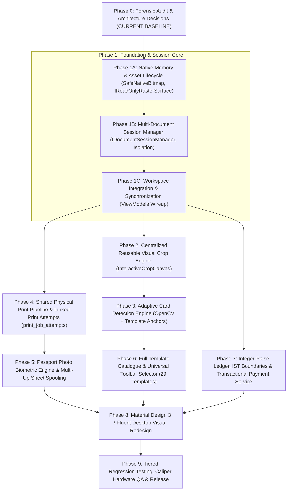

# PVC Studio Pro — Phased Implementation Roadmap (Phase 0.3 Validated)
**Sequenced Engineering Delivery Plan: Dependencies, Quality Gates & Acceptance**

- **Document:** `docs/PHASED_IMPLEMENTATION_ROADMAP.md`
- **Revision:** Phase 0.3 Validated
- **Date:** 2026-11-19
- **Auditor:** Senior Windows Desktop Systems & Print Engine Architect
- **Strategy:** Rigorous Phased Engineering. Each phase gates the next. Zero code in Phase 0.

---

## 1. Master Phase Sequence & Dependency Graph

---

## 2. Phase-by-Phase Technical Specifications

### Phase 0: Forensic Analysis, Architecture Review & Delivery Plan (CURRENT BASELINE)
- **Status:** **COMPLETE & AWAITING USER REVIEW & AUTHORIZATION**.
- **Deliverables:** All architectural and audit documents validated and committed to `docs/`. Zero application code modified.

---

### Phase 1A: Native Memory & Asset Lifecycle Management
- **Objectives:** Implement atomic, reference-counted native memory management wrapping SkiaSharp `SKBitmap` to prevent native memory leaks, use-after-free crashes, and underflow bugs, exposing strictly non-disposable read-only raster surfaces (`IReadOnlyRasterSurface`) to application consumers.
- **Strictly Allowed Production Files in Phase 1A:**
  - `src/PVCStudioPro.Core/Models/IReadOnlyRasterSurface.cs` (New: Read-only raster surface)
  - `src/PVCStudioPro.Core/Models/IAssetLease.cs` (New: Short-lived lease contract)
  - `src/PVCStudioPro.Core/Models/SafeNativeBitmap.cs` (New: Atomic Interlocked ref-counting wrapper)
  - `src/PVCStudioPro.Core/Models/SourceImageAsset.cs` (New: Root immutable asset)
  - `src/PVCStudioPro.Core/Models/DerivedImageAsset.cs` (New: Versioned revision tree)
- **Strictly Allowed Test Files in Phase 1A:**
  - `tests/PVCStudioPro.Tests/NativeAssetLifecycleTests.cs` (New: Complete lifecycle test suite)
- **Strictly FORBIDDEN in Phase 1A:**
  - `src/PVCStudioPro.Core/Services/IDocumentSessionManager.cs` / `DocumentSessionManager.cs` (Phase 1B).
  - `src/PVCStudioPro.App/ViewModels/*` (Phase 1C).
  - `src/PVCStudioPro.App/Views/*` (Phase 8).
  - `src/PVCStudioPro.Core/Services/Implementations/CropEngine.cs` (Phase 2).
  - `src/PVCStudioPro.Core/Services/Implementations/PrintService.cs` (Phase 4).
  - `src/PVCStudioPro.Core/Services/Implementations/DatabaseService.cs` (Phase 7).
  - Any database migrations, XAML controls, or package changes.
- **Existing Functionality to Reuse:** SkiaSharp native bindings.
- **New Models / Interfaces:** `IReadOnlyRasterSurface`, `IAssetLease`, `ISharedAsset`, `SafeNativeBitmap`, `SourceImageAsset`, `DerivedImageAsset`.
- **Automated Tests:**
  1. `DoubleDisposal_OfAssetOwner_IsIdempotent`
  2. `DoubleDisposal_OfLease_IsIdempotent`
  3. `AcquireLease_AfterOwnerDisposal_ThrowsObjectDisposedException`
  4. `ConcurrentAcquisition_AndOwnerDisposal_IsThreadSafe`
  5. `OwnerDisposal_WhileLeaseHeld_KeepsResourceAlive`
  6. `ExceptionAndCancellation_InRenderingPipeline_ReleasesLeaseCleanly`
  7. `UndoRedo_RetentionAndEviction_DisposesEvictedNativeBuffers`
  8. `MemoryQuota_Enforcement_EvictsOldestRevisionsWhenExceeding250MB`
  9. `NoUseAfterFree_OrNativeResourceLeak`
- **Manual Acceptance Criteria:** Run automated tests under high load; verify that memory allocates and frees cleanly without native access violation crashes.
- **Definition of Done:** 100% passed unit tests in `NativeAssetLifecycleTests.cs`; zero exposed raw mutable `SKBitmap` properties.
- **Estimated Effort:** 1.5 Engineering Days.

---

### Phase 1B: Multi-Document Session Management & Isolation
- **Objectives:** Implement `IDocumentSessionManager` and `IDocumentSession`, supporting multiple open documents simultaneously, active document switching, isolated revision histories, and cancelable asynchronous loading pipelines.
- **Exact Source Files Likely to Change:**
  - `src/PVCStudioPro.Core/Services/IDocumentSessionManager.cs` (New)
  - `src/PVCStudioPro.Core/Services/Implementations/DocumentSessionManager.cs` (New)
  - `src/PVCStudioPro.Core/Models/DocumentSession.cs` (New)
  - `tests/PVCStudioPro.Tests/DocumentSessionManagerTests.cs` (New)
- **Existing Functionality to Reuse:** `PdfDocumentService` (PDFium loading), `DocumentImportService` (Magic byte sniffing).
- **New Models / Interfaces:** `IDocumentSessionManager`, `IDocumentSession`, `SessionEvent`, `CropSettings`.
- **Automated Tests:** Multi-document concurrency tests: verify opening Document A and Document B maintains independent revisions; verify closing Document A disposes only Document A's assets.
- **Manual Acceptance Criteria:** Load 3 distinct PDFs in succession; verify each session maintains independent state; cancel a loading task mid-flight; verify unmanaged resources are reclaimed.
- **Definition of Done:** Multi-document manager fully operational with thread-safe session switching and leak-free event subscriptions.
- **Estimated Effort:** 1.5 Engineering Days.

---

### Phase 1C: Workspace Integration & State Synchronization
- **Objectives:** Wire existing ViewModels (`MainViewModel`, `ProductionWorkspaceViewModel`, `DocumentDeskViewModel`, `CropStudioViewModel`) to observe `IDocumentSessionManager`, eliminating direct bitmap mutations and using lease-based canvas rendering.
- **Exact Source Files Likely to Change:**
  - `src/PVCStudioPro.App/App.xaml.cs` (DI registrations)
  - `src/PVCStudioPro.App/ViewModels/MainViewModel.cs` (Session tab bar binding)
  - `src/PVCStudioPro.App/ViewModels/ProductionWorkspaceViewModel.cs` (Bind to active session)
  - `src/PVCStudioPro.App/ViewModels/DocumentDeskViewModel.cs` (Bind to active session)
  - `src/PVCStudioPro.App/ViewModels/CropStudioViewModel.cs` (Bind to active session)
- **UI Changes:** Main window header displays multi-document tabs allowing instant switching between active documents.
- **Dependencies:** Phases 1A and 1B.
- **Automated Tests:** `WorkspaceSynchronizationTests.cs` (Document loaded in Desk is observed in Production without disk reload).
- **Manual Acceptance Criteria:** Open Aadhaar in Production; switch to Document Desk; confirm image appears immediately; perform edit in Crop Studio; confirm Production Workspace reflects edit upon commit.
- **Definition of Done:** All primary workspaces observe shared session state via leased interfaces; zero cross-workspace state contamination.
- **Estimated Effort:** 2.0 Engineering Days.

---

### Phase 2: Centralized Reusable Visual Crop Engine
- **Objectives:** Build the single authoritative visual crop component (`InteractiveCropCanvas`) featuring cursor-centric zoom ($0.1\times$ to $5.0\times$), smooth pan, 8 interactive handles, aspect-ratio constraints (CR80, Passport), perspective quad warping, rotation, two-way synchronized numeric millimeter inputs, and undo/redo.
- **Exact Source Files Likely to Change:**
  - `src/PVCStudioPro.Core/Services/ICropEngine.cs` (New)
  - `src/PVCStudioPro.Core/Services/Implementations/CropEngine.cs` (New)
  - `src/PVCStudioPro.App/Controls/InteractiveCropCanvas.xaml` & `.xaml.cs` (New reusable UserControl)
  - `src/PVCStudioPro.App/ViewModels/CropStudioViewModel.cs` (Refactor to wrap `InteractiveCropCanvas`)
  - `src/PVCStudioPro.App/ViewModels/ProductionWorkspaceViewModel.cs` (Embed `InteractiveCropCanvas` in crop drawer)
- **Existing Functionality to Reuse:** `ManualCropService` matrix mathematics and OpenCV `WarpPerspective`.
- **New Models / Interfaces:** `ICropEngine`, `CropBounds`, `CropInteractionState`, `CropAspectRatio`.
- **UI Changes:** Both the modal Crop Studio and the in-place crop drawer render the identical visual canvas with blue interactive drag handles and live sub-pixel coordinates.
- **Dependencies:** Phase 1C.
- **Automated Tests:** `CropEngineTests.cs` (Sub-pixel coordinate mapping, aspect-ratio preservation, 90° rotation invariance, quad warp accuracy).
- **Manual Acceptance Criteria:** Open scan; drag crop handle; confirm image scales smoothly with mouse-wheel ($0.1\times$ to $5\times$) without pixel jumping; apply crop; verify card dimensions are exactly $85.60 \times 53.98\text{ mm}$ CR80.
- **Definition of Done:** Zero numeric typing required for standard cropping; both modal and drawer share the same control.
- **Estimated Effort:** 3.0 Engineering Days.

---

### Phase 3: Adaptive Identity Card Detection & Extraction Engine
- **Objectives:** Implement a 5-stage adaptive detection pipeline combining PDF point geometry, OCR keyword heuristics, calibrated template seeds, and OpenCV adaptive Canny/Hough line search with confidence scoring and graceful low-confidence operator fallback.
- **Exact Source Files Likely to Change:**
  - `src/PVCStudioPro.Core/Services/Implementations/CardDetectionService.cs`
  - `src/PVCStudioPro.Core/Services/Implementations/DocumentTypeDetectionService.cs`
  - `src/PVCStudioPro.Core/Models/UniversalDocumentModels.cs`
  - `src/PVCStudioPro.App/ViewModels/ProductionWorkspaceViewModel.cs`
- **Existing Functionality to Reuse:** `TemplateService` calibrated anchor coordinates, `VisionService` OpenCV bindings.
- **New Models / Interfaces:** `ICardDetectionEngine`, `DetectionConfidenceScore`, `CardExtractionResult`.
- **UI Changes:** Displays detection confidence percentage (`98% High Confidence`). If confidence is $<85\%$, displays amber banner and auto-opens visual crop drawer with calibrated guides.
- **Dependencies:** Phase 2.
- **Automated Tests:** `CardDetectionAdaptiveTests.cs` (Modern e-Aadhaar, Baal Aadhaar, mAadhaar, shifted scans, and rotation vectors).
- **Manual Acceptance Criteria:** Load e-Aadhaar with varied printer margins; confirm both front and back cards are cropped exactly to the cutlines with zero text truncation.
- **Definition of Done:** Tier 1 and Tier 2 tests pass on test corpus; low-confidence documents cleanly route to manual confirmation drawer.
- **Estimated Effort:** 3.0 Engineering Days.

---

### Phase 4: Shared Physical Print Pipeline & Linked Print Attempts
- **Objectives:** Enforce the single source of truth layout principle so the canvas preview, PDF export, and Windows print spooler share identical millimeter geometry, backed by a 6-stage print job lifecycle and a linked multi-attempt model (`print_job_attempts`) supporting non-billable hardware reprints and defect tracking.
- **Exact Source Files Likely to Change:**
  - `src/PVCStudioPro.Core/Services/Implementations/PhysicalPageRenderService.cs`
  - `src/PVCStudioPro.Core/Services/Implementations/PrintService.cs`
  - `src/PVCStudioPro.App/ViewModels/ProductionWorkspaceViewModel.cs`
  - `src/PVCStudioPro.App/ViewModels/PrintPreviewApprovalViewModel.cs`
- **Existing Functionality to Reuse:** SkiaSharp physical rendering and Windows GDI+ `PrintDocument`.
- **New Models / Interfaces:** `IPhysicalPageLayoutEngine`, `PrintJobLifecycleStatus`, `PrintSpoolJob`, `PrintJobAttempt`.
- **UI Changes:** Instant live toggle for cut guidelines (0.2 mm crop lines), center folding line, and mirror printing; live spooling status indicator and operator reprint verification dialog.
- **Dependencies:** Phase 1C.
- **Automated Tests:** `PhysicalPageRenderTests.cs` (Pixel-to-mm roundtrip accuracy at 150, 300, 600, and 1200 DPI; non-billable reprint generation).
- **Manual Acceptance Criteria:** Spool A4 sheet to Microsoft Print to PDF; measure exported PDF points; verify front card is exactly at $X=15.0\text{ mm}$ and back card at $X=109.4\text{ mm}$; record defective attempt and reprint without double billing.
- **Definition of Done:** Zero divergence between screen preview, exported PDF, and print spooler raster; spooler status transitions through `PhysicalOutputConfirmedByOperator`.
- **Estimated Effort:** 2.0 Engineering Days.

---

### Phase 5: Passport Photo Biometric Engine & Multi-Up Sheet Spooling
- **Objectives:** Eliminate the 5% margin flaw in GrabCut to guarantee a straight, clean bottom edge without wavy scallops; enable interactive face positioning; implement standard 4x6 (8-up) and A4 (16/32-up) photo sheets; connect to real hardware spooling.
- **Exact Source Files Likely to Change:**
  - `src/PVCStudioPro.Core/Services/Implementations/VisionService.cs`
  - `src/PVCStudioPro.App/ViewModels/PhotoStudioViewModel.cs`
  - `src/PVCStudioPro.App/Views/PhotoStudioView.xaml`
- **Existing Functionality to Reuse:** OpenCV GrabCut, `IPrintService`.
- **New Models / Interfaces:** `IPassportPhotoEngine`, `BiometricGuidelineModel`.
- **UI Changes:** Interactive portrait adorner allowing the operator to drag and re-scale the face within ICAO 9303 biometric guide lines; real printer selection and physical spooling button.
- **Dependencies:** Phase 4.
- **Automated Tests:** `PassportPhotoEngineTests.cs` (GrabCut bottom boundary verification, ICAO dimensional checks).
- **Manual Acceptance Criteria:** Import portrait; verify bottom edge is completely clean with zero wavy scallops; click Print; verify print job enters Windows print queue and logs in ledger.
- **Definition of Done:** Flawless background removal and genuine hardware printing.
- **Estimated Effort:** 2.5 Engineering Days.

---

### Phase 6: Full Template Catalogue & Universal Toolbar Integration (29 Templates)
- **Objectives:** Wire all 29 competitor templates directly into `ProductionWorkspaceViewModel` with an intuitive categorized template switcher, auto-detection overrides, and custom coordinate profiles.
- **Exact Source Files Likely to Change:**
  - `src/PVCStudioPro.App/ViewModels/ProductionWorkspaceViewModel.cs`
  - `src/PVCStudioPro.App/Views/ProductionWorkspaceView.xaml`
  - `src/PVCStudioPro.Core/Services/Implementations/TemplateService.cs`
- **Existing Functionality to Reuse:** All 29 templates in `TemplateService.cs`.
- **New Models / Interfaces:** `TemplateSelectionEventArgs`, `TemplateCategoryGroup`.
- **UI Changes:** Clean categorized template dropdown on top toolbar (Identity, Health, Labour, State Rations, Transport) with quick search.
- **Dependencies:** Phase 3.
- **Automated Tests:** `TemplateRegistryIntegrationTests.cs` (All 29 templates loaded, matched, and applied to canvas).
- **Manual Acceptance Criteria:** Select "Kerala Ration Card" or "Ayushman PM-JAY"; verify layout instantly snaps to the calibrated template coordinates.
- **Definition of Done:** Every competitor template reachable and functional in the primary workspace.
- **Estimated Effort:** 1.5 Engineering Days.

---

### Phase 7: Integer-Paise Financial Ledger, IST Boundaries & Transactional Payment Service
- **Objectives:** Implement enterprise financial ledger with 64-bit integer paise, separate `transaction_payments` table, `print_job_attempts` linked attempts, centralized `ITransactionPaymentService` with ACID guarantees, explicit `Asia/Kolkata` day boundaries (`@StartUtc` to `@EndUtc`), overpayment prevention, refund ceiling enforcement, auditable edits, voids, daily closing reconciliation, and total physical Test Mode sandbox isolation.
- **Exact Source Files Likely to Change:**
  - `src/PVCStudioPro.Core/Services/ITransactionPaymentService.cs` (New)
  - `src/PVCStudioPro.Core/Services/Implementations/TransactionPaymentService.cs` (New)
  - `src/PVCStudioPro.Core/Services/IDatabasePathProvider.cs` (New)
  - `src/PVCStudioPro.Core/Services/Implementations/DatabasePathProvider.cs` (New)
  - `src/PVCStudioPro.App/ViewModels/JobLedgerViewModel.cs`
  - `src/PVCStudioPro.App/Views/JobLedgerView.xaml`
  - `src/PVCStudioPro.App/MainWindow.xaml` (Test Mode banner)
- **Existing Functionality to Reuse:** Dapper ORM and SQLite database connectivity.
- **New Models / Interfaces:** `ITransactionPaymentService`, `BusinessTransaction`, `TransactionPayment`, `PrintJobAttempt`, `TransactionAuditTrail`, `IDatabasePathProvider`.
- **UI Changes:** Transaction edit/void modals; daily cash reconciliation panel; top bar Test Mode toggle with prominent orange warning banner; read-only balance bindings.
- **Dependencies:** Phase 1C.
- **Automated Tests:** `TransactionLedgerTests.cs` (Integer paise math, 5 accounting scenarios, IST midnight boundary tests, refund ceiling rules, overpayment rejection, Test Mode database separation, schema migration validation).
- **Manual Acceptance Criteria:** Enter transaction in Test Mode; reset test data; confirm production ledger remains completely untouched; edit a transaction in Production Mode; confirm audit trail records the change reason.
- **Definition of Done:** Zero test data leakage; full financial reconciliation capabilities.
- **Estimated Effort:** 3.0 Engineering Days.

---

### Phase 8: Material Design 3 / Fluent Desktop Visual Redesign
- **Objectives:** Enforce uniform visual styling across all views using the M3 color/elevation token system; ensure crisp contrast in Light and Dark modes; implement keyboard accelerators (Ctrl+O, Ctrl+P, arrow key nudges); verify responsive collapsing for 1280x800 screens.
- **Exact Source Files Likely to Change:**
  - `src/PVCStudioPro.App/Resources/Theme/M3Tokens.xaml` (New)
  - `src/PVCStudioPro.App/App.xaml`
  - `src/PVCStudioPro.App/MainWindow.xaml`
  - All workspace XAML views.
- **Existing Functionality to Reuse:** WPF-UI control library.
- **UI Changes:** Polished, professional high-density commercial desktop styling.
- **Dependencies:** Phases 1 through 7.
- **Automated Tests:** Theme resource verification tests.
- **Manual Acceptance Criteria:** Toggle Light/Dark mode; verify all text meets 4.5:1 contrast; resize window to $1280 \times 800$; confirm zero layout clipping or overlap.
- **Definition of Done:** Product looks and feels like a tier-1 commercial application.
- **Estimated Effort:** 2.0 Engineering Days.

---

### Phase 9: Tiered Regression Testing, Caliper Hardware QA & Release
- **Objectives:** Execute complete end-to-end 5-tier acceptance test suite; test physical print spooling; measure physical card prints with digital caliper; build self-contained Release installer.
- **Exact Source Files Likely to Change:**
  - `scripts/install_local.ps1`
  - `publish/` artifacts
- **Deliverables:** Verified Release Candidate and updated user documentation.
- **Dependencies:** All previous phases.
- **Estimated Effort:** 1.5 Engineering Days.
