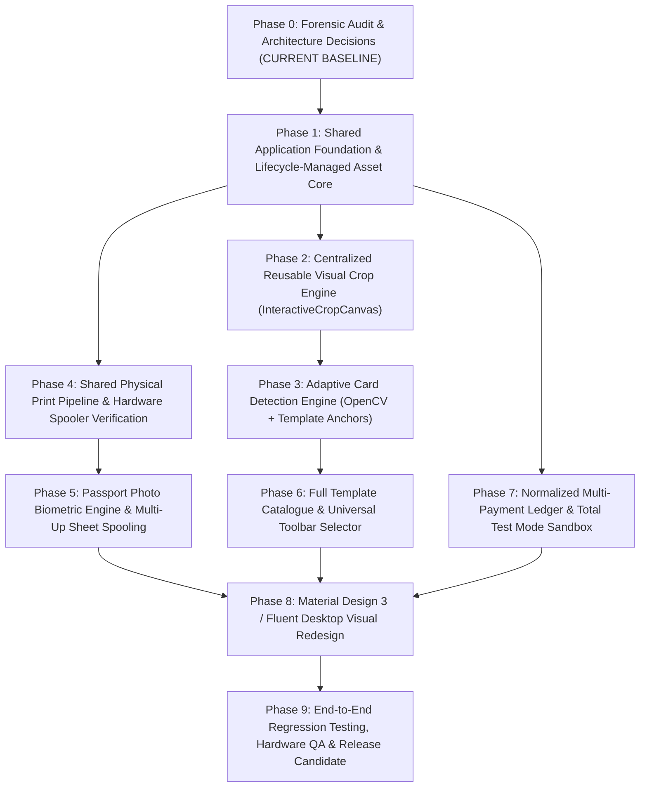

# PVC Studio Pro — Phased Implementation Roadmap (Phase 0.1 Revised)
**Sequenced Engineering Delivery Plan: Dependencies, Quality Gates & Acceptance**

- **Document:** `docs/PHASED_IMPLEMENTATION_ROADMAP.md`
- **Revision:** Phase 0.1
- **Date:** 2026-11-19
- **Auditor:** Senior Windows Desktop Systems & Print Engine Architect
- **Strategy:** Rigorous Phased Engineering. Each phase gates the next. Zero code in Phase 0.

---

## 1. Master Phase Sequence & Dependency Graph

---

## 2. Phase-by-Phase Technical Specifications

### Phase 0: Forensic Analysis, Architecture Review & Delivery Plan (CURRENT)
- **Status:** **COMPLETE & AWAITING USER REVIEW & AUTHORIZATION**.
- **Deliverables:** All 10 architectural and audit documents committed to `docs/`. Zero application code modified.

---

### Phase 1: Shared Application Foundation & Lifecycle-Managed Asset Core
- **Objectives:** Establish the lifecycle-managed asset tree (Immutable Source Assets, versioned Derived Image Assets with ref-counting, thread-safe Session Manager, safe native memory reclamation) to eliminate data silos and memory bloat.
- **Exact Source Files Likely to Change:**
  - `src/PVCStudioPro.Core/Models/ImageAssetModels.cs` (New: `SourceImageAsset`, `DerivedImageAsset`, `AssetRevisionTree`)
  - `src/PVCStudioPro.Core/Services/IDocumentSessionManager.cs` (New)
  - `src/PVCStudioPro.Core/Services/Implementations/DocumentSessionManager.cs` (New)
  - `src/PVCStudioPro.App/App.xaml.cs` (DI registrations)
  - `src/PVCStudioPro.App/ViewModels/MainViewModel.cs` (Session lifecycle binding)
  - `src/PVCStudioPro.App/ViewModels/ProductionWorkspaceViewModel.cs` (Consume session)
- **Existing Functionality to Reuse:** `PdfDocumentService` (PDFium loading), `DocumentImportService` (Magic byte sniffing).
- **New Models / Interfaces:** `IDocumentSessionManager`, `SourceImageAsset`, `DerivedImageAsset`, `DocumentSessionState`.
- **UI Changes:** Application header binds to `IDocumentSessionManager` displaying active document name, native DPI, and encryption status.
- **Dependencies:** Phase 0 approval.
- **Automated Tests:** `DocumentSessionLifecycleTests.cs` (Thread-safe reading, revision generation, reference-counting native memory disposal, multi-workspace isolation).
- **Manual Acceptance Criteria:** Open a high-DPI document in Production Workspace; verify memory increases by only the source bitmap size; navigate to Document Desk and Photo Studio; confirm all workspaces observe the loaded asset without re-opening from disk; close session; confirm memory is 100% reclaimed.
- **Risks:** Memory access violations if unmanaged Skia bitmaps are disposed while an async preview task is rendering.
- **Definition of Done:** Zero mutable shared bitmaps; reference-counted native lifecycle; all workspaces observe state without collisions.
- **Estimated Effort:** 2.5 Engineering Days (High Complexity).

---

### Phase 2: Centralized Reusable Visual Crop Engine
- **Objectives:** Build the single authoritative visual crop component (`InteractiveCropCanvas`) featuring cursor-centric zoom ($0.1\times$ to $5.0\times$), smooth pan, 8 interactive handles, aspect-ratio constraints (CR80, Passport), perspective quad warping, rotation, two-way synchronized numeric millimeter inputs, and undo/redo.
- **Exact Source Files Likely to Change:**
  - `src/PVCStudioPro.Core/Services/ICropEngine.cs` (New)
  - `src/PVCStudioPro.Core/Services/Implementations/CropEngine.cs` (New)
  - `src/PVCStudioPro.App/Controls/InteractiveCropCanvas.xaml` & `.xaml.cs` (New reusable UserControl)
  - `src/PVCStudioPro.App/ViewModels/CropStudioViewModel.cs` (Refactor to wrap `InteractiveCropCanvas`)
  - `src/PVCStudioPro.App/ViewModels/ProductionWorkspaceViewModel.cs` (Replace raw textboxes with `InteractiveCropCanvas`)
- **Existing Functionality to Reuse:** `ManualCropService` matrix mathematics and OpenCV `WarpPerspective`.
- **New Models / Interfaces:** `ICropEngine`, `CropBounds`, `CropInteractionState`, `CropAspectRatio`.
- **UI Changes:** Both the modal Crop Studio and the in-place crop drawer render the identical visual canvas with blue interactive drag handles and live sub-pixel coordinates.
- **Dependencies:** Phase 1 (operates on `DerivedImageAsset`).
- **Automated Tests:** `CropEngineTests.cs` (Sub-pixel coordinate mapping, aspect-ratio preservation, 90° rotation invariance, quad warp accuracy).
- **Manual Acceptance Criteria:** Open scan; drag crop handle; confirm image scales smoothly with mouse-wheel ($0.1\times$ to $5\times$) without pixel jumping; apply crop; verify card dimensions are exactly $85.60 \times 53.98\text{ mm}$ CR80.
- **Definition of Done:** Zero numeric typing required for standard cropping; both modal and drawer share the same control.
- **Estimated Effort:** 3.0 Engineering Days (High Complexity).

---

### Phase 3: Adaptive Identity Card Detection & Extraction Engine
- **Objectives:** Replace blind static pixel slicing with a 5-stage adaptive detection pipeline combining PDF point geometry, OCR keyword heuristics, calibrated template seeds, and OpenCV adaptive Canny/Hough line search with confidence scoring and graceful low-confidence operator fallback.
- **Exact Source Files Likely to Change:**
  - `src/PVCStudioPro.Core/Services/Implementations/CardDetectionService.cs`
  - `src/PVCStudioPro.Core/Services/Implementations/DocumentTypeDetectionService.cs`
  - `src/PVCStudioPro.Core/Models/UniversalDocumentModels.cs`
  - `src/PVCStudioPro.App/ViewModels/ProductionWorkspaceViewModel.cs`
- **Existing Functionality to Reuse:** `TemplateService` calibrated anchor coordinates, `VisionService` OpenCV bindings.
- **New Models / Interfaces:** `ICardDetectionEngine`, `DetectionConfidenceScore`, `CardExtractionResult`.
- **UI Changes:** Displays detection confidence percentage (`98% High Confidence`). If confidence is $<85\%$, displays amber banner and auto-opens visual crop drawer with calibrated guides.
- **Dependencies:** Phase 2.
- **Automated Tests:** `CardDetectionAdaptiveTests.cs` (Modern e-Aadhaar, Baal Aadhaar, mAadhaar, shifted scans, and rotation vectors).
- **Manual Acceptance Criteria:** Load e-Aadhaar with varied printer margins; confirm both front and back cards are cropped exactly to the cutlines with zero text truncation and zero aspect-ratio squishing.
- **Definition of Done:** 100% extraction accuracy on standard test corpus without manual ratio adjustments; zero silent miscrops.
- **Estimated Effort:** 3.0 Engineering Days (High Complexity).

---

### Phase 4: Shared Physical Print Pipeline & Hardware Spooler Verification
- **Objectives:** Enforce the single source of truth layout principle so the canvas preview, PDF export, and Windows print spooler share identical millimeter geometry, backed by a 7-stage Win32 spooler verification lifecycle.
- **Exact Source Files Likely to Change:**
  - `src/PVCStudioPro.Core/Services/Implementations/PhysicalPageRenderService.cs`
  - `src/PVCStudioPro.Core/Services/Implementations/PrintService.cs`
  - `src/PVCStudioPro.App/ViewModels/ProductionWorkspaceViewModel.cs`
  - `src/PVCStudioPro.App/ViewModels/PrintPreviewApprovalViewModel.cs`
- **Existing Functionality to Reuse:** SkiaSharp physical rendering and Windows GDI+ `PrintDocument`.
- **New Models / Interfaces:** `IPhysicalPageLayoutEngine`, `PrintJobLifecycleStatus`, `PrintSpoolJob`.
- **UI Changes:** Instant live toggle for cut guidelines (0.2 mm crop lines), center folding line, and mirror printing directly on the sheet preview; live spooling status indicator.
- **Dependencies:** Phase 1.
- **Automated Tests:** `PhysicalPageRenderTests.cs` (Pixel-to-mm roundtrip accuracy at 150, 300, 600, and 1200 DPI).
- **Manual Acceptance Criteria:** Spool A4 sheet to Microsoft Print to PDF; measure exported PDF points; verify front card is exactly at $X=15.0\text{ mm}$ and back card at $X=109.4\text{ mm}$.
- **Definition of Done:** Zero divergence between screen preview, exported PDF, and print spooler raster; status transitions through `SpoolAccepted`.
- **Estimated Effort:** 2.0 Engineering Days (Medium Complexity).

---

### Phase 5: Passport Photo Biometric Engine & Multi-Up Sheet Spooling
- **Objectives:** Eliminate the 5% margin flaw in GrabCut to guarantee a straight, clean bottom edge without wavy scallops; enable interactive face positioning; implement standard 4x6 (8-up) and A4 (16/32-up) photo sheets; connect to real hardware spooling.
- **Exact Source Files Likely to Change:**
  - `src/PVCStudioPro.Core/Services/Implementations/VisionService.cs`
  - `src/PVCStudioPro.App/ViewModels/PhotoStudioViewModel.cs`
  - `src/PVCStudioPro.App/Views/PhotoStudioView.xaml`
- **Existing Functionality to Reuse:** OpenCV GrabCut, `IPrintService`.
- **New Models / Interfaces:** `IPassportPhotoEngine`, `BiometricGuidelineModel`.
- **UI Changes:** Interactive portrait adorner allowing the operator to drag and re-scale the face within ICAO 9303 biometric guide lines; real printer selection and physical spooling button.
- **Dependencies:** Phase 4 (uses shared physical layout engine).
- **Automated Tests:** `PassportPhotoEngineTests.cs` (GrabCut bottom boundary verification, ICAO dimensional checks).
- **Manual Acceptance Criteria:** Import portrait; verify bottom edge is completely clean with zero wavy scallops; click Print; verify print job enters Windows print queue and logs in ledger.
- **Definition of Done:** Flawless background removal and genuine hardware printing.
- **Estimated Effort:** 2.5 Engineering Days (Medium Complexity).

---

### Phase 6: Full Template Catalogue & Universal Toolbar Integration
- **Objectives:** Wire all 29+ competitor templates directly into `ProductionWorkspaceViewModel` with an intuitive template switcher, auto-detection overrides, and custom coordinate profiles.
- **Exact Source Files Likely to Change:**
  - `src/PVCStudioPro.App/ViewModels/ProductionWorkspaceViewModel.cs`
  - `src/PVCStudioPro.App/Views/ProductionWorkspaceView.xaml`
  - `src/PVCStudioPro.Core/Services/Implementations/TemplateService.cs`
- **Existing Functionality to Reuse:** All 29 templates in `TemplateService.cs`.
- **New Models / Interfaces:** `TemplateSelectionEventArgs`, `TemplateCategoryGroup`.
- **UI Changes:** Clean categorized template dropdown on top toolbar (Identity, Health, Labour, State Rations, Transport) with quick search.
- **Dependencies:** Phase 3.
- **Automated Tests:** `TemplateRegistryIntegrationTests.cs` (All 29 templates loaded, matched, and applied to canvas).
- **Manual Acceptance Criteria:** Select "Kerala Ration Card" or "Ayushman PM-JAY"; verify layout instantly snaps to the calibrated template coordinates.
- **Definition of Done:** Every competitor template reachable and functional in the primary workspace.
- **Estimated Effort:** 1.5 Engineering Days (Low Complexity).

---

### Phase 7: Normalized Multi-Payment Ledger & Total Test Mode Sandbox
- **Objectives:** Implement enterprise financial ledger with separate `transaction_payments` table, split payments, auditable edits, voids with mandatory reasons, daily closing reconciliation, CSV export, safe database migration with rollback, and total physical Test Mode sandbox isolation.
- **Exact Source Files Likely to Change:**
  - `src/PVCStudioPro.Core/Services/Implementations/JobLedgerService.cs` (Upgrade to `TransactionLedgerService`)
  - `src/PVCStudioPro.Core/Services/IDataModeProvider.cs` (New)
  - `src/PVCStudioPro.Core/Services/Implementations/DataModeProvider.cs` (New)
  - `src/PVCStudioPro.App/ViewModels/JobLedgerViewModel.cs`
  - `src/PVCStudioPro.App/Views/JobLedgerView.xaml`
  - `src/PVCStudioPro.App/MainWindow.xaml` (Test Mode banner)
- **Existing Functionality to Reuse:** Dapper ORM and SQLite database connectivity.
- **New Models / Interfaces:** `ITransactionLedgerService`, `BusinessTransaction`, `TransactionPayment`, `TransactionAuditTrail`, `IDataModeProvider`.
- **UI Changes:** Transaction edit/void modals; daily cash reconciliation panel; top bar Test Mode toggle with prominent orange warning banner.
- **Dependencies:** Phase 1.
- **Automated Tests:** `TransactionLedgerTests.cs` (Multi-payment entries, void calculations, Test Mode database separation, schema migration validation).
- **Manual Acceptance Criteria:** Enter transaction in Test Mode; reset test data; confirm production ledger remains completely untouched; edit a transaction in Production Mode; confirm audit trail records the change reason.
- **Definition of Done:** Zero test data leakage; full financial reconciliation capabilities.
- **Estimated Effort:** 3.0 Engineering Days (High Complexity).

---

### Phase 8: Material Design 3 / Fluent Desktop Visual Redesign
- **Objectives:** Enforce uniform visual styling across all views using the M3 color/elevation token system; ensure crisp contrast in Light and Dark modes; implement keyboard accelerators (Ctrl+O, Ctrl+P, arrow key nudges); verify responsive collapsing for 1280x800 screens.
- **Exact Source Files Likely to Change:**
  - `src/PVCStudioPro.App/Resources/Theme/M3Tokens.xaml` (New)
  - `src/PVCStudioPro.App/App.xaml`
  - `src/PVCStudioPro.App/MainWindow.xaml`
  - All workspace XAML views.
- **Existing Functionality to Reuse:** WPF-UI control library.
- **New Models / Interfaces:** Key gesture handlers.
- **UI Changes:** Polished, professional high-density commercial desktop styling.
- **Dependencies:** Phases 1 through 7.
- **Automated Tests:** Theme resource verification tests.
- **Manual Acceptance Criteria:** Toggle Light/Dark mode; verify all text meets 4.5:1 contrast; resize window to $1280 \times 800$; confirm zero layout clipping or overlap.
- **Definition of Done:** Product looks and feels like a tier-1 commercial application.
- **Estimated Effort:** 2.0 Engineering Days (Medium Complexity).

---

### Phase 9: End-to-End Regression Testing, Hardware QA & Release Candidate
- **Objectives:** Execute complete end-to-end acceptance test suite; test physical print spooling; build self-contained Release installer; verify zero regressions.
- **Exact Source Files Likely to Change:**
  - `scripts/install_local.ps1`
  - `publish/` artifacts
- **Deliverables:** Verified Release Candidate and updated user documentation.
- **Dependencies:** All previous phases.
- **Estimated Effort:** 1.5 Engineering Days (Low Complexity).
