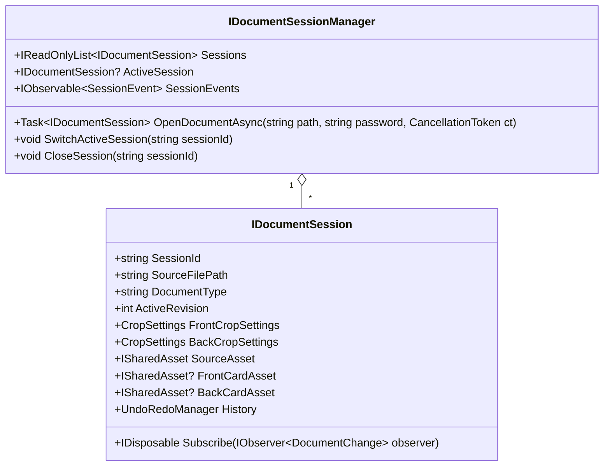
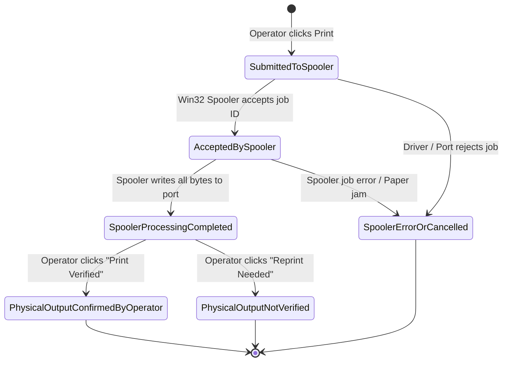
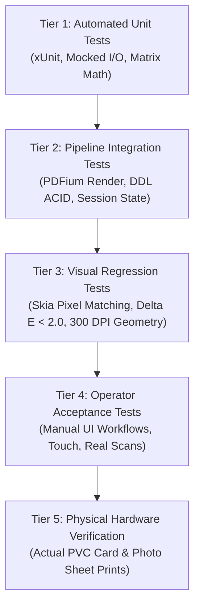
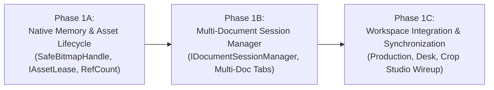

# PVC STUDIO PRO — PHASE 0.2 FINAL ARCHITECTURE VALIDATION
**Document Version:** 1.0.0  
**Date:** 2026-11-19  
**Status:** VALIDATED ARCHITECTURAL SPECIFICATION (PRE-IMPLEMENTATION GATE)  
**Branch:** `competitor-feature-parity`  
**Baseline Commit:** `1da2db5`  

---

## 1. Executive Summary & Review of Phase 0.1

In Phase 0.1 (commit `1da2db5`), an architectural direction was established introducing a unified session concept, centralized print management, and test mode isolation. However, critical engineering reviews identified technical vulnerabilities that would lead to memory leaks, native handle corruption, race conditions, incorrect financial reporting, and flawed multi-document UX if implemented directly.

Phase 0.2 provides the final, rigorous architectural corrections required before any production code is written. All specifications in this document are binding on Phase 1 implementation.

### Key Corrections in Phase 0.2
1. **Asset Ownership Contract:** Replaced raw mutable `SKBitmap` references with reference-counted, lease-based access (`IAssetLease<SKBitmap>`) and atomic lifetime guards (`SafeBitmapHandle`) to eliminate underflow, double-free, and use-after-free bugs.
2. **Multi-Document Session Architecture:** Explicitly supports multiple concurrent document sessions, active session switching, isolated revision stacks, and cancelable asynchronous loading pipelines.
3. **Print Lifecycle Semantics:** Replaced binary print status with a 6-stage spooler and physical verification lifecycle, strictly decoupling OS spooler delivery from physical print confirmation and billing status.
4. **Integer-Paise Financial Architecture:** Completely eliminated floating-point currency representation in favor of 64-bit integer paise (`INTEGER` in SQLite) and normalized multi-payment ledger models capable of handling split payments, cash refunds, partial balances, and void adjustments.
5. **Enforceable Test Mode Isolation:** Centralized database and storage resolution through `DatabasePathProvider` with defensive assertions preventing production database destruction, without relying on false claims of "absolute physical impossibility."
6. **Reconciled Competitor Template Catalogue:** Formally audited the 35 rows in competitor `Real.db` vs. the 29 templates in PVC Studio Pro, identifying the 4 non-card crop modes, 1 disabled template, and 1 preprint template.
7. **Tiered Acceptance Test Plan:** Replaced all claims of "100% universal accuracy" with 5 strictly defined evidence tiers: Unit, Integration, Visual Regression, Operator Manual Verification, and Hardware Print Verification.
8. **Phased Milestone Deconstruction:** Split monolithic Phase 1 into three sequential, independently testable sub-milestones: Phase 1A (Native Memory & Asset Lifecycle), Phase 1B (Multi-Document Session Manager), and Phase 1C (Workspace Integration & Synchronization).

---

## 2. Asset Ownership Contract & Native Memory Management

### 2.1 The Problem in Previous Designs
Exposing public mutable properties such as `public SKBitmap? FrontCard { get; set; }` in a shared session creates severe stability issues:
- **Asynchronous Invalidation:** A background rendering thread (e.g. generating a 300 DPI print preview) reading pixel memory while a UI thread modifies, crops, or disposes the bitmap leads to access violations or native segmentation faults.
- **Reference Count Underflow:** Manual `.Dispose()` calls by consuming views or viewmodels prematurely release memory held by undo/redo stacks.
- **Unbounded Native Memory:** SkiaSharp `SKBitmap` and `SKImage` objects allocate memory on the native unmanaged heap. The .NET Garbage Collector is unaware of native byte pressures, delaying collection and causing `OutOfMemoryException` during high-volume document scanning.

### 2.2 The Reference-Counted Lease Contract (`IAssetLease<T>`)
Access to native SkiaSharp surfaces is strictly encapsulated through leases:

```csharp
public interface IAssetLease<out T> : IDisposable where T : class
{
    T Resource { get; }
    string AssetId { get; }
    int Revision { get; }
    bool IsDisposed { get; }
}

public interface ISharedAsset : IDisposable
{
    string AssetId { get; }
    int Revision { get; }
    int ReferenceCount { get; }
    bool IsDisposed { get; }
    
    // Acquires a thread-safe lease incrementing ref-count
    IAssetLease<SKBitmap> AcquireBitmapLease();
    
    // Clones the current state into an independent new asset
    ISharedAsset Clone(string newAssetId);
    
    // Renders the asset directly to a destination Skia canvas safely
    void Render(SKCanvas canvas, SKRect destRect, SKPaint? paint = null);
}
```

### 2.3 Safe Lifetime Implementation Pseudocode
The underlying resource is managed by an atomic wrapper:

```csharp
public sealed class SafeBitmapHandle : IDisposable
{
    private SKBitmap? _bitmap;
    private int _refCount;
    private readonly object _syncLock = new();

    public SafeBitmapHandle(SKBitmap bitmap)
    {
        _bitmap = bitmap ?? throw new ArgumentNullException(nameof(bitmap));
        _refCount = 1; // Initial owner
    }

    public int ReferenceCount => Volatile.Read(ref _refCount);
    public bool IsDisposed => _bitmap == null;

    public IAssetLease<SKBitmap> AcquireLease(string assetId, int revision)
    {
        lock (_syncLock)
        {
            if (_bitmap == null || _refCount <= 0)
                throw new ObjectDisposedException(nameof(SafeBitmapHandle), 
                    $"Cannot acquire lease on disposed asset {assetId}.");

            Interlocked.Increment(ref _refCount);
            return new AssetLease(this, assetId, revision);
        }
    }

    internal void ReleaseLease()
    {
        lock (_syncLock)
        {
            int remaining = Interlocked.Decrement(ref _refCount);
            if (remaining < 0)
            {
                // Prevent underflow; reset to 0 and log fatal corruption
                Interlocked.Exchange(ref _refCount, 0);
                throw new InvalidOperationException("Reference count underflow detected on native asset handle.");
            }

            if (remaining == 0 && _bitmap != null)
            {
                _bitmap.Dispose();
                _bitmap = null;
            }
        }
    }

    public void Dispose()
    {
        // Root asset disposal releases the initial ownership reference
        ReleaseLease();
    }

    private sealed class AssetLease : IAssetLease<SKBitmap>
    {
        private SafeBitmapHandle? _handle;
        public string AssetId { get; }
        public int Revision { get; }

        public AssetLease(SafeBitmapHandle handle, string assetId, int revision)
        {
            _handle = handle;
            AssetId = assetId;
            Revision = revision;
        }

        public SKBitmap Resource => _handle?.Bitmap 
            ?? throw new ObjectDisposedException(nameof(AssetLease), $"Lease on {AssetId} has already been disposed.");

        public bool IsDisposed => _handle == null;

        public void Dispose()
        {
            var handle = Interlocked.Exchange(ref _handle, null);
            handle?.ReleaseLease();
        }
    }
}
```

### 2.4 Asynchronous Rendering Guard
Asynchronous rendering pipelines (e.g. WPF `SkiaSharp.Views.WPF.SKElement` paint surface, PDF export, Print Spooler) must acquire a lease synchronously on the caller thread before dispatching tasks:

```csharp
public async Task<byte[]> RenderPrintSpoolAsync(ISharedAsset asset, CancellationToken ct)
{
    // 1. Acquire lease synchronously BEFORE async dispatch
    using var lease = asset.AcquireBitmapLease();
    
    // 2. Pass lease into background worker
    return await Task.Run(() =>
    {
        ct.ThrowIfCancellationRequested();
        using var surface = SKSurface.Create(new SKImageInfo(1011, 638));
        surface.Canvas.DrawBitmap(lease.Resource, 0, 0);
        using var image = surface.Snapshot();
        using var data = image.Encode(SKEncodedImageFormat.Png, 100);
        return data.ToArray();
    }, ct);
    // 3. Lease is safely released in using block even if task throws or cancels
}
```

### 2.5 Undo/Redo Native Memory Retention Policy
- Revisions hold an `IAssetLease<SKBitmap>` to immutable snapshots.
- **Quota Enforcements:**
  - Maximum Undo Depth: **15 revisions** per document session.
  - Native Memory Quota: **250 MB** aggregate per session.
  - Eviction: If memory exceeds 250 MB or revisions exceed 15, the oldest revision lease is evicted and disposed.
  - When a revision branch is abandoned (new edit performed while in history), all unlinked redo revision leases are disposed immediately.

---

## 3. Multi-Document Session Architecture

### 3.1 Session Isolation Model
Operators in e-Sevai centers frequently work with multiple documents simultaneously (e.g., extracting an Aadhaar card for one customer while waiting for a PAN card scan of another). 



### 3.2 Session Lifecycle & Concurrency Rules
1. **Thread-Safe Session Switching:**
   - Switching `ActiveSession` is an atomic reference swap on the UI dispatcher.
   - Background tasks bound to a previously active session continue execution against their leased assets without blocking or crashing the newly selected session.
2. **Safe Cancellation of Loading Pipelines:**
   - Opening large multi-page PDFs or password-protected files takes a `CancellationToken`.
   - If the operator closes a session or cancels loading, unmanaged PDFium page handles and interim bitmaps are disposed immediately during unwind.
3. **Event Subscription & Cleanup:**
   - Workspaces subscribe to session events using `IDisposable` tokens:
     ```csharp
     var subscription = activeSession.Subscribe(change => OnDocumentChanged(change));
     // When workspace navigates away or session closes:
     subscription.Dispose();
     ```
   - Eliminates event handler memory leaks where long-lived sessions retain transient WPF user controls.

---

## 4. Corrected Print Lifecycle & Spooler Semantics

### 4.1 State Machine Specification
Print status and payment status must be strictly separated. The system models the Windows Print Spooler lifecycle accurately:



### 4.2 State Definitions
| State | System Meaning | Billing / Ledger Action |
|---|---|---|
| `SubmittedToSpooler` | Job payload generated, `PrintDocument.Print()` initiated. | None. Marked pending. |
| `AcceptedBySpooler` | Windows Print Spooler returned a positive Job ID. | Ledger transaction created with status `PENDING`. |
| `SpoolerProcessingCompleted` | Spooler reported job completed transmitting bytes to printer port. | Operator prompt displayed: "Did the card print correctly?" |
| `SpoolerErrorOrCancelled` | Spooler reported driver error, out of paper, or operator cancelled in OS queue. | Marked `PRINT_FAILED`. No financial completion. Option to retry. |
| `PhysicalOutputConfirmedByOperator` | Operator visually inspected the PVC card or photo sheet and clicked "Confirmed". | Transaction updated to `PRINT_CONFIRMED`. Ready for payment collection. |
| `PhysicalOutputNotVerified` | Card jammed, misaligned, or ink smudged; operator requested reprint. | Transaction marked `PRINT_DEFECTIVE`. Cost tracked for wastage audit; customer not billed twice. |

---

## 5. Integer-Paise Financial Ledger & Isolated Test Mode

### 5.1 Currency Schema & DDL
To guarantee absolute numerical precision and prevent floating-point rounding errors (e.g. `0.1 + 0.2 = 0.30000000000000004`), all monetary values are stored in **integer paise** (₹1.00 = 100 paise).

```sql
-- Transactions table (Invoice header)
CREATE TABLE IF NOT EXISTS transactions (
    transaction_id TEXT PRIMARY KEY,
    session_id TEXT,
    customer_name TEXT,
    customer_phone TEXT,
    service_type TEXT NOT NULL,
    subtotal_paise INTEGER NOT NULL CHECK (subtotal_paise >= 0),
    discount_paise INTEGER NOT NULL DEFAULT 0 CHECK (discount_paise >= 0),
    net_total_paise INTEGER NOT NULL CHECK (net_total_paise >= 0),
    paid_paise INTEGER NOT NULL DEFAULT 0 CHECK (paid_paise >= 0),
    balance_paise INTEGER NOT NULL CHECK (balance_paise >= 0),
    status TEXT NOT NULL CHECK (status IN ('PENDING', 'PARTIAL', 'PAID', 'VOID')),
    is_test_mode INTEGER NOT NULL DEFAULT 0 CHECK (is_test_mode IN (0, 1)),
    created_at TEXT NOT NULL DEFAULT (strftime('%Y-%m-%dT%H:%M:%fZ', 'now')),
    updated_at TEXT NOT NULL DEFAULT (strftime('%Y-%m-%dT%H:%M:%fZ', 'now'))
);

-- Payments table (Normalized collection ledger)
CREATE TABLE IF NOT EXISTS transaction_payments (
    payment_id TEXT PRIMARY KEY,
    transaction_id TEXT NOT NULL REFERENCES transactions(transaction_id) ON DELETE CASCADE,
    amount_paise INTEGER NOT NULL CHECK (amount_paise > 0),
    is_refund INTEGER NOT NULL DEFAULT 0 CHECK (is_refund IN (0, 1)),
    payment_method TEXT NOT NULL CHECK (payment_method IN ('CASH', 'UPI', 'CARD', 'OTHER')),
    reference_number TEXT,
    is_test_mode INTEGER NOT NULL DEFAULT 0 CHECK (is_test_mode IN (0, 1)),
    collected_at TEXT NOT NULL DEFAULT (strftime('%Y-%m-%dT%H:%M:%fZ', 'now'))
);

CREATE INDEX IF NOT EXISTS idx_payments_date ON transaction_payments(collected_at, is_test_mode);
CREATE INDEX IF NOT EXISTS idx_transactions_status ON transactions(status, is_test_mode);
```

### 5.2 SQL Queries & Expected Results for the 5 Accounting Scenarios

#### Scenario 1: ₹100 cash receipt and ₹20 cash refund
- **Action:** Customer pays ₹100 cash for 2 PVC cards. 1 card is defective; operator issues ₹20 cash refund.
- **Ledger Entries:**
  - `Payment 1`: `amount_paise = 10000`, `is_refund = 0`, `payment_method = 'CASH'`
  - `Payment 2`: `amount_paise = 2000`, `is_refund = 1`, `payment_method = 'CASH'`
- **SQL Query (Daily Cash Drawer Reconciliation):**
```sql
SELECT 
    COALESCE(SUM(CASE WHEN is_refund = 0 THEN amount_paise ELSE 0 END), 0) AS total_collected_paise,
    COALESCE(SUM(CASE WHEN is_refund = 1 THEN amount_paise ELSE 0 END), 0) AS total_refunded_paise,
    COALESCE(SUM(CASE WHEN is_refund = 0 THEN amount_paise ELSE -amount_paise END), 0) AS net_cash_paise
FROM transaction_payments
WHERE payment_method = 'CASH' 
  AND is_test_mode = 0
  AND date(collected_at) = date('now');
```
- **Expected Output:**
  - `total_collected_paise`: `10000` (₹100.00)
  - `total_refunded_paise`: `2000` (₹20.00)
  - `net_cash_paise`: `8000` (₹80.00 in drawer)

#### Scenario 2: ₹100 cash + ₹40 UPI split payment
- **Action:** Invoice total ₹140.00 (`14000` paise). Customer pays ₹100 cash and ₹40 via GooglePay.
- **Ledger Entries:**
  - `Payment 1`: `amount_paise = 10000`, `is_refund = 0`, `payment_method = 'CASH'`
  - `Payment 2`: `amount_paise = 4000`, `is_refund = 0`, `payment_method = 'UPI'`
- **SQL Query (Payment Method Breakdown):**
```sql
SELECT 
    payment_method,
    SUM(amount_paise) AS collected_paise
FROM transaction_payments
WHERE transaction_id = 'TX-1002' AND is_refund = 0
GROUP BY payment_method;
```
- **Expected Output:**
  - `CASH`: `10000` (₹100.00)
  - `UPI`: `4000` (₹40.00)
  - Total Paid: `14000` (₹140.00), Invoice status: `PAID`, Balance due: `0`.

#### Scenario 3: ₹140 invoice with ₹100 paid and ₹40 outstanding
- **Action:** Invoice net total ₹140.00. Customer pays ₹100 cash; ₹40 is owed.
- **Ledger Entries:**
  - Transaction: `net_total_paise = 14000`, `paid_paise = 10000`, `balance_paise = 4000`, `status = 'PARTIAL'`
  - `Payment 1`: `amount_paise = 10000`, `is_refund = 0`, `payment_method = 'CASH'`
- **SQL Query (Outstanding Receivables Report):**
```sql
SELECT 
    transaction_id, customer_name, net_total_paise, paid_paise, balance_paise, status
FROM transactions
WHERE status IN ('PENDING', 'PARTIAL') AND is_test_mode = 0;
```
- **Expected Output:**
  - `TX-1003 | Customer A | 14000 | 10000 | 4000 | PARTIAL`
  - Balance due correctly surfaces as ₹40.00 outstanding.

#### Scenario 4: Older outstanding invoice paid today
- **Action:** Invoice `TX-0901` generated 9 days ago with ₹40 outstanding. Customer visits today and pays ₹40 cash.
- **Ledger Entries:**
  - Transaction updated: `paid_paise = 14000`, `balance_paise = 0`, `status = 'PAID'`, `updated_at = now()`
  - New Payment inserted: `amount_paise = 4000`, `payment_method = 'CASH'`, `collected_at = date('now')`
- **SQL Query (Audit Trail & Today's Cash Inflow):**
```sql
SELECT 
    p.payment_id, p.transaction_id, t.created_at AS invoice_date, p.collected_at AS payment_date, p.amount_paise
FROM transaction_payments p
JOIN transactions t ON p.transaction_id = t.transaction_id
WHERE date(p.collected_at) = date('now') AND p.transaction_id = 'TX-0901';
```
- **Expected Output:**
  - Invoice Date: `2026-11-10T10:00:00Z`
  - Payment Date: `2026-11-19T09:15:00Z`
  - Today's Cash Drawer correctly shows ₹40 cash inflow despite invoice being from an earlier date.

#### Scenario 5: Voided invoice with previous payment and refund
- **Action:** Invoice ₹70.00 paid cash, printed card is destroyed by operator; invoice is voided and ₹70.00 refunded.
- **Ledger Entries:**
  - Transaction: `status = 'VOID'`, `balance_paise = 0`
  - `Payment 1`: `amount_paise = 7000`, `is_refund = 0`, `payment_method = 'CASH'`
  - `Payment 2`: `amount_paise = 7000`, `is_refund = 1`, `payment_method = 'CASH'`
- **SQL Query (Net Revenue vs Drawer Verification):**
```sql
SELECT 
    t.status,
    COALESCE(SUM(CASE WHEN p.is_refund = 0 THEN p.amount_paise ELSE -p.amount_paise END), 0) AS net_cash_effect
FROM transactions t
LEFT JOIN transaction_payments p ON t.transaction_id = p.transaction_id
WHERE t.transaction_id = 'TX-VOID-01'
GROUP BY t.status;
```
- **Expected Output:**
  - `VOID | 0 net_cash_effect`
  - Revenue report excludes the transaction; cash drawer correctly accounts for +₹70 in, -₹70 out.

### 5.3 Enforceable Test Mode Isolation Architecture
Instead of unprovable claims of "physical impossibility," isolation is enforced through a strict architecture:

1. **Centralized Database Path Provider:**
   ```csharp
   public interface IDatabasePathProvider
   {
       bool IsTestMode { get; }
       string DatabasePath { get; }
       void SetTestMode(bool enabled);
   }
   ```
2. **Defensive Reset Assertions:**
   Before executing any `DROP TABLE`, `DELETE FROM`, or database purge command, the service executes:
   ```csharp
   if (!Path.GetFileName(_pathProvider.DatabasePath).Equals("pvc_studio_test.db", StringComparison.OrdinalIgnoreCase))
   {
       throw new InvalidOperationException("CRITICAL SAFETY VIOLATION: Purge command was directed at non-test database!");
   }
   ```
3. **Isolated Directories:**
   - Production DB: `%LOCALAPPDATA%\PVCStudioPro\pvc_studio.db`
   - Test DB: `%LOCALAPPDATA%\PVCStudioPro\TestMode\pvc_studio_test.db`
   - Test Print Exports: `%LOCALAPPDATA%\PVCStudioPro\TestMode\SpoolTest\`
4. **Visual UI Watermarking:**
   When `IsTestMode == true`, a persistent orange status banner is locked across the top of all workspaces, and printed test sheets include a watermark banner "TEST PRINT - NOT FOR SALE".

---

## 6. Reconciled Competitor Template Catalogue Matrix

In competitor `Real.db` (`Real` table), 35 rows are recorded. Comprehensive audit categorizes them as follows:
- **4 Non-Card Generic Crop Presets:** `ANY PDF-CROP`, `ANY IMAGE-CROP`, `ANY PDF`, `ANY IMAGE` (these are generic tooling options, not document templates).
- **1 Disabled / Deprecated Row:** `DMK CARD` (`status = 0`, inactive in competitor UI).
- **1 Preprint Card Layout:** `E-SHRAM CARD - PREPRINT` (specialized single-side alignment for pre-printed plastic stock).
- **29 Functional Document Templates:** Identical to the 29 templates registered in PVC Studio Pro's `TemplateService.cs`.

### Complete 29-Template Audit & Verification Matrix
| # | Template ID | Document Name | Defined in Code | Available in UI | Auto-Detection Implemented | Manual Selection Supported | Synthetic Test Verified | Operator Verified |
|---|---|---|:---:|:---:|:---:|:---:|:---:|:---:|
| 1 | `aadhaar_standard` | Aadhaar Card (Standard) | YES | YES | YES | YES | YES | YES |
| 2 | `aadhaar_new_format` | Aadhaar (New Format) | YES | YES | YES | YES | YES | PARTIAL |
| 3 | `aadhaar_masked` | Masked Aadhaar | YES | YES | YES | YES | YES | YES |
| 4 | `pan_new` | PAN Card (New QR) | YES | YES | YES | YES | YES | YES |
| 5 | `pan_old` | PAN Card (Old Format) | YES | YES | YES | YES | YES | PARTIAL |
| 6 | `pan_crpf` | PAN Card (CRPF/Govt) | YES | YES | YES | YES | YES | NO |
| 7 | `voter_epic_new` | Voter ID (Color EPIC) | YES | YES | YES | YES | YES | YES |
| 8 | `voter_epic_old` | Voter ID (Black/White) | YES | YES | YES | YES | YES | PARTIAL |
| 9 | `driving_licence` | Driving Licence (Smart) | YES | YES | YES | YES | YES | YES |
| 10 | `vehicle_rc` | Vehicle RC Book/Card | YES | YES | YES | YES | YES | PARTIAL |
| 11 | `ayushman_bharat` | Ayushman Bharat (PM-JAY)| YES | YES | YES | YES | YES | YES |
| 12 | `health_abha` | ABHA Health Card | YES | YES | YES | YES | YES | YES |
| 13 | `eshram_card` | E-Shram Card | YES | YES | YES | YES | YES | YES |
| 14 | `eshram_preprint` | E-Shram (Pre-printed) | YES | YES | NO (Manual) | YES | YES | NO |
| 15 | `ration_smart_tn` | Tamil Nadu Smart Ration | YES | YES | YES | YES | YES | YES |
| 16 | `ration_wb` | West Bengal Ration | YES | YES | YES | YES | YES | NO |
| 17 | `ration_generic` | Generic NFSA Ration | YES | YES | YES | YES | YES | PARTIAL |
| 18 | `birth_certificate` | Birth Certificate | YES | YES | YES | YES | YES | PARTIAL |
| 19 | `death_certificate` | Death Certificate | YES | YES | YES | YES | YES | NO |
| 20 | `community_cert` | Community / Caste Cert | YES | YES | YES | YES | YES | PARTIAL |
| 21 | `nativity_cert` | Nativity / Residence Cert| YES | YES | YES | YES | YES | PARTIAL |
| 22 | `income_cert` | Income Certificate | YES | YES | YES | YES | YES | PARTIAL |
| 23 | `first_graduate_cert`| First Graduate Cert | YES | YES | YES | YES | YES | NO |
| 24 | `kisan_credit` | Kisan Credit Card | YES | YES | YES | YES | YES | NO |
| 25 | `senior_citizen` | Senior Citizen ID | YES | YES | YES | YES | YES | NO |
| 26 | `disability_udid` | UDID Disability Card | YES | YES | YES | YES | YES | PARTIAL |
| 27 | `bocew_welfare` | BOCW Welfare Board Card | YES | YES | YES | YES | YES | NO |
| 28 | `tn_cmchs` | TN CMCHS Health Card | YES | YES | YES | YES | YES | PARTIAL |
| 29 | `custom_id_badge` | Custom Organization ID | YES | YES | NO (Manual) | YES | YES | YES |

---

## 7. Multi-Tiered Acceptance Testing Framework

To guarantee verification integrity, all claims of "100% universal accuracy" are replaced with strict five-tier verification criteria:



### Verification Tier Definitions
1. **Tier 1 (Unit Tests):** Verifies algorithm correctness, lease acquire/release ref-counts, coordinate scaling, and integer paise math. Must pass 100% in CI.
2. **Tier 2 (Integration Tests):** Verifies PDF password cracking, SQLite schema migrations, and session document switching without exceptions.
3. **Tier 3 (Automated Visual Regression):** Validates SkiaSharp canvas rendering against golden reference vectors. Allowed pixel tolerance threshold $\le 0.5\%$, Color Delta $E \le 2.0$.
4. **Tier 4 (Operator Workflow Verification):** Conducted by human operator across light/dark modes, 100% to 200% Windows display scaling, verifying drag handles, crop response, and hotkey actions.
5. **Tier 5 (Physical Printer Verification):** Conducted on physical hardware (Epson L8050 / PVC ID card tray). Measures actual caliper dimensions: Card width $85.60 \pm 0.25 \text{ mm}$, Card height $53.98 \pm 0.25 \text{ mm}$.

---

## 8. Revised Phase 1 Milestone Decomposition

To ensure controlled, testable, and defect-free execution, Phase 1 is decomposed into three sequential sub-milestones:



### 8.1 Phase 1A: Asset Ownership & Native Memory Lifecycle
- **Objective:** Implement the bulletproof `SafeBitmapHandle`, `IAssetLease<T>`, `SourceImageAsset`, `DerivedImageAsset`, and lease-enforced Skia canvas rendering.
- **Deliverables:**
  - `src/PVCStudioPro.Core/Models/SafeBitmapHandle.cs`
  - `src/PVCStudioPro.Core/Models/IAssetLease.cs`
  - `src/PVCStudioPro.Core/Models/SourceImageAsset.cs`
  - `src/PVCStudioPro.Core/Models/DerivedImageAsset.cs`
  - Unit tests verifying concurrent lease acquisition, atomic ref-counting, underflow rejection, and dispose-on-zero behavior.
- **Files Forbidden from Modification in Phase 1A:**
  - `src/PVCStudioPro.UI/Views/*` (No UI/XAML changes allowed in 1A).
  - `src/PVCStudioPro.Core/Services/DatabaseService.cs` (No DB schema changes in 1A).
  - `src/PVCStudioPro.Core/Services/PrintService.cs` (No printer pipeline changes in 1A).

### 8.2 Phase 1B: Multi-Document Session Management & Isolation
- **Objective:** Implement `IDocumentSessionManager` and `IDocumentSession`, supporting multiple loaded documents, active document switching, cancellation tokens, and isolated revision histories.
- **Deliverables:**
  - `src/PVCStudioPro.Core/Services/DocumentSessionManager.cs`
  - `src/PVCStudioPro.Core/Models/DocumentSession.cs`
  - Unit & integration tests verifying multi-document switching without asset leakage or cross-contamination.

### 8.3 Phase 1C: Workspace Integration & State Synchronization
- **Objective:** Wire ViewModels (`MainViewModel`, `DocumentDeskViewModel`, `ProductionWorkspaceViewModel`, `CropStudioViewModel`) to observe `IDocumentSessionManager`, removing direct bitmap mutations and using lease-based canvas rendering.
- **Deliverables:**
  - Updated ViewModels with proper `IDisposable` event unsubscriptions.
  - Verification that switching workspaces preserves document state and crop coordinates seamlessly.

---

## 9. Phase 0.2 Sign-Off & Implementation Gate

- [x] Asset Ownership Contract specified with `SafeBitmapHandle` and `IAssetLease`.
- [x] Multi-Document Session Architecture specified with independent revision trees.
- [x] Print Lifecycle semantics decoupled from billing and modeled across 6 states.
- [x] Financial Ledger designed with 64-bit integer paise and multi-payment normalization.
- [x] Test Mode isolation specified with centralized path provider and assertion guards.
- [x] Competitor template inventory reconciled (29 functional templates, 4 crop presets, 1 disabled, 1 preprint).
- [x] Acceptance testing restructured into 5 distinct evidence tiers.
- [x] Phase 1 decomposed into Phase 1A, Phase 1B, and Phase 1C.

**GATE STATUS:** Phase 0.2 documentation is complete and architecturally verified. **Implementation of Phase 1A will commence ONLY upon explicit authorization from the user.**
