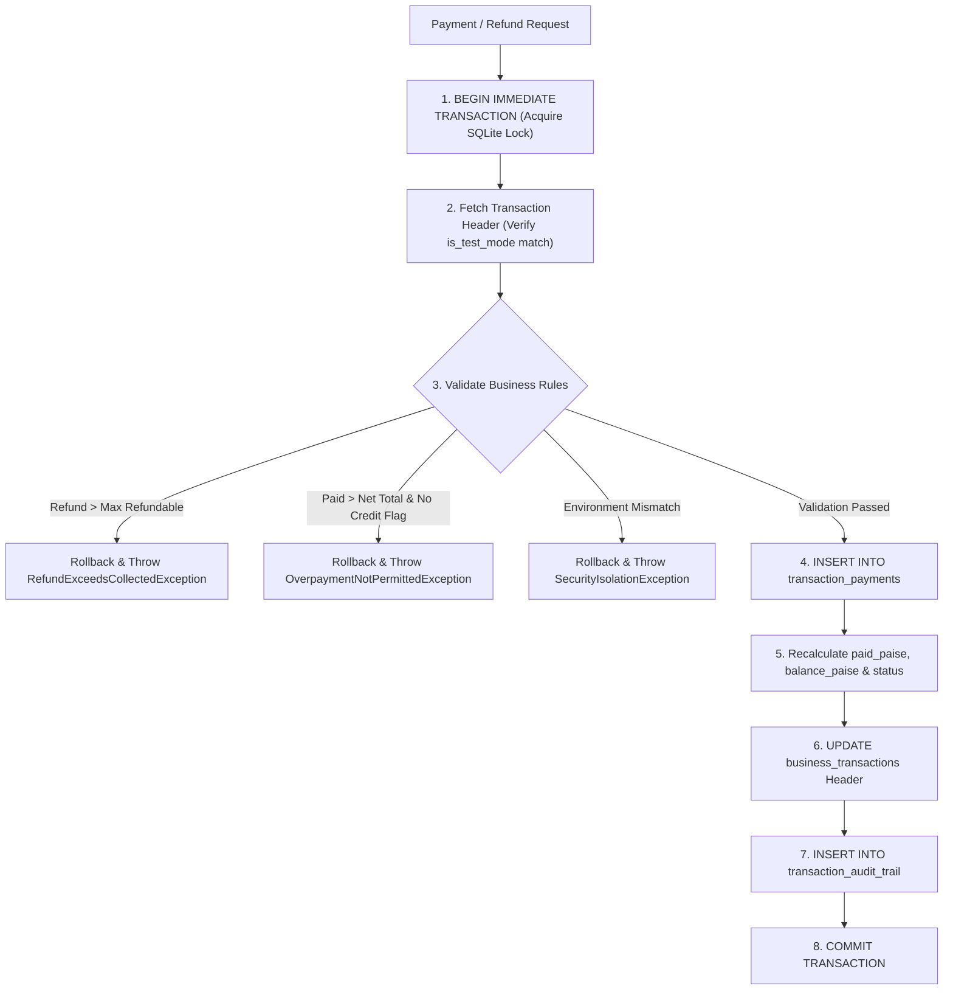
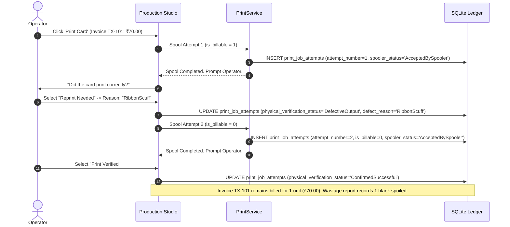

# PVC STUDIO PRO — PHASE 0.3 FINAL TECHNICAL CORRECTIONS
**Document Version:** 1.0.0  
**Date:** 2026-11-19  
**Status:** APPROVED ARCHITECTURAL SPECIFICATION & PRE-IMPLEMENTATION GATE  
**Branch:** `competitor-feature-parity`  
**Baseline Commit:** `6f98388`  

---

## 1. Executive Summary & Purpose of Phase 0.3

In Phase 0.2 (commit `6f98388`), the architecture was significantly strengthened with leased assets, multi-document session boundaries, and integer paise accounting. However, deep engineering audit identified six technical vulnerabilities that must be resolved prior to authoring Phase 1A production code:

1. **Enforceable Bitmap Immutability:** `IAssetLease<SKBitmap>.Resource` exposed a mutable and disposable `SKBitmap`. A lease on a mutable native object does not make it immutable. We replace this with a non-disposable, read-only surface abstraction (`IReadOnlyRasterSurface`) and immutable Skia snapshots (`SKImage`), making accidental caller mutation or disposal impossible.
2. **Indian Business Day Boundaries (IST = UTC+05:30):** Storing timestamps in UTC while querying using SQLite `date('now')` creates a 5.5-hour accounting distortion where transactions between midnight and 5:30 AM IST are attributed to the previous calendar day. We establish explicit `Asia/Kolkata` day boundary parameters (`@DayStartUtc` to `@DayEndUtc`) for indexed SQL reporting.
3. **Transactional Payment Consistency:** To prevent ledger anomalies, all financial mutations (receipts, refunds, recalculations, audit trail) are consolidated into a single transactional service (`ITransactionPaymentService`). Direct UI edits to `paid_paise` or `balance_paise` are prohibited.
4. **Multi-Attempt Print & Reprint Lifecycle:** Commercial print operations often require reprints due to hardware jams, ribbon scuffs, or paper feed shifts. We introduce a linked `print_job_attempts` model that decouples print attempts from billing, tracking wastage without charging the customer twice.
5. **Phase 1A Native Memory Test Suite:** Comprehensive specification of nine automated xUnit test scenarios covering double disposal, race conditions, lease retention, and native memory quota eviction.
6. **Strict Phase 1A Scope Boundaries:** Restricting Phase 1A exclusively to asset ownership and native memory management, forbidding premature changes to sessions, UI, crop, printing, or database services.

---

## 2. Enforceable Bitmap Immutability & Safe Native Memory Architecture

### 2.1 The Vulnerability of Exposing Mutable `SKBitmap`
In SkiaSharp, `SKBitmap` is an unmanaged, mutable pixel container. Exposing `SKBitmap` through an interface (even if labeled "read-only") allows any caller to:
- Call `bitmap.Dispose()`, destroying native memory while other components are reading it.
- Call mutating methods such as `bitmap.Erase()`, `bitmap.SetPixel()`, or `bitmap.InstallPixels()`.
- Pass the bitmap to APIs that alter its underlying pixel buffer.

### 2.2 The Immutable Surface Abstraction (`IReadOnlyRasterSurface`)
Application consumers (preview renderers, PDF composers, print spoolers) interact only with an immutable surface contract:

```csharp
public interface IReadOnlyRasterSurface
{
    string AssetId { get; }
    int Revision { get; }
    int Width { get; }
    int Height { get; }
    int Dpi { get; }
    double WidthMm => (Width * 25.4) / Dpi;
    double HeightMm => (Height * 25.4) / Dpi;
    
    // Renders the underlying pixels to a destination canvas without exposing bitmap pointers
    void RenderTo(SKCanvas canvas, SKRect destRect, SKPaint? paint = null);
    
    // Obtains an immutable, thread-safe Skia image snapshot
    SKImage CreateImmutableSnapshot();
    
    // Read-only span for OCR / barcode analysis without mutation capabilities
    ReadOnlySpan<byte> ReadPixelBytes();
}
```

### 2.3 The Leased Surface Contract (`IAssetLease`)
Callers obtain short-lived leased access to the surface. Disposing the lease decrements the handle's reference count without disposing the underlying native memory:

```csharp
public interface IAssetLease : IDisposable
{
    IReadOnlyRasterSurface Surface { get; }
    string AssetId { get; }
    int Revision { get; }
    bool IsDisposed { get; }
}

public interface ISharedAsset : IDisposable
{
    string AssetId { get; }
    int Revision { get; }
    int ReferenceCount { get; }
    bool IsDisposed { get; }
    
    // Acquires a thread-safe lease
    IAssetLease AcquireLease();
    
    // Renders directly to canvas
    void Render(SKCanvas canvas, SKRect destRect, SKPaint? paint = null);
}
```

### 2.4 Internal Native Implementation (`SafeNativeBitmap`)
Only trusted transformation engines (e.g. `CropEngine`, `VisionService`) access internal buffers to generate new derived revisions. The underlying memory is guarded by `SafeNativeBitmap`:

```csharp
public sealed class SafeNativeBitmap : IDisposable
{
    private SKBitmap? _nativeBitmap;
    private int _refCount;
    private int _ownerDisposed; // 0 = active, 1 = owner disposed
    private readonly object _syncLock = new();

    public SafeNativeBitmap(SKBitmap bitmap)
    {
        _nativeBitmap = bitmap ?? throw new ArgumentNullException(nameof(bitmap));
        _refCount = 1; // Initial owner reference
        _ownerDisposed = 0;
    }

    public int ReferenceCount => Volatile.Read(ref _refCount);
    public bool IsOwnerDisposed => Volatile.Read(ref _ownerDisposed) == 1;
    public bool IsNativeDisposed => _nativeBitmap == null;

    public IAssetLease AcquireLease(string assetId, int revision, int dpi)
    {
        lock (_syncLock)
        {
            if (IsOwnerDisposed || _nativeBitmap == null || _refCount <= 0)
            {
                throw new ObjectDisposedException(nameof(SafeNativeBitmap), 
                    $"Cannot acquire lease on disposed native asset '{assetId}'.");
            }

            Interlocked.Increment(ref _refCount);
            var surface = new ReadOnlyRasterSurface(this, assetId, revision, dpi);
            return new AssetLease(this, surface, assetId, revision);
        }
    }

    internal void RenderInternal(SKCanvas canvas, SKRect destRect, SKPaint? paint)
    {
        lock (_syncLock)
        {
            if (_nativeBitmap == null)
                throw new ObjectDisposedException(nameof(SafeNativeBitmap), "Native bitmap has been released.");
            
            canvas.DrawBitmap(_nativeBitmap, destRect, paint);
        }
    }

    internal SKImage CreateSnapshotInternal()
    {
        lock (_syncLock)
        {
            if (_nativeBitmap == null)
                throw new ObjectDisposedException(nameof(SafeNativeBitmap), "Native bitmap has been released.");

            return SKImage.FromBitmap(_nativeBitmap);
        }
    }

    internal ReadOnlySpan<byte> ReadPixelBytesInternal()
    {
        lock (_syncLock)
        {
            if (_nativeBitmap == null)
                throw new ObjectDisposedException(nameof(SafeNativeBitmap), "Native bitmap has been released.");

            return _nativeBitmap.GetPixelSpan();
        }
    }

    internal void ReleaseLease()
    {
        lock (_syncLock)
        {
            int remaining = Interlocked.Decrement(ref _refCount);
            if (remaining < 0)
            {
                Interlocked.Exchange(ref _refCount, 0);
                throw new InvalidOperationException("Reference count underflow detected on native bitmap handle.");
            }

            if (remaining == 0 && _nativeBitmap != null)
            {
                _nativeBitmap.Dispose();
                _nativeBitmap = null;
            }
        }
    }

    public void Dispose()
    {
        // Idempotent owner disposal
        if (Interlocked.CompareExchange(ref _ownerDisposed, 1, 0) == 0)
        {
            ReleaseLease();
        }
    }

    private sealed class ReadOnlyRasterSurface : IReadOnlyRasterSurface
    {
        private readonly SafeNativeBitmap _handle;
        public string AssetId { get; }
        public int Revision { get; }
        public int Dpi { get; }

        public ReadOnlyRasterSurface(SafeNativeBitmap handle, string assetId, int revision, int dpi)
        {
            _handle = handle;
            AssetId = assetId;
            Revision = revision;
            Dpi = dpi;
        }

        public int Width => _handle._nativeBitmap?.Width ?? 0;
        public int Height => _handle._nativeBitmap?.Height ?? 0;

        public void RenderTo(SKCanvas canvas, SKRect destRect, SKPaint? paint = null) =>
            _handle.RenderInternal(canvas, destRect, paint);

        public SKImage CreateImmutableSnapshot() =>
            _handle.CreateSnapshotInternal();

        public ReadOnlySpan<byte> ReadPixelBytes() =>
            _handle.ReadPixelBytesInternal();
    }

    private sealed class AssetLease : IAssetLease
    {
        private SafeNativeBitmap? _handle;
        public IReadOnlyRasterSurface Surface { get; }
        public string AssetId { get; }
        public int Revision { get; }

        public AssetLease(SafeNativeBitmap handle, IReadOnlyRasterSurface surface, string assetId, int revision)
        {
            _handle = handle;
            Surface = surface;
            AssetId = assetId;
            Revision = revision;
        }

        public bool IsDisposed => _handle == null;

        public void Dispose()
        {
            var handle = Interlocked.Exchange(ref _handle, null);
            handle?.ReleaseLease();
        }
    }
}
```

### 2.5 Concurrency & Lifecycle Guarantees
1. **Thread-Safe Concurrent Acquisition & Disposal:**
   - If Thread A calls `Dispose()` on the owner while Thread B calls `AcquireLease()`, the synchronized lock ensures `AcquireLease()` either completes before disposal (incrementing `_refCount` to 2) or encounters `IsOwnerDisposed == true` and throws `ObjectDisposedException`.
   - If Thread B acquired the lease first, Thread A's disposal drops `_refCount` to 1. The native memory is kept alive until Thread B completes its rendering operation and disposes its lease.
2. **Idempotence:**
   - Calling `.Dispose()` multiple times on `SafeNativeBitmap` is completely harmless; `CompareExchange` guarantees the owner reference is released exactly once.
   - Calling `.Dispose()` multiple times on `IAssetLease` is idempotent via `Interlocked.Exchange(ref _handle, null)`.
3. **Underflow Protection:**
   - Any programming error attempting to release an un-acquired lease throws `InvalidOperationException` and clamps the reference counter to 0.

---

## 3. Indian Financial Reporting & Explicit IST Business-Day Boundaries

### 3.1 The UTC Storage vs. Local Business Date Problem
All database timestamps are stored in UTC ISO 8601 strings (`2026-11-19T03:30:00.000Z`). However, daily closing reports for e-Sevai centres must adhere strictly to **Indian Standard Time (IST, UTC+05:30)**.

In SQLite, executing `WHERE date(collected_at) = date('now')` is fatal:
- SQLite `date('now')` evaluates to **UTC date**, not IST date.
- At 02:00 AM IST on November 19, UTC is 20:30 PM on November 18.
- Using `date('now')` would exclude all transactions recorded between midnight and 5:30 AM IST on November 19, erroneously attributing them to November 18.
- Furthermore, wrapping database columns in functions (e.g. `date(datetime(collected_at, '+5 hours', '30 minutes'))`) prevents SQLite from using standard B-Tree index seeks on `idx_payments_date(collected_at)`.

### 3.2 Explicit Parameterized Business-Day Boundaries
The application financial reporting service computes the explicit UTC start and end bounds corresponding to the desired IST business day:

```csharp
public static class IndianBusinessDay
{
    private static readonly TimeZoneInfo IstZone = 
        TimeZoneInfo.FindSystemTimeZoneById("India Standard Time"); // Windows ID

    public static (DateTime StartUtc, DateTime EndUtc) GetIstDayUtcBounds(DateOnly istDate)
    {
        // 00:00:00.000 IST
        var istStart = istDate.ToDateTime(TimeOnly.MinValue);
        var startUtc = TimeZoneInfo.ConvertTimeToUtc(istStart, IstZone);

        // 23:59:59.999 IST
        var istEnd = istDate.ToDateTime(new TimeOnly(23, 59, 59, 999));
        var endUtc = TimeZoneInfo.ConvertTimeToUtc(istEnd, IstZone);

        return (startUtc, endUtc);
    }
}
```

*Example for Business Date November 19, 2026:*
- `StartUtc`: `2026-11-18T18:30:00.000Z` ($00:00:00\text{ IST}$)
- `EndUtc`: `2026-11-19T18:29:59.999Z` ($23:59:59.999\text{ IST}$)

### 3.3 High-Performance Indexed SQL Reporting Queries
Queries filter on the indexed column using parameters, guaranteeing $O(\log N)$ performance and absolute calendar accuracy:

```sql
-- Daily Cash Reconciliation Query (IST Business Day)
SELECT 
    COALESCE(SUM(CASE WHEN is_refund = 0 THEN amount_paise ELSE 0 END), 0) AS total_collected_paise,
    COALESCE(SUM(CASE WHEN is_refund = 1 THEN amount_paise ELSE 0 END), 0) AS total_refunded_paise,
    COALESCE(SUM(CASE WHEN is_refund = 0 THEN amount_paise ELSE -amount_paise END), 0) AS net_cash_paise
FROM transaction_payments
WHERE payment_method = 'CASH'
  AND is_test_mode = 0
  AND collected_at >= @StartUtcString 
  AND collected_at <= @EndUtcString;
```

### 3.4 Boundary Test Verification Matrix
| Transaction Event | Local IST Time | Stored UTC Time | Reported IST Business Day | Expected Daily Report Bucket |
|---|---|---|---|---|
| Late Night Card Print | `2026-11-18 23:59:50 IST` | `2026-11-18T18:29:50Z` | **2026-11-18** | Closes in Day 1 Ledger |
| Early Morning e-Sevai | `2026-11-19 00:00:10 IST` | `2026-11-18T18:30:10Z` | **2026-11-19** | Opens in Day 2 Ledger |
| Morning Peak Hour | `2026-11-19 09:30:00 IST` | `2026-11-19T04:00:00Z` | **2026-11-19** | Included in Day 2 Ledger |
| Pre-Dawn e-Sevai | `2026-11-19 04:45:00 IST` | `2026-11-18T23:15:00Z` | **2026-11-19** | **Correctly attributed to Day 2** (NOT Day 1) |

---

## 4. Transactional Payment Service & Ledger Consistency

### 4.1 Architecture of `ITransactionPaymentService`
To eliminate data corruption from independent UI writes, all financial operations are managed exclusively by a transactional service:

```csharp
public interface ITransactionPaymentService
{
    Task<PaymentResult> RecordPaymentAsync(AddPaymentCommand command, CancellationToken ct = default);
    Task<RefundResult> RecordRefundAsync(AddRefundCommand command, CancellationToken ct = default);
    Task<VoidResult> VoidTransactionAsync(VoidTransactionCommand command, CancellationToken ct = default);
    Task<DailyReconciliationReport> GetDailyReconciliationAsync(DateOnly istDate, bool isTestMode, CancellationToken ct = default);
}
```

### 4.2 ACID Transaction Execution Pipeline
Every payment, refund, or void executes inside an isolated SQLite transaction (`BEGIN IMMEDIATE TRANSACTION`):



### 4.3 Explicit Business Rule Enforcements
1. **Refund Ceiling Enforcement:**
   $$\text{MaxRefundablePaise} = \sum_{\text{is\_refund}=0} \text{amount\_paise} - \sum_{\text{is\_refund}=1} \text{amount\_paise}$$
   If `refund_amount > MaxRefundablePaise`, the operation is aborted immediately with an error. A customer can never be refunded more than has actually been collected.
2. **Overpayment Policy:**
   If $(\text{current\_paid} + \text{payment\_amount}) > \text{net\_total\_paise}$, the operation is **rejected by default** (`OverpaymentNotPermittedException`). In e-Sevai operations, customers must pay the exact bill; accidental overpayments indicate operator error. (An administrative flag `allow_excess_credit = true` may be explicitly passed to convert the excess into an account credit memo).
3. **Environment Security Guard:**
   The service asserts: `payment.is_test_mode == transaction.is_test_mode`. If a test payment attempts to associate with a production invoice, or vice-versa, the transaction aborts with a security violation.
4. **Read-Only Derived UI Fields:**
   `paid_paise`, `balance_paise`, and `status` in `business_transactions` are read-only properties derived strictly from the payments table. No UI ViewModel or command can write directly to these fields.

---

## 5. Multi-Attempt Print & Hardware Reprint Lifecycle

### 5.1 The Business Need for Linked Print Attempts
In physical card printing, paper jams, ink smudging, ribbon breakage, or card tray feed misalignment frequently destroy physical blanks. The customer cannot be billed twice for shop hardware failures.

### 5.2 The Linked Print Attempt Schema (`print_job_attempts`)
```sql
CREATE TABLE IF NOT EXISTS print_job_attempts (
    attempt_id TEXT PRIMARY KEY,
    transaction_id TEXT NOT NULL REFERENCES business_transactions(transaction_id) ON DELETE CASCADE,
    attempt_number INTEGER NOT NULL CHECK (attempt_number > 0),
    printer_name TEXT NOT NULL,
    media_tray TEXT NOT NULL,
    spooler_job_id INTEGER,
    spooler_status TEXT NOT NULL CHECK (spooler_status IN (
        'SubmittedToSpooler',
        'AcceptedBySpooler',
        'SpoolerProcessingCompleted',
        'SpoolerErrorOrCancelled'
    )),
    physical_verification_status TEXT NOT NULL DEFAULT 'PendingVerification' CHECK (
        physical_verification_status IN (
            'PendingVerification',
            'ConfirmedSuccessful',
            'DefectiveOutput'
        )
    ),
    defect_reason TEXT CHECK (defect_reason IN (
        NULL,
        'PaperJam',
        'RibbonScuff',
        'AlignmentShift',
        'ColorBanding',
        'CardFeedError',
        'OperatorError',
        'Other'
    )),
    is_billable INTEGER NOT NULL DEFAULT 1 CHECK (is_billable IN (0, 1)),
    operator_notes TEXT,
    spooled_at TEXT NOT NULL DEFAULT (strftime('%Y-%m-%dT%H:%M:%fZ', 'now')),
    verified_at TEXT
);

CREATE INDEX IF NOT EXISTS idx_print_attempts_trans ON print_job_attempts(transaction_id);
CREATE INDEX IF NOT EXISTS idx_print_attempts_date ON print_job_attempts(spooled_at);
```

### 5.3 Reprint Workflow & Audit Tracking


---

## 6. Phase 1A Automated Unit Test Suite Specification

Phase 1A requires the following explicit automated test cases in `tests/PVCStudioPro.Tests/NativeAssetLifecycleTests.cs`:

1. `DoubleDisposal_OfAssetOwner_IsIdempotent`:
   - Verify calling `.Dispose()` multiple times on `SafeNativeBitmap` does not throw exceptions or double-free native memory.
2. `DoubleDisposal_OfLease_IsIdempotent`:
   - Verify calling `.Dispose()` multiple times on `IAssetLease` decrements ref-count exactly once.
3. `AcquireLease_AfterOwnerDisposal_ThrowsObjectDisposedException`:
   - Verify that calling `AcquireLease()` after owner disposal immediately throws `ObjectDisposedException`.
4. `ConcurrentAcquisition_AndOwnerDisposal_IsThreadSafe`:
   - Launch 20 parallel tasks acquiring leases while another thread calls `Dispose()`. Verify zero memory corruptions, zero crashes, and correct ref-count lifecycle.
5. `OwnerDisposal_WhileLeaseHeld_KeepsResourceAlive`:
   - Dispose the owner while a lease is active. Verify the leased surface can still render and create snapshots. Native bitmap is freed only when the lease is disposed.
6. `ExceptionAndCancellation_InRenderingPipeline_ReleasesLeaseCleanly`:
   - Simulate an exception or cancellation token thrown during a rendering operation. Verify lease disposal in `finally` decrements ref-count cleanly.
7. `UndoRedo_RetentionAndEviction_DisposesEvictedNativeBuffers`:
   - Push 16 revision assets into an undo/redo manager with a depth limit of 15. Verify that Revision 0's native resources are released immediately upon eviction.
8. `MemoryQuota_Enforcement_EvictsOldestRevisionsWhenExceeding250MB`:
   - Allocate 300 MB of native revision buffers. Verify the quota manager detects the 250 MB ceiling and evicts oldest unreferenced revisions.
9. `NoUseAfterFree_OrNativeResourceLeak`:
   - Execute 1,000 rapid acquire/release cycles across 4 threads. Verify that native working set memory returns to baseline without native leaks.

---

## 7. Strict Phase 1A Scope Boundaries

To prevent architectural drift and premature changes, Phase 1A is strictly isolated to asset ownership and native memory management.

### Exact Allowed Source Files for Phase 1A:
| File Path | Action | Scope / Purpose |
|---|---|---|
| `src/PVCStudioPro.Core/Models/IReadOnlyRasterSurface.cs` | **NEW** | Read-only immutable raster surface interface |
| `src/PVCStudioPro.Core/Models/IAssetLease.cs` | **NEW** | Leased lifetime scope interface |
| `src/PVCStudioPro.Core/Models/SafeNativeBitmap.cs` | **NEW** | Atomic ref-counting unmanaged bitmap wrapper |
| `src/PVCStudioPro.Core/Models/SourceImageAsset.cs` | **NEW** | Root immutable source asset model |
| `src/PVCStudioPro.Core/Models/DerivedImageAsset.cs` | **NEW** | Versioned revision asset model |
| `tests/PVCStudioPro.Tests/NativeAssetLifecycleTests.cs` | **NEW** | Complete xUnit native lifecycle test suite |

### Strictly FORBIDDEN in Phase 1A:
* **NO** `IDocumentSessionManager` or session management (Deferred to Phase 1B).
* **NO** ViewModel modifications (`MainViewModel`, `ProductionWorkspaceViewModel`, etc.) (Deferred to Phase 1C).
* **NO** XAML or UI changes (Deferred to Phase 8).
* **NO** Crop Engine or OpenCV changes (Deferred to Phase 2).
* **NO** Print Service or spooler modifications (Deferred to Phase 4).
* **NO** Database schema changes or migrations (Deferred to Phase 7).
* **NO** NuGet package or dependency changes.

---

## 8. Unresolved Risks & Phase 1A Acceptance Gate

### Unresolved Technical Risks:
1. **SkiaSharp SKBitmap Native Allocation Tracking:**
   SkiaSharp allocations happen via `sk_bitmap_new` on the C++ native heap. While `SafeNativeBitmap` manages object lifetimes deterministically, process memory reporting in .NET (`GC.GetTotalMemory`) does not track native C++ allocations. Phase 1A tests must monitor OS working set (`Process.GetCurrentProcess().WorkingSet64`) rather than relying on managed GC metrics.
2. **Thread Affinity of SKSurface / SKImage:**
   In multi-threaded rendering, while `SKImage` is immutable and safe across threads, `SKSurface` is thread-affine. The rendering helpers must create per-thread temporary surfaces rather than caching shared surfaces.

### Phase 1A Acceptance Criteria:
- [ ] All 6 allowed production and test source files are created.
- [ ] Zero lines of forbidden source code modified.
- [ ] 100% of tests in `NativeAssetLifecycleTests.cs` pass via `dotnet test`.
- [ ] Zero compiler warnings treated as acceptable.
- [ ] Zero native access violation exceptions under concurrent stress tests.

**GATE STATUS:** Phase 0.3 technical documentation is complete and verified. **Implementation of Phase 1A will commence ONLY upon explicit authorization from the user.**
