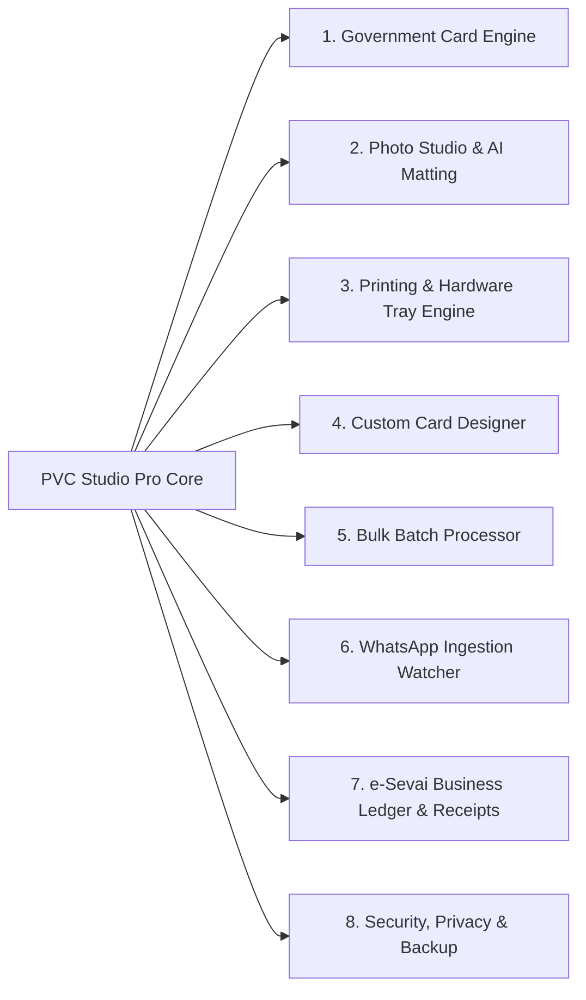

# Product Requirements Document (PRD) — PVC Studio Pro

**Version:** 1.0.0-DRAFT  
**Date:** 2026-11-18  
**Author:** Senior Windows Desktop Software Architect & Product Lead  

---

## 1. Product Objectives & Target Personas

### 1.1 Primary Persona: e-Sevai / CSC Operator (Vignesh, Karur, TN)
- Runs a commercial digital service centre serving 50–100 citizens daily.
- Hardware: Windows 11 PC, Epson L805 / L8050 inkjet printer with 2-card PVC tray, flatbed scanner.
- Key Goals: Print customer cards rapidly (< 20 seconds), avoid misaligned tray prints (wasted plastic cards), generate clean passport photos, track daily cash earnings, and maintain zero downtime.
- Pain with current software: ₹500 annual subscription lockout, poor background removal, blurry Tamil fonts, no customer ledger.

---

## 2. Functional Scope & Modules

### Module 1: Government Card Engine
- Support for e-Aadhaar (UIDAI), NSDL PAN, UTIITSL PAN, Voter ID (e-EPIC), Ayushman Bharat (PM-JAY), Parivahan Driving Licence & Vehicle RC, Tamil Nadu Smart Ration Card, e-Shram, ABHA, Jan Aadhaar, and generic citizen cards.
- Vector rendering at native 600/1200 DPI via PDFium.
- Automated password hinting and auto-fill based on citizen name and year of birth.
- 1-Click compliant Aadhaar Masking (`XXXX-XXXX-1234`).
- Computer Vision contour boundary detection and perspective rectification for scanned/photographed physical cards.

### Module 2: Photo Studio & Local AI Matting
- Preset cropping for Indian Passport (35×45 mm), US/Schengen Visa (50×50 mm), Stamp Size, and custom dimensions.
- 100% offline, local AI portrait background segmentation (ONNX Runtime) with solid color replacement (White, Light Blue, Custom).
- Signature extraction tool with adaptive thresholding for crisp black-and-white vector embedding.
- Multi-up sheet generation for 4×6 photo sheets (6, 8, 12 photos) and A4 sheets with cutting guidelines.

### Module 3: Printing & Tray Calibration Engine
- Pre-configured hardware tray profiles:
  - Epson L805 (2-card tray).
  - Epson L8050 / L18050 (native ID card tray).
  - Canon G-series (multi-purpose tray).
  - CR80 Direct Card Printers (Zebra, Evolis, Magicard).
  - Dragon Sheet / PVC Fusing Sheet (Mirror Inverted Mode).
- Interactive 2-step calibration wizard with printed millimeter ruler test pattern.
- Front/Back registration alignment with visual step-by-step flip instructions.

### Module 4: Custom Card Designer
- Blank CR80 canvas (85.60 × 53.98 mm) with front and back editing.
- Drag-and-drop elements: text, images, logos, shapes, barcodes (Code 128, QR Code).
- Save, export, and import custom reusable card templates.

### Module 5: Bulk Batch Processing
- Batch import via CSV / Excel (.xlsx) for institutional ID printing (Schools, Colleges, Private Companies).
- Batch photo matching using filename or student/employee ID.
- Queue manager with progress bar, pause/resume, and failed-job recovery.

### Module 6: WhatsApp Ingestion Watcher
- Monitored folder integration: automatically detects new images and PDFs saved from WhatsApp Desktop.
- 1-Click quick crop and dispatch to print queue.

### Module 7: e-Sevai Business Ledger & Receipts
- Automatic daily print register logging job time, card type, quantity, and customer fee.
- Daily revenue and profit summary analytics.
- 1-Click receipt generation (Thermal 58/80mm or digital PDF).
- 1-Click reprint capability from recent job history.

### Module 8: Security, Privacy & Backup
- Strict local-first architecture with zero external telemetry or cloud upload.
- In-memory processing and cryptographic shredding of temporary cache files.
- DPAPI encryption of stored customer records.
- 1-Click encrypted local database backup and restore wizard.
- Full bilingual English and Tamil user interface.
