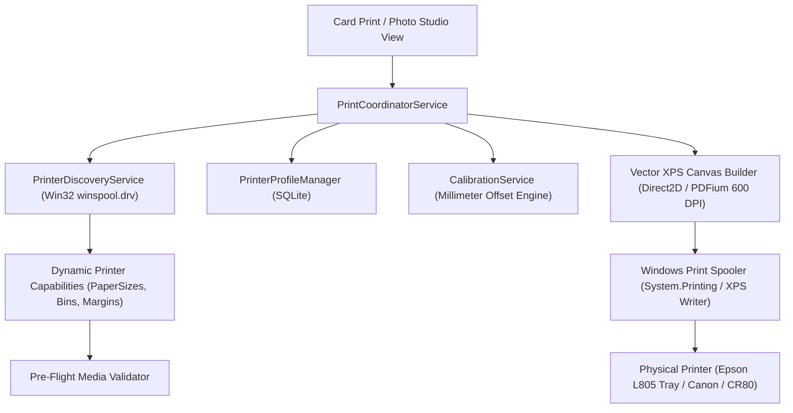

# Printing Engine Design & Abstraction Layer — PVC Studio Pro

**Architecture:** Dynamic Win32 Spooler Interop & Vector XPS Rendering  
**Target Hardware:** Epson L805, L8050, L18050, Canon G-series, CR80 Card Printers  
**Date:** 2026-11-18  

---

## 1. Printing Engine Architecture

---

## 2. Dynamic Discovery vs Hardcoded Profiles

Instead of hardcoding tray offsets and paper sizes, the engine operates dynamically:
1. **Capability Inspection:** Upon printer selection, calls `DeviceCapabilities` (Win32 `winspool.drv`) to enumerate all supported paper sizes and input bins (`DC_BINNAMES`, `DC_PAPERNAMES`).
2. **Physical Margin Detection:** Calls `GetDeviceCaps` on a printer device context (`CreateDC`) to retrieve exact physical hardware margins (`PHYSICALOFFSETX`, `PHYSICALOFFSETY`) in millimeters.
3. **Pre-Flight Validation:** If an operator selects "Epson L805" but leaves the printer driver on "Plain Paper A4" instead of "CD/DVD Tray", the software intercepts the job and displays an alert:
   > *"Warning: Printer tray mismatch. You selected CR80 PVC Card printing, but the driver is set to A4 Plain Paper. Please switch paper source to CD/DVD Tray."*
4. **Millimeter Calibration Transform:** Every coordinate sent to the print spooler passes through the calibration matrix:
   $$\text{Final } X = X_{\text{template}} + \Delta X_{\text{profile}}$$
   $$\text{Final } Y = Y_{\text{template}} + \Delta Y_{\text{profile}}$$
   Where $\Delta X$ and $\Delta Y$ are stored in the local SQLite database to 0.1 mm precision.
