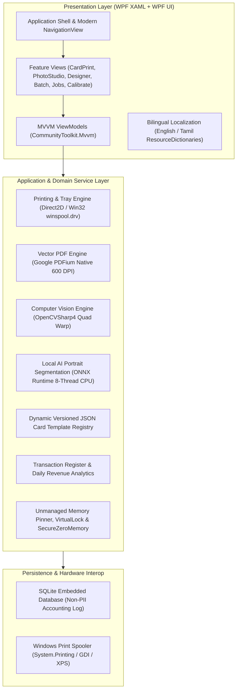

# System Architecture — PVC Studio Pro (Revised 2.0)

**Target Platform:** Windows 10 (1809+) & Windows 11 (64-bit, x64)  
**Framework:** .NET 10 LTS / C# 13 + Windows Presentation Foundation (WPF)  
**Design System:** Windows 11 Fluent Design (`Wpf.Ui` by lepo.co + `ui-ux-pro-max`)  
**Data Policy:** Zero-PII Storage (Strict DPDP Act 2023 Compliance)  

---

## 1. High-Level Architectural Flow

---

## 2. Hardened Service Contracts

1. **`IPdfService`:** Takes `Stream` or `byte[]` in memory. Uses Google PDFium native C++ rasterizer to render vector cards at 600 DPI. Never creates intermediate decrypted files on disk.
2. **`IPrinterDiscoveryService`:** Interrogates connected Windows printers via `DeviceCapabilities` (Win32 `winspool.drv`), identifying supported bins (`DC_BINNAMES`), paper dimensions, duplex support, and physical unprintable margins.
3. **`IVisionService`:** Uses OpenCVSharp4 contour approximation (`Cv2.ApproxPolyDP`) and 4-point perspective warping (`Cv2.WarpPerspective`) to deskew photographed or scanned cards into a standardized 85.60 × 53.98 mm CR80 geometry in ~31 ms.
4. **`IAiPhotoService`:** Executes multi-threaded ONNX inference on CPU using quantized portrait models in ~1.5s with zero external cloud dependencies.
5. **`ISecurityService`:** Pins memory buffers using `VirtualLock`, executes cryptographic overwrites via `SecureZeroMemory`, and enforces the Zero-PII storage policy.
