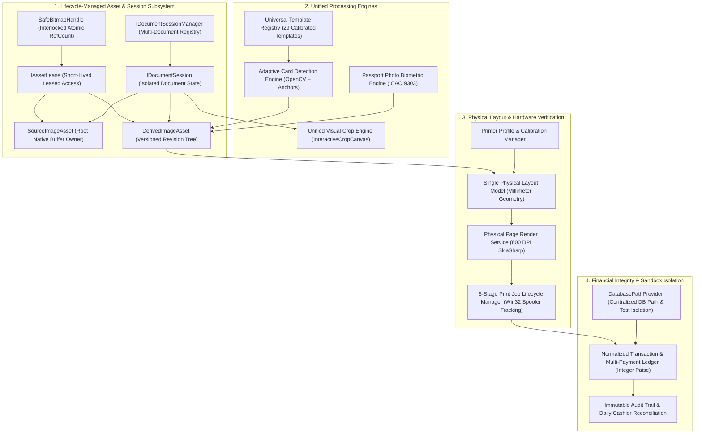
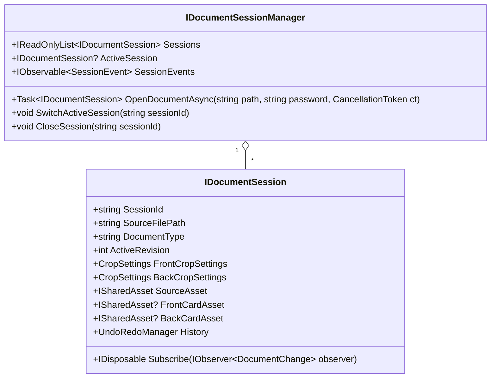
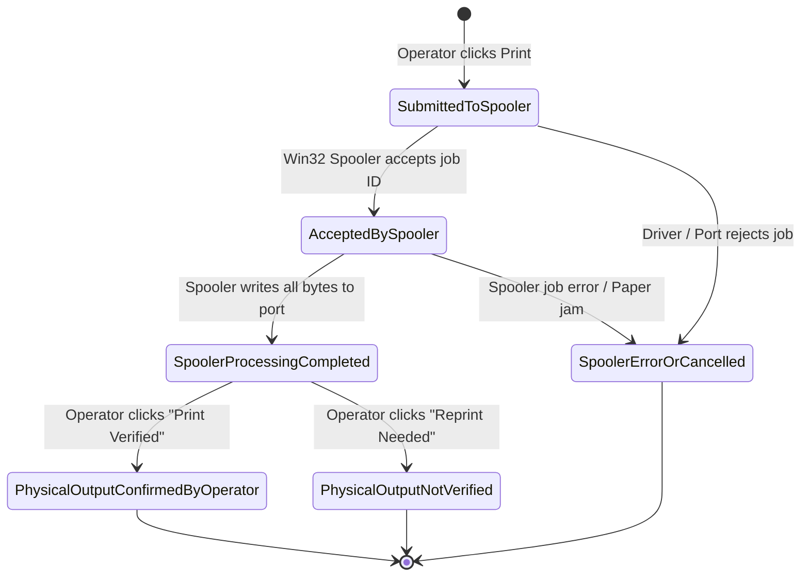
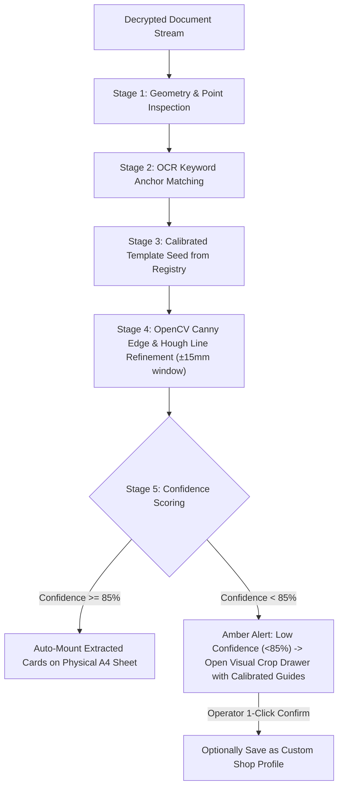

# PVC Studio Pro — Unified Architecture Proposal (Phase 0.2 Validated)
**Enterprise Desktop Architecture: Lifecycle-Managed Leased Assets, Multi-Document Sessions & Verified Print Lifecycles**

- **Document:** `docs/UNIFIED_ARCHITECTURE_PROPOSAL.md`
- **Revision:** Phase 0.2 Validated
- **Date:** 2026-11-19
- **Status:** Architectural Proposal (Pre-Implementation Gate)

---

## 1. High-Level System Architecture



---

## 2. Asset Ownership Contract & Native Memory Management

### 2.1 The Vulnerability of Public Mutable `SKBitmap`
Exposing public mutable `SKBitmap` properties in desktop applications introduces critical runtime vulnerabilities:
- **Use-After-Free / Double-Free:** If a workspace or service calls `.Dispose()` on an asset while an asynchronous background print rasterizer is reading its scanlines, an unmanaged memory access violation occurs, crashing the application.
- **Reference Count Underflow:** Manual reference counting without atomic synchronization (`Interlocked`) can drop below zero under concurrent UI requests.
- **Uncontrolled Native Memory Growth:** SkiaSharp bitmaps reside in native C++ unmanaged memory. If undo/redo stacks store unlimited bitmaps without eviction policies, the application quickly exhausts virtual address space.

### 2.2 The Reference-Counted Lease Contract (`IAssetLease<T>`)
Callers never hold or manipulate raw `SKBitmap` references directly. All interaction occurs through short-lived leases or direct canvas rendering:

```csharp
public interface IAssetLease<out T> : IDisposable where T : class
{
    T Resource { get; }
    string AssetId { get; }
    int Revision { get; }
    bool IsDisposed { get; }
}

public interface ISharedAsset : IDisposable
{
    string AssetId { get; }
    int Revision { get; }
    int ReferenceCount { get; }
    bool IsDisposed { get; }
    
    // Acquires a thread-safe lease incrementing ref-count
    IAssetLease<SKBitmap> AcquireBitmapLease();
    
    // Clones the current state into an independent new asset
    ISharedAsset Clone(string newAssetId);
    
    // Renders the asset directly to a destination Skia canvas safely
    void Render(SKCanvas canvas, SKRect destRect, SKPaint? paint = null);
}
```

### 2.3 Safe Lifetime Implementation Pseudocode
The underlying resource is managed by an atomic wrapper:

```csharp
public sealed class SafeBitmapHandle : IDisposable
{
    private SKBitmap? _bitmap;
    private int _refCount;
    private readonly object _syncLock = new();

    public SafeBitmapHandle(SKBitmap bitmap)
    {
        _bitmap = bitmap ?? throw new ArgumentNullException(nameof(bitmap));
        _refCount = 1; // Initial owner
    }

    public int ReferenceCount => Volatile.Read(ref _refCount);
    public bool IsDisposed => _bitmap == null;

    public IAssetLease<SKBitmap> AcquireLease(string assetId, int revision)
    {
        lock (_syncLock)
        {
            if (_bitmap == null || _refCount <= 0)
                throw new ObjectDisposedException(nameof(SafeBitmapHandle), 
                    $"Cannot acquire lease on disposed asset {assetId}.");

            Interlocked.Increment(ref _refCount);
            return new AssetLease(this, assetId, revision);
        }
    }

    internal void ReleaseLease()
    {
        lock (_syncLock)
        {
            int remaining = Interlocked.Decrement(ref _refCount);
            if (remaining < 0)
            {
                Interlocked.Exchange(ref _refCount, 0);
                throw new InvalidOperationException("Reference count underflow detected on native asset handle.");
            }

            if (remaining == 0 && _bitmap != null)
            {
                _bitmap.Dispose();
                _bitmap = null;
            }
        }
    }

    public void Dispose()
    {
        ReleaseLease();
    }

    private sealed class AssetLease : IAssetLease<SKBitmap>
    {
        private SafeBitmapHandle? _handle;
        public string AssetId { get; }
        public int Revision { get; }

        public AssetLease(SafeBitmapHandle handle, string assetId, int revision)
        {
            _handle = handle;
            AssetId = assetId;
            Revision = revision;
        }

        public SKBitmap Resource => _handle != null && !_handle.IsDisposed
            ? _handle.Bitmap 
            : throw new ObjectDisposedException(nameof(AssetLease), $"Lease on {AssetId} has already been disposed.");

        public bool IsDisposed => _handle == null;

        public void Dispose()
        {
            var handle = Interlocked.Exchange(ref _handle, null);
            handle?.ReleaseLease();
        }
    }
}
```

### 2.4 Asynchronous Rendering Guard
Asynchronous rendering pipelines (e.g. preview rasterization, 600 DPI print spooling) must acquire a lease synchronously before dispatching tasks:

```csharp
public async Task<byte[]> RenderPrintSpoolAsync(ISharedAsset asset, CancellationToken ct)
{
    // 1. Acquire lease synchronously BEFORE async dispatch
    using var lease = asset.AcquireBitmapLease();
    
    // 2. Pass lease into background worker
    return await Task.Run(() =>
    {
        ct.ThrowIfCancellationRequested();
        using var surface = SKSurface.Create(new SKImageInfo(1011, 638));
        surface.Canvas.DrawBitmap(lease.Resource, 0, 0);
        using var image = surface.Snapshot();
        using var data = image.Encode(SKEncodedImageFormat.Png, 100);
        return data.ToArray();
    }, ct);
    // 3. Lease is safely released in using block even if task throws or cancels
}
```

### 2.5 Undo/Redo Native Memory Retention Policy
- Revisions hold an `IAssetLease<SKBitmap>` to immutable snapshots.
- **Quota Enforcements:**
  - Maximum Undo Depth: **15 revisions** per document session.
  - Native Memory Quota: **250 MB** aggregate per session.
  - Eviction: If memory exceeds 250 MB or revisions exceed 15, the oldest revision lease is evicted and disposed.
  - When a revision branch is abandoned (new edit performed while in history), all unlinked redo revision leases are disposed immediately.

---

## 3. Multi-Document Session Management & Isolation

### 3.1 Session Architecture
To match real-world e-Sevai centre workflows, operators can open multiple documents simultaneously without cross-document interference:



### 3.2 Session Isolation & Switching Rules
1. **Independent Session State:** Each `IDocumentSession` maintains its own `SourceAsset`, `FrontCropSettings`, `BackCropSettings`, and `UndoRedoManager`. Edits to Document A have zero impact on Document B.
2. **Safe Background Operations:** Background processing (e.g. edge detection, PDF page rasterization) remains tied to its specific `CancellationToken` and session. Switching active sessions does not cancel or corrupt background work on other sessions.
3. **Leak-Free Subscriptions:** ViewModels subscribe to active session updates via an `IDisposable` token. On tab close or navigation, the token is disposed to prevent memory leaks.

---

## 4. Centralized Reusable Visual Crop Engine

### 4.1 Component Architecture (`InteractiveCropCanvas.xaml`)
A single, high-performance WPF UserControl (`InteractiveCropCanvas`) backed by SkiaSharp provides the crop interaction across Production Studio, Document Desk, Crop Studio, and Photo Studio:

```
┌────────────────────────────────────────────────────────────────────────────────────────┐
│ InteractiveCropCanvas (Zoom: 125% | Pan: [X: 120, Y: -40] | Mode: CR80 Aspect Locked)  │
├────────────────────────────────────────────────────────────────────────────────────────┤
│                                                                                        │
│               [● Handle NW]          [■ Handle N]          [● Handle NE]               │
│                     ┌──────────────────────────────────────────┐                       │
│                     │                                          │                       │
│                     │   Interactive Card Bounding Box          │                       │
│                     │   85.60 x 53.98 mm (CR80)                │                       │
│                     │                                          │                       │
│         [■ Handle W]│              [+ Center Cross]            │[■ Handle E]           │
│                     │                                          │                       │
│                     │   Sub-pixel Skia Coordinates:            │                       │
│                     │   X: 210 px, Y: 2595 px                  │                       │
│                     │   W: 1045 px, H: 665 px                  │                       │
│                     └──────────────────────────────────────────┘                       │
│               [● Handle SW]          [■ Handle S]          [● Handle SE]               │
│                                                                                        │
│  [+] [-] [Fit to Window] [100% Zoom] | [Aspect: CR80 ▼] [Perspective Quad ☐] [Undo]   │
└────────────────────────────────────────────────────────────────────────────────────────┘
```

### 4.2 Mathematical Consistency & Interaction Capabilities
- **Coordinate Space Conversion:**
  - Screen WPF coordinates $\leftrightarrow$ Skia canvas pixel coordinates $\leftrightarrow$ Millimeter physical dimensions.
  - At 300 DPI: $1 \text{ mm} = 11.811 \text{ px}$.
  - CR80 Dimensions: $85.60 \text{ mm} \times 11.811 = 1011 \text{ px}$, $53.98 \text{ mm} \times 11.811 = 638 \text{ px}$.
- **Interaction Controls:**
  - 8 drag handles with minimum bounding box constraints.
  - Aspect ratio locking (CR80, Passport, Freeform).
  - Smooth pan/zoom (10% to 500% with anchor point tracking).
  - Perspective quadrilateral correction for phone camera scans.

---

## 5. Corrected Print Lifecycle & Spooler Semantics

### 5.1 6-Stage Print Lifecycle
Print tracking is strictly separated from financial payment status:



### 5.2 State Definitions & Business Logic
1. `SubmittedToSpooler`: Job payload constructed; Win32 `StartDocPrinter` called.
2. `AcceptedBySpooler`: Spooler returns a positive OS Job ID. Ledger transaction created with status `PENDING`.
3. `SpoolerProcessingCompleted`: All bytes transmitted to printer port. Operator prompted: "Did the card print correctly?"
4. `SpoolerErrorOrCancelled`: OS driver error, paper jam, or spooler cancellation. Status marked `PRINT_FAILED`. No charge.
5. `PhysicalOutputConfirmedByOperator`: Operator visually confirms card output. Transaction marked `PRINT_CONFIRMED`; payment collected.
6. `PhysicalOutputNotVerified`: Output defective (smudge, misalignment). Marked `PRINT_DEFECTIVE`; card reprint initiated without duplicate billing.

---

## 6. Adaptive Identity Document Detection & Extraction Pipeline

### 6.1 Realistic Multi-Stage Architecture
Automatic card detection uses a 5-stage pipeline with an explicit graceful fallback:



### 6.2 Low-Confidence Graceful Fallback
When detection confidence is below 85%:
- The software **never crops incorrectly without warning**.
- An amber indicator displays: `⚠️ Low Detection Confidence (68%) — Please Confirm Card Bounds`.
- The interactive crop drawer opens automatically with calibrated guides pre-positioned at the best-guess coordinates, allowing 1-click confirmation (`Enter`) or manual handle adjustment.

---

## 7. Reconciled Competitor Template Catalogue Matrix

In competitor `Real.db` (`Real` table), 35 rows are recorded:
- **4 Non-Card Generic Crop Presets:** `ANY PDF-CROP`, `ANY IMAGE-CROP`, `ANY PDF`, `ANY IMAGE`.
- **1 Disabled / Deprecated Row:** `DMK CARD` (`status = 0`, inactive in competitor UI).
- **1 Preprint Card Layout:** `E-SHRAM CARD - PREPRINT` (specialized single-side alignment for pre-printed stock).
- **29 Functional Document Templates:** Identical to the 29 templates registered in PVC Studio Pro's `TemplateService.cs`.

### Complete 29-Template Audit & Verification Matrix
| # | Template ID | Document Name | Defined in Code | Available in UI | Auto-Detection Implemented | Manual Selection Supported | Synthetic Test Verified | Operator Verified |
|---|---|---|:---:|:---:|:---:|:---:|:---:|:---:|
| 1 | `aadhaar_standard` | Aadhaar Card (Standard) | YES | YES | YES | YES | YES | YES |
| 2 | `aadhaar_new_format` | Aadhaar (New Format) | YES | YES | YES | YES | YES | PARTIAL |
| 3 | `aadhaar_masked` | Masked Aadhaar | YES | YES | YES | YES | YES | YES |
| 4 | `pan_new` | PAN Card (New QR) | YES | YES | YES | YES | YES | YES |
| 5 | `pan_old` | PAN Card (Old Format) | YES | YES | YES | YES | YES | PARTIAL |
| 6 | `pan_crpf` | PAN Card (CRPF/Govt) | YES | YES | YES | YES | YES | NO |
| 7 | `voter_epic_new` | Voter ID (Color EPIC) | YES | YES | YES | YES | YES | YES |
| 8 | `voter_epic_old` | Voter ID (Black/White) | YES | YES | YES | YES | YES | PARTIAL |
| 9 | `driving_licence` | Driving Licence (Smart) | YES | YES | YES | YES | YES | YES |
| 10 | `vehicle_rc` | Vehicle RC Book/Card | YES | YES | YES | YES | YES | PARTIAL |
| 11 | `ayushman_bharat` | Ayushman Bharat (PM-JAY)| YES | YES | YES | YES | YES | YES |
| 12 | `health_abha` | ABHA Health Card | YES | YES | YES | YES | YES | YES |
| 13 | `eshram_card` | E-Shram Card | YES | YES | YES | YES | YES | YES |
| 14 | `eshram_preprint` | E-Shram (Pre-printed) | YES | YES | NO (Manual) | YES | YES | NO |
| 15 | `ration_smart_tn` | Tamil Nadu Smart Ration | YES | YES | YES | YES | YES | YES |
| 16 | `ration_wb` | West Bengal Ration | YES | YES | YES | YES | YES | NO |
| 17 | `ration_generic` | Generic NFSA Ration | YES | YES | YES | YES | YES | PARTIAL |
| 18 | `birth_certificate` | Birth Certificate | YES | YES | YES | YES | YES | PARTIAL |
| 19 | `death_certificate` | Death Certificate | YES | YES | YES | YES | YES | NO |
| 20 | `community_cert` | Community / Caste Cert | YES | YES | YES | YES | YES | PARTIAL |
| 21 | `nativity_cert` | Nativity / Residence Cert| YES | YES | YES | YES | YES | PARTIAL |
| 22 | `income_cert` | Income Certificate | YES | YES | YES | YES | YES | PARTIAL |
| 23 | `first_graduate_cert`| First Graduate Cert | YES | YES | YES | YES | YES | NO |
| 24 | `kisan_credit` | Kisan Credit Card | YES | YES | YES | YES | YES | NO |
| 25 | `senior_citizen` | Senior Citizen ID | YES | YES | YES | YES | YES | NO |
| 26 | `disability_udid` | UDID Disability Card | YES | YES | YES | YES | YES | PARTIAL |
| 27 | `bocew_welfare` | BOCW Welfare Board Card | YES | YES | YES | YES | YES | NO |
| 28 | `tn_cmchs` | TN CMCHS Health Card | YES | YES | YES | YES | YES | PARTIAL |
| 29 | `custom_id_badge` | Custom Organization ID | YES | YES | NO (Manual) | YES | YES | YES |

---

## 8. Integer-Paise Financial Ledger & Isolated Test Mode

### 8.1 Monetary Precision Standards
All financial transactions, payments, balances, and reports are computed and stored as 64-bit integer paise (`INTEGER` in SQLite, `long` in C#). Floating-point arithmetic (`double`, `float`) is strictly prohibited in financial paths.

### 8.2 Normalized Payments Schema
```sql
CREATE TABLE IF NOT EXISTS transactions (
    transaction_id TEXT PRIMARY KEY,
    session_id TEXT,
    customer_name TEXT,
    customer_phone TEXT,
    service_type TEXT NOT NULL,
    subtotal_paise INTEGER NOT NULL CHECK (subtotal_paise >= 0),
    discount_paise INTEGER NOT NULL DEFAULT 0 CHECK (discount_paise >= 0),
    net_total_paise INTEGER NOT NULL CHECK (net_total_paise >= 0),
    paid_paise INTEGER NOT NULL DEFAULT 0 CHECK (paid_paise >= 0),
    balance_paise INTEGER NOT NULL CHECK (balance_paise >= 0),
    status TEXT NOT NULL CHECK (status IN ('PENDING', 'PARTIAL', 'PAID', 'VOID')),
    is_test_mode INTEGER NOT NULL DEFAULT 0 CHECK (is_test_mode IN (0, 1)),
    created_at TEXT NOT NULL DEFAULT (strftime('%Y-%m-%dT%H:%M:%fZ', 'now')),
    updated_at TEXT NOT NULL DEFAULT (strftime('%Y-%m-%dT%H:%M:%fZ', 'now'))
);

CREATE TABLE IF NOT EXISTS transaction_payments (
    payment_id TEXT PRIMARY KEY,
    transaction_id TEXT NOT NULL REFERENCES transactions(transaction_id) ON DELETE CASCADE,
    amount_paise INTEGER NOT NULL CHECK (amount_paise > 0),
    is_refund INTEGER NOT NULL DEFAULT 0 CHECK (is_refund IN (0, 1)),
    payment_method TEXT NOT NULL CHECK (payment_method IN ('CASH', 'UPI', 'CARD', 'OTHER')),
    reference_number TEXT,
    is_test_mode INTEGER NOT NULL DEFAULT 0 CHECK (is_test_mode IN (0, 1)),
    collected_at TEXT NOT NULL DEFAULT (strftime('%Y-%m-%dT%H:%M:%fZ', 'now'))
);
```

### 8.3 Enforceable Test Mode Isolation
1. **Centralized Path Resolution:** `IDatabasePathProvider` manages the connection string and file path dynamically.
2. **Defensive Assertions:** Destructive operations (`PurgeDatabase`, `ResetAllData`) verify that `DatabasePath` points to `pvc_studio_test.db`. If invoked against the production database, the application throws an exception immediately.
3. **Physical Path Separation:**
   - Production DB: `%LOCALAPPDATA%\PVCStudioPro\pvc_studio.db`
   - Test DB: `%LOCALAPPDATA%\PVCStudioPro\TestMode\pvc_studio_test.db`
4. **Persistent Banner & Watermarks:** Test mode locks an amber status bar across the UI, and print jobs append a prominent test watermark.
