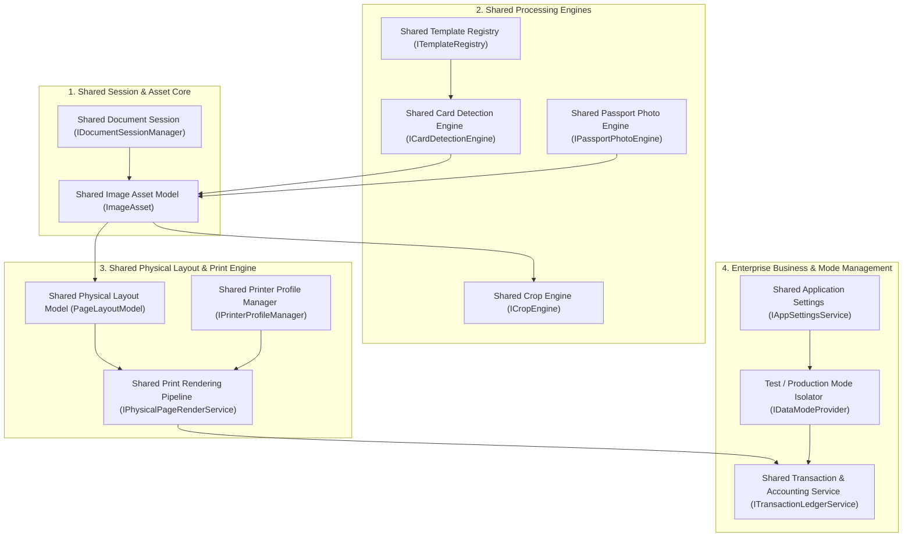

# PVC Studio Pro — Unified Architecture Proposal
**Clean-Room Enterprise Architecture: Shared State, Single Source of Truth & Zero Redundancy**

- **Date:** 2026-11-19
- **Auditor:** Senior Windows Desktop Systems & Print Engine Architect
- **Status:** Architectural Proposal (Phase 0 Design Baseline)

---

## 1. Architectural Philosophy: The Twelve Shared Pillars

To eliminate the duplication, state drift, and fragmented prototypes identified during the forensic audit, PVC Studio Pro must be re-anchored on **twelve authoritative shared subsystems**:



---

## 2. Specification of the Twelve Shared Subsystems

### Pillar 1: Shared Document Session (`IDocumentSessionManager`)
- **Role:** Holds the currently active file, decrypted streams, rasterized high-DPI page cache, and security status.
- **Contract:**
  ```csharp
  public interface IDocumentSessionManager
  {
      DocumentSessionState CurrentState { get; }
      event EventHandler<DocumentSessionChangedEventArgs> SessionChanged;
      Task<bool> OpenDocumentAsync(string filePath, string? password = null);
      void CloseSession();
      SKBitmap? GetPageBitmap(int pageIndex = 0, int dpi = 300);
      string? CurrentPassword { get; }
      bool IsEncrypted { get; }
      DocumentKind DetectedKind { get; set; }
      CardTemplate? ActiveTemplate { get; set; }
  }
  ```
- **Benefit:** When a document is loaded in the top toolbar or production workspace, every workspace (Production, Passport Photo, Batch, Designer) immediately accesses the identical in-memory session. Zero file re-reading or cache desynchronization.

### Pillar 2: Shared Image Asset Model (`ImageAsset`)
- **Role:** Encapsulates bitmap pixels, native DPI, millimeter dimensions, rotation angle, and color profile.
- **Contract:**
  ```csharp
  public class ImageAsset : IDisposable
  {
      public string AssetId { get; } = Guid.NewGuid().ToString("N");
      public SKBitmap Bitmap { get; private set; }
      public int Dpi { get; set; } = 300;
      public double WidthMm => (Bitmap.Width * 25.4) / Dpi;
      public double HeightMm => (Bitmap.Height * 25.4) / Dpi;
      public int RotationDegrees { get; set; }
      public bool IsLockedToCr80 { get; set; }
      public void NormalizeToCr80(int targetDpi = 600);
      public ImageAsset Clone();
  }
  ```

### Pillar 3: Shared Interactive Crop Engine (`ICropEngine`)
- **Role:** A single unified mathematical and interaction engine powering both in-place drawers and modal crop workflows.
- **Capabilities:**
  - Standard rectangular crop with locked aspect ratios (CR80: $85.60 \times 53.98$, Passport: $35 \times 45$, Freeform).
  - Perspective quadrilateral 4-point quad warp for mobile camera scans.
  - Smooth mouse-wheel zoom ($0.1\times$ to $5\times$) centered on cursor.
  - Interactive 8-point adorner bounding handles with live sub-pixel coordinates.
  - Immediate SkiaSharp bicubic rectification without intermediate disk writes.

### Pillar 4: Shared Template Registry (`ITemplateRegistry`)
- **Role:** Authoritative inventory of all 35 Indian identity and document templates matching `Real.db` and national specifications.
- **Capabilities:**
  - Multi-factor keyword matching with confidence scoring.
  - Visual aspect and geometry verification.
  - Allows the operator to manually override and pick any template from a categorized dropdown.

### Pillar 5: Shared Card Detection Engine (`ICardDetectionEngine`)
- **Role:** Replaces blind static pixel slicing with **adaptive confidence-based detection**.
- **Algorithm:**
  1. Sniff document keywords and OCR markers.
  2. If template matches with $>90\%$ confidence, fetch calibrated anchor coordinates.
  3. Execute OpenCV adaptive Canny thresholding + Hough line detection within a $\pm 15\text{ mm}$ search window around the anchor to locate the physical card cut-box.
  4. If card borders are found, snap crop boundaries to the real cutlines. If not, fallback safely to calibrated anchor defaults.
  5. Letterbox / pad cleanly to $85.60 \times 53.98\text{ mm}$ CR80 without stretching.

### Pillar 6: Shared Passport Photo Engine (`IPassportPhotoEngine`)
- **Role:** Implements ICAO 9303 compliant portrait processing.
- **Algorithm:**
  1. Detect face bounding box, eye centerlines, and chin base via OpenCV Haar/DNN.
  2. Center and scale portrait to enforce standard $70\%–80\%$ head coverage ($32\text{ mm}$ to $36\text{ mm}$).
  3. **Correct GrabCut Boundary:** Keep bottom margin at 0; mark bottom edge as Probable Foreground (`PR_FGD`) to eliminate the wavy edge artifact.
  4. Interactive face positioner allows operator to nudge head alignment.
  5. Solid color studio replacement (White, Off-White Grey, Passport Blue).

### Pillar 7: Shared Physical Page Layout Model (`PageLayoutModel`)
- **Role:** Single source of truth for physical paper and tray geometry.
- **Rule:** Every coordinate is expressed in millimeters. All items (front card, back card, passport photos, cut guides) are stored as `PageLayoutItem` instances in a single unified list.

### Pillar 8: Shared Print Rendering Pipeline (`IPhysicalPageRenderService`)
- **Role:** Executes identical SkiaSharp rendering across:
  - Screen preview canvas (fitted to window).
  - High-DPI rasterization for GDI+ spooling ($600\text{ DPI}$).
  - Vector PDF export (`SKDocument.CreatePdf`).
  - High-resolution PNG export.

### Pillar 9: Shared Printer Profile Manager (`IPrinterProfileManager`)
- **Role:** Discovers Windows print queues, stores printer-specific $X/Y$ offset calibrations, remembers default trays, and manages tray media profiles.

### Pillar 10: Shared Transaction & Accounting Service (`ITransactionLedgerService`)
- **Role:** Full commercial transaction management.
- **Capabilities:**
  - Create transaction with invoice ID (`INV-YYYYMMDD-XXXX`).
  - Edit transaction (adjust fee, change payment mode, update customer notes).
  - Record partial payments and track outstanding balance.
  - Void / cancel transaction with auditable reason.
  - Daily closing, cashier reconciliation, and CSV export.

### Pillar 11: Shared Application Settings (`IAppSettingsService`)
- **Role:** Application preferences, hardware defaults, theme, and language.

### Pillar 12: Test / Production Mode Isolator (`IDataModeProvider`)
- **Role:** Complete physical isolation between business accounting and test operations.

---

## 3. Existing Code Reuse, Refactoring, and Deprecation Matrix

| Existing Component | Planned Action | Rationale & Migration Strategy |
| :--- | :---: | :--- |
| `src/PVCStudioPro.Core/Models/PageLayoutModels.cs` | **RETAIN & EXPAND** | High quality millimeter layout model. Add `PassportPhoto` item kind and cut-line styling. |
| `src/PVCStudioPro.Core/Services/Implementations/PhysicalPageRenderService.cs` | **RETAIN & REFACTOR** | Proven 600 DPI rendering engine. Refactor to serve as the sole print pipeline for both cards and photos. |
| `src/PVCStudioPro.Core/Services/Implementations/TemplateService.cs` | **RETAIN & WIRE** | Contains 29 high-accuracy templates. Wire directly to `ProductionWorkspaceViewModel`. |
| `src/PVCStudioPro.Core/Services/Implementations/PdfService.cs` | **RETAIN** | Solid PDFium/Docnet implementation. Retain stream handling and password unlocking. |
| `src/PVCStudioPro.Core/Services/Implementations/CardDetectionService.cs` | **REFACTOR** | Replace static array slicing with adaptive Canny edge search + anchor fallbacks. |
| `src/PVCStudioPro.Core/Services/Implementations/VisionService.cs` | **REFACTOR** | Fix GrabCut bottom boundary condition; move portrait sheet composition to `PhysicalPageRenderService`. |
| `src/PVCStudioPro.Core/Services/Implementations/JobLedgerService.cs` | **REPLACE** | Replace insert-only SQL with comprehensive `TransactionLedgerService` supporting edits and test mode. |
| `src/PVCStudioPro.App/ViewModels/CropStudioViewModel.cs` | **MERGE** | Merge interactive zoom/pan/adorners into a reusable user control consumable across all workspaces. |
| `src/PVCStudioPro.App/ViewModels/DocumentDeskViewModel.cs` | **MERGE / DEPRECATE** | Redundant with `ProductionWorkspaceViewModel`. Consolidate document handling into the unified hero workspace. |
| `src/PVCStudioPro.App/ViewModels/PhotoStudioViewModel.cs` | **REFACTOR** | Connect to real `IPrintService` and unify sheet composition with `PageLayoutModel`. |
| `src/PVCStudioPro.App/ViewModels/ProductionWorkspaceViewModel.cs` | **REFACTOR** | Establish as the single unified production workspace, consuming the shared session, crop engine, and template registry. |
