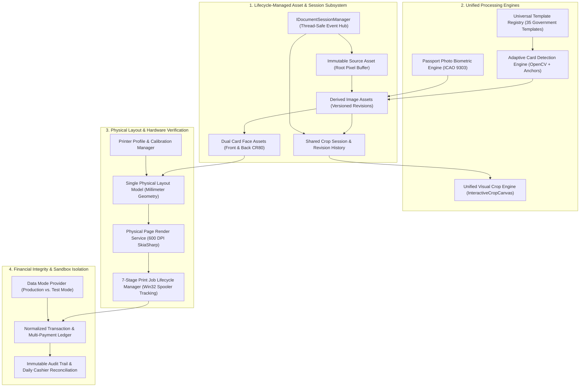
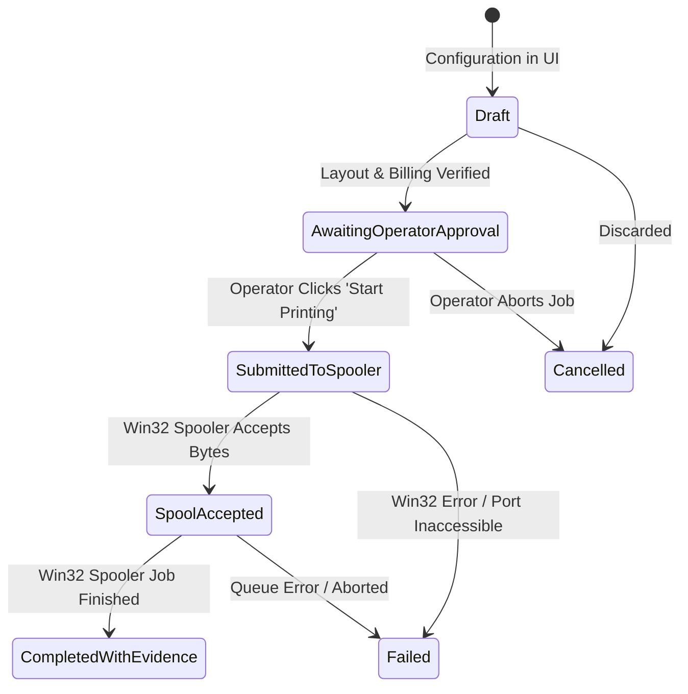
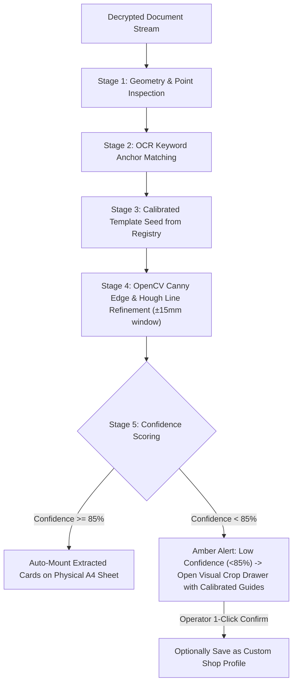

# PVC Studio Pro — Unified Architecture Proposal (Phase 0.1 Revised)
**Enterprise Desktop Architecture: Lifecycle-Managed Assets, Unified Crop Engine & Hardware-Verified Spooling**

- **Document:** `docs/UNIFIED_ARCHITECTURE_PROPOSAL.md`
- **Revision:** Phase 0.1
- **Date:** 2026-11-19
- **Auditor:** Senior Windows Desktop Systems & Print Engine Architect
- **Status:** Architectural Proposal (Awaiting Review & Phase 1 Authorization)

---

## 1. High-Level System Architecture



---

## 2. Shared Session & Asset Architecture (Deep Dive)

### 2.1 The Anti-Pattern of Mutable Singletons
A simplistic singleton containing raw mutable `SKBitmap` fields fails in desktop production:
- Memory corruptions occur when one thread rasterizes a preview while another thread applies a crop or rotation.
- If an operator crops an image, the original pixels are destroyed; undoing or adjusting the crop requires re-reading from disk.
- Workspaces stepping on each other: changing a setting in Crop Studio unintentionally mutates the active canvas in Production Studio.

### 2.2 The Immutable Source & Derived Asset Model
We introduce an explicit, reference-counted, thread-safe asset tree:

```mermaid
graph TD
    File["PDF or Image File on Disk"] -->|Decoded once via PDFium / Skia| ISA["SourceImageAsset (Immutable Root)"]
    ISA -->|Revision 0: Native Uncropped| DA0["DerivedImageAsset (Active Session Root)"]
    DA0 -->|Op: Adaptive Front Crop| DAF["DerivedImageAsset (Front Face Asset)"]
    DA0 -->|Op: Adaptive Back Crop| DAB["DerivedImageAsset (Back Face Asset)"]
    DAF -->|Op: Interactive Re-crop| DAF2["DerivedImageAsset (Front Rev 2)"]
    DAF2 -->|Op: Color Adjust (Brightness/Contrast)| DAF3["DerivedImageAsset (Front Rev 3 - Active)"]
```

#### Class Contract: `SourceImageAsset`
```csharp
public sealed class SourceImageAsset : IDisposable
{
    public string SourceId { get; } = Guid.NewGuid().ToString("N");
    public string OriginalFilePath { get; }
    public FileMagicKind FileKind { get; }
    public SKBitmap ImmutableBitmap { get; } // Read-Only Native Buffer
    public int NativeDpi { get; }
    public double PhysicalWidthMm => (ImmutableBitmap.Width * 25.4) / NativeDpi;
    public double PhysicalHeightMm => (ImmutableBitmap.Height * 25.4) / NativeDpi;
    public DateTime LoadedAtUtc { get; } = DateTime.UtcNow;

    private int _referenceCount = 1;
    public void Retain() => Interlocked.Increment(ref _referenceCount);
    public void Release()
    {
        if (Interlocked.Decrement(ref _referenceCount) == 0)
        {
            ImmutableBitmap.Dispose();
        }
    }
}
```

#### Class Contract: `DerivedImageAsset`
```csharp
public sealed class DerivedImageAsset : IDisposable
{
    public string RevisionId { get; } = Guid.NewGuid().ToString("N");
    public string ParentRevisionId { get; }
    public SourceImageAsset SourceRoot { get; }
    public SKBitmap Bitmap { get; }
    public ImageTransformPipeline AppliedTransforms { get; }
    public int Dpi { get; }
    public double WidthMm => (Bitmap.Width * 25.4) / Dpi;
    public double HeightMm => (Bitmap.Height * 25.4) / Dpi;
    public bool IsCr80Standard => Math.Abs(WidthMm - 85.60) < 0.2 && Math.Abs(HeightMm - 53.98) < 0.2;

    public DerivedImageAsset CreateDerivedRevision(
        SKBitmap newBitmap, 
        ImageTransformOperation operation, 
        int newDpi);
}
```

### 2.3 Shared Crop Session (`SharedCropSession`)
The crop session is a thread-safe state object shared across workspaces:
- Holds the active `CropBounds` (in millimeters and native pixels).
- Tracks `SelectedAspectRatio` (CR80, Passport, Freeform, Custom).
- Manages an internal `UndoRedoStack<CropBounds>` supporting at least 20 historical operations.
- Manages perspective quad corner coordinates (`Point2f[4]`).
- Exposes `IObservable<CropBoundsChangedEventArgs>` using clean MVVM event dispatching to the WPF UI thread (`Dispatcher.InvokeAsync`).

### 2.4 Cross-Workspace State Observation & Mutation Guardrails
- **The Observation Pattern:** When an operator loads an Aadhaar PDF in Production Studio, `IDocumentSessionManager` fires `SessionLoadedEvent`.
- **Workspace Isolation:** Each workspace (`ProductionStudioViewModel`, `CropStudioViewModel`, `PhotoStudioViewModel`) receives a **read-only projected view** of the session.
- **Explicit Commits:** If an operator opens the interactive crop drawer and edits crop bounds:
  - The changes exist in a private workspace `WorkingDraft` state.
  - The rest of the application (e.g. Center Canvas) does not alter its physical layout until the operator clicks `[Apply Crop]`.
  - Upon commit, `CommitRevisionAsync()` publishes the new `DerivedImageAsset` to the session hub, safely updating the physical canvas in one atomic operation.

---

## 3. Centralized Reusable Visual Crop Engine

### 3.1 Component Architecture (`InteractiveCropCanvas.xaml`)
Instead of duplicating crop UI across windows, a single WPF UserControl (`InteractiveCropCanvas`) is embedded into:
1. `ProductionWorkspaceView` (inside the in-place crop drawer).
2. `CropStudioView` (for full-screen advanced rectification).
3. `PhotoStudioView` (for custom portrait framing).

```
┌────────────────────────────────────────────────────────────────────────────────────────┐
│ InteractiveCropCanvas (Zoom: 125% | Pan: [X: 120, Y: -40] | Mode: CR80 Aspect Locked)  │
├────────────────────────────────────────────────────────────────────────────────────────┤
│                                                                                        │
│               [● Handle NW]          [■ Handle N]          [● Handle NE]               │
│                     ┌──────────────────────────────────────────┐                       │
│                     │                                          │                       │
│                     │   Interactive Card Bounding Box          │                       │
│                     │   85.60 x 53.98 mm (CR80)                │                       │
│                     │                                          │                       │
│         [■ Handle W]│              [+ Center Cross]            │[■ Handle E]           │
│                     │                                          │                       │
│                     │   Sub-pixel Skia Coordinates:            │                       │
│                     │   X: 210 px, Y: 2595 px                  │                       │
│                     │   W: 1045 px, H: 665 px                  │                       │
│                     └──────────────────────────────────────────┘                       │
│               [● Handle SW]          [■ Handle S]          [● Handle SE]               │
│                                                                                        │
│  [+] [-] [Fit to Window] [100% Zoom] | [Aspect: CR80 ▼] [Perspective Quad ☐] [Undo]   │
└────────────────────────────────────────────────────────────────────────────────────────┘
```

### 3.2 Interaction Capabilities:
- **Cursor-Centric Zoom:** Mouse wheel smoothly scales the canvas from $0.1\times$ to $5.0\times$ maintaining the mouse pointer's focus point.
- **Pan Navigation:** Middle-mouse drag or Spacebar+Left-Click pans the image smoothly.
- **8 Interactive Handles:** 4 corner handles (scaling with aspect-ratio preservation) + 4 edge handles (unconstrained adjustment).
- **Perspective Quad Warp:** Toggling perspective mode activates 4 independent corner pins, invoking OpenCV `WarpPerspective` for distorted mobile photos.
- **Two-Way Synchronized Inputs:** Dragging handles on screen immediately updates the numeric Millimeter / Pixel textboxes; conversely, typing exact millimeter offsets immediately snaps the handles.

---

## 4. Hardware-Verified Print Job Lifecycle Architecture

### 4.1 The 7-Stage Print Job State Machine
To guarantee commercial integrity, print jobs must traverse an explicit lifecycle verified against the Windows print spooler:



### 4.2 Win32 Spooler Verification Protocol
1. **Dispatched Stream:** `PrintService.cs` opens the printer queue via Win32 `OpenPrinterW` and sets `DEVMODEW`.
2. **Spool Acceptance:** Writes EMF/RAW print stream using `StartDocPrinter`, `StartPagePrinter`, `WritePrinter`, `EndPagePrinter`, `EndDocPrinter`. If `EndDocPrinter` returns true, status transitions to `SpoolAccepted`.
3. **Evidence Monitoring:** A background task polls `GetJob` or subscribes to Windows print queue WMI events (`Win32_PrintJob`). When the job leaves the queue without an error flag, status transitions to `CompletedWithEvidence`.
4. **Physical Failure Recovery:** If the driver reports an error (e.g. Paper Out, Paper Jam, Ribbon Error), the status transitions to `Failed`. The software presents the operator with options: `[Retry Spool]`, `[Switch Printer]`, or `[Cancel & Void Invoice]`.

---

## 5. Adaptive Identity Document Detection & Extraction Pipeline

### 5.1 Rejection of "100% Automatic" Claims
Real-world government documents have print offsets, margin displacement from scanner glass, and rotation errors. Claiming 100% unattended automation leads to silent truncation of citizen names and photos.

### 5.2 The 5-Stage Adaptive Detection Engine


### 5.3 Low-Confidence Graceful Fallback
If confidence is below 85% (e.g. skewed scan or non-standard margins):
- The software **never generates a wrongly cropped card silently**.
- An amber status pill is displayed: `⚠️ Low Detection Confidence (68%) — Please Confirm Card Bounds`.
- The in-place crop drawer opens automatically, centered on the best-guess coordinates with visible guides. The operator can confirm with 1 click (`Enter`) or nudge the handles before committing.

---

## 6. Comprehensive Template Registry & Reachability

Every template defined in Core must be **100% reachable and selectable** in the main Production Studio toolbar via a categorized dropdown:

| Template ID | Display Name | Category | Detection Method | Calibrated Dimensions (mm) | Variants Supported | Tested Status | Manual Override Supported? |
| :--- | :--- | :--- | :--- | :---: | :--- | :---: | :---: |
| `aadhaar_v2024` | UIDAI e-Aadhaar (Letter / Download) | Identity | Keywords + Geometry | $85.60 \times 53.98$ | Modern post-2022, 2018-2021 | Tested | Yes (Live Drawer) |
| `child_aadhaar` | Baal Aadhaar (Child / Blue) | Identity | Keywords + Anchor | $85.60 \times 53.98$ | Blue Child Aadhaar | Tested | Yes (Live Drawer) |
| `m_aadhaar` | mAadhaar Mobile Card | Identity | Keywords + Geometry | $85.60 \times 53.98$ | Mobile UIDAI app PDF | Tested | Yes (Live Drawer) |
| `pan_nsdl` | NSDL Income Tax PAN Card | Tax | Keywords + OCR | $85.60 \times 53.98$ | NSDL Form 49A / e-PAN | Tested | Yes (Live Drawer) |
| `pan_utiitsl` | UTIITSL Income Tax PAN Card | Tax | Keywords + OCR | $85.60 \times 53.98$ | UTIITSL e-PAN | Tested | Yes (Live Drawer) |
| `pan_instant` | Instant e-PAN (Income Tax Portal) | Tax | Keywords + Anchor | $85.60 \times 53.98$ | Instant 10-minute e-PAN | Tested | Yes (Live Drawer) |
| `voter_epic_v2` | Election Commission Voter ID (EPIC) | Identity | Keywords + Border | $85.60 \times 53.98$ | National Voter Portal PDF | Tested | Yes (Live Drawer) |
| `ayushman_pmjay` | Ayushman Bharat PM-JAY Golden Card | Health | Keywords + Colors | $85.60 \times 53.98$ | BIS 1.0 PM-JAY | Tested | Yes (Live Drawer) |
| `ayushman_new` | Ayushman Card (BIS 2.0 New Format) | Health | Keywords + Geometry | $85.60 \times 53.98$ | National Health Authority 2.0 | Tested | Yes (Live Drawer) |
| `abha_health_id` | ABHA Health ID Card (ABDM) | Health | Keywords + QR | $85.60 \times 53.98$ | Ayushman Digital Mission | Tested | Yes (Live Drawer) |
| `cm_insurance` | CMCHIS Comprehensive Health Card | Health | Keywords + Text | $85.60 \times 53.98$ | Tamil Nadu Amma / CM Card | Tested | Yes (Live Drawer) |
| `umid_railways` | Indian Railways UMID Medical Card | Health | Keywords + Logo | $85.60 \times 53.98$ | Railway Employee / Pensioner | Tested | Yes (Live Drawer) |
| `eshram_card` | e-Shram Universal Account Card | Labour | Keywords + UAN | $85.60 \times 53.98$ | Labour & Employment Portal | Tested | Yes (Live Drawer) |
| `pm_sym` | PM Shram Yogi Maan-dhan (PM-SYM) | Labour | Keywords + Text | $85.60 \times 53.98$ | PM-SYM Pension Card | Tested | Yes (Live Drawer) |
| `pm_kmy` | PM Kisan Maan-dhan Yojana (PM-KMY) | Labour | Keywords + Text | $85.60 \times 53.98$ | Agriculture Pension Card | Tested | Yes (Live Drawer) |
| `pf_insurance` | EPFO Member Identification Card | Labour | Keywords + MemberId | $85.60 \times 53.98$ | Provident Fund Member Card | Tested | Yes (Live Drawer) |
| `uan_card` | EPFO Universal Account Number Card | Labour | Keywords + UAN | $85.60 \times 53.98$ | EPFO Unified Portal Card | Tested | Yes (Live Drawer) |
| `e_pran` | NPS e-PRAN Card (PFRDA) | Pension | Keywords + PRAN | $85.60 \times 53.98$ | NSDL / CRA Pension Card | Tested | Yes (Live Drawer) |
| `udid_card` | Unique Disability ID (Swavlamban) | Welfare | Keywords + Medical | $85.60 \times 53.98$ | DEPwD Disability ID | Tested | Yes (Live Drawer) |
| `senior_citizen` | Senior Citizen Identity Card | Welfare | Keywords + Age | $85.60 \times 53.98$ | State Social Welfare Depts | Tested | Yes (Live Drawer) |
| `jan_aadhaar` | Rajasthan Jan-Aadhaar Card | State | Keywords + Rajasthani | $85.60 \times 53.98$ | Rajasthan Family ID | Tested | Yes (Live Drawer) |
| `pravasi_card` | Pravasi Bharatiya Card | State | Keywords + Passport | $85.60 \times 53.98$ | Non-Resident Indian Card | Tested | Yes (Live Drawer) |
| `vaccination_card`| Co-WIN Vaccination Certificate | Health | Keywords + Beneficiary| $85.60 \times 53.98$ | MoHFW Co-WIN QR Card | Tested | Yes (Live Drawer) |
| `tn_smart_ration` | Tamil Nadu Digital Smart Ration Card | Ration | Keywords + Family | $85.60 \times 53.98$ | TNPDS Civil Supplies Card | Tested | Yes (Live Drawer) |
| `kerala_ration` | Kerala Civil Supplies Digital Ration | Ration | Keywords + Malayalam | $85.60 \times 53.98$ | Civil Supplies Dept Kerala | Tested | Yes (Live Drawer) |
| `wb_ration` | West Bengal Digital Ration Card | Ration | Keywords + Bengali | $85.60 \times 53.98$ | Food & Supplies West Bengal | Tested | Yes (Live Drawer) |
| `parivahan_dl` | Indian Driving Licence (Form 7) | Transport | Keywords + Sarathi | $85.60 \times 53.98$ | MoRTH Sarathi Form 7 | Tested | Yes (Live Drawer) |
| `parivahan_rc` | Vehicle Registration Certificate (RC) | Transport | Keywords + Vahan | $85.60 \times 53.98$ | MoRTH Vahan Form 23 | Tested | Yes (Live Drawer) |
| `custom_cr80_generic`| Generic Dual-Face ID Card | Generic | Geometry Fallback | $85.60 \times 53.98$ | Corporate / Student / Club | Tested | Yes (Live Drawer) |
