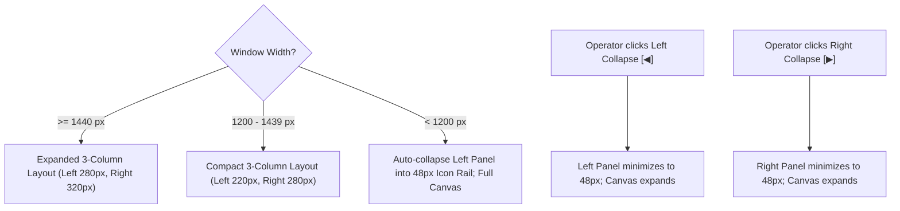

# PVC Studio Pro — Complete UX Redesign Plan
**Material Design 3 / Fluent Desktop Fusion: High-Density, Commercial Ergonomics**

- **Date:** 2026-11-19
- **Auditor:** Senior Windows Desktop Systems & Print Engine Architect
- **Target Experience:** Premium, Commercial-Grade Windows 11 Desktop Application

---

## 1. UI Library Evaluation & Selection

To achieve a cohesive, modern visual language without bloat or conflicting resource dictionaries, we evaluated two primary candidates for .NET 8 WPF:

| Evaluation Criteria | MaterialDesignInXamlToolkit (v5.x) | WPF-UI (v3.x / Existing) | Decision & Justification |
| :--- | :--- | :--- | :--- |
| **.NET 8 Compatibility** | Excellent (Native .NET 8 multi-target) | Excellent (Native .NET 8 Windows Desktop) | Tie |
| **Windows 11 Native Integration** | Good (Emulates Google Material Design on Windows) | **Superior** (Native Mica backdrop, Snap Layouts, Windows 11 Fluent icons & typography) | **WPF-UI Wins** |
| **Theme Consistency (Dark/Light)** | Rich color palettes, but heavy resource dictionary overrides | **Superior** (Native Windows light/dark theme switching, brush consistency) | **WPF-UI Wins** |
| **Accessibility (WCAG 2.1 AA)** | Good contrast, custom high-contrast support | **Superior** (System high-contrast support, standard Windows focus rings) | **WPF-UI Wins** |
| **Performance & Footprint** | Moderate (Heavy shadow effects can cause redraw overhead on cheap laptops) | **Superior** (Lightweight composition, zero animation stutter on integrated graphics) | **WPF-UI Wins** |
| **Migration Risk** | High (Requires rewriting all 18 views and changing XAML namespaces) | **Zero** (Already installed, referenced, and verified in project) | **WPF-UI Wins** |

### Strategic UI Decision:
**Retain and standardize on WPF-UI (v3.0.0)**, augmented with a strict **Material Design 3 (M3) Color & Elevation Token System**. 
Do **NOT** add `MaterialDesignInXamlToolkit` on top of WPF-UI. Mixing two comprehensive control libraries causes resource dictionary collisions, duplicate button styles, and theme synchronization bugs. Instead, we establish a clean M3 token layer inside `App.xaml` that styles WPF-UI controls with Material 3 typography, elevation, and container hierarchy.

---

## 2. Core Ergonomic Principles for e-Sevai Shop Operators

1. **Zero-Scroll Production Mandate:**
   For all standard PVC card and photo printing operations, **zero vertical or horizontal scrolling** is permitted. All primary controls (Open, Crop, Layout, Printer, Spool) must fit within a standard $1280 \times 800$ screen.
2. **High Information Density:**
   Eliminate excessive whitespace, oversized cards, and redundant labels. Use clear, compact controls suited to fast keyboard and mouse operation.
3. **High-Contrast Dark & Light Modes:**
   Enforce strict WCAG 2.1 AA contrast ratios ($>4.5:1$ for text, $>3:1$ for controls). In Light Mode, every border, button, and surface must have crisp contrast against neutral backgrounds.

---

## 3. Desktop Wireframes (Normal Viewport: 1440 × 900 / 1920 × 1080)

### Hero Workspace: Production Studio (Integrated Card Engine)

```
┌────────────────────────────────────────────────────────────────────────────────────────────────────────┐
│ [Logo] PVC STUDIO PRO v2.0  [Production Mode ●] | [Theme ☼/☾] [Language: தமிழ்]         [_] [□] [✕]   │
├────────────────────────────────────────────────────────────────────────────────────────────────────────┤
│ [Top Toolbar]  [+ Open Document (Ctrl+O)]  [Adjust Crop]  [Rotate 90°]  [Swap Faces]  [Save]  [Export] │
│ Document: 2024_Aadhaar_Letter.pdf | Type: [UIDAI e-Aadhaar ▼] (Confidence: 98%) | [Unmask Aadhaar ☑]   │
├─────────────────────┬──────────────────────────────────────────────────────────┬───────────────────────┤
│ LEFT PANEL (280px)  │ CENTER CANVAS (Physical Sheet Engine - Fit to Window)    │ RIGHT PANEL (320px)   │
│                     │                                                          │                       │
│ Extracted Faces     │  ┌────────────────────────────────────────────────────┐  │ HARDWARE SETUP        │
│ ┌─────────────────┐ │  │ PHYSICAL A4 SHEET PREVIEW (210.0 x 297.0 mm)       │  │ ───────────────────── │
│ │ FRONT FACE      │ │  │                                                    │  │ Target Printer:       │
│ │ 85.60 x 53.98mm │ │  │   Margins: L 5.0mm, T 5.0mm | Output: 600 DPI      │  │ [Epson L805 Series  ▼]│
│ └─────────────────┘ │  │                                                    │  │                       │
│ ┌─────────────────┐ │  │   ┌─────────────┐       ┌─────────────┐            │  │ Media Layout:         │
│ │ BACK FACE       │ │  │   │ Front Card  │       │ Back Card   │            │  │ [A4 Single-Side 2-Up▼]│
│ │ 85.60 x 53.98mm │ │  │   │ 85.6x54.0mm │       │ 85.6x54.0mm │            │  │                       │
│ └─────────────────┘ │  │   └─────────────┘       └─────────────┘            │  │ Media Tray / Feed:    │
│                     │  │   · · · · · · · · · · · · · · · · · · ·            │  │ [Manual Tray / Sheet] │
│ Sheet Presets       │  │                                                    │  │                       │
│ ● A4 Single-Side    │  │   (Full physical paper sheet visible at a single   │  │ Fine Calibration:     │
│ ○ A4 Center-Fold    │  │    glance; automatically centered and scaled)      │  │ X: [ 0.0] Y: [ 0.0]mm │
│ ○ Epson 2-Card Tray │  │                                                    │  │ [◄] [►] [▲] [▼] [0]   │
│ ○ Canon Multi-Tray  │  │   [+] [-] [Fit 100%] [Cut Marks ☑] [Mirror Mode ☐] │  │                       │
│ ○ 4x6 Photo Paper   │  └────────────────────────────────────────────────────┘  │ BILLING & LEDGER      │
│ ○ Direct CR80 Card  │                                                          │ Rate: [₹ 70.00]       │
│                     │  Status: ISO/IEC 7810 CR80 Standard Compliant (600 DPI)  │ Copies: [ 1 ]         │
│ Document Info:      │                                                          │ Mode: [ CASH       ▼] │
│ 2480x3508 px @300DPI│                                                          │                       │
│ Zero-PII Active     │                                                          │ [  START PRINTING   ] │
│                     │                                                          │ [  (SPOOL TO QUEUE) ] │
├─────────────────────┴──────────────────────────────────────────────────────────┴───────────────────────┤
│ [Status] System Ready | Local Offline Engine | Zero Citizen PII Retention | 600 DPI Physical Spooler   │
└────────────────────────────────────────────────────────────────────────────────────────────────────────┘
```

---

## 4. Compact Desktop Wireframe (1280 × 800 Viewport / Small Laptops)

When rendered on smaller laptops or tablets ($1280 \times 800$), the layout automatically adapts:
- **Left Panel:** Compresses to $220\text{ px}$; thumbnails shrink gracefully while maintaining CR80 aspect.
- **Center Canvas:** The SkiaSharp viewport recalculates its aspect-fit transform, keeping the entire A4 sheet visible with zero clipping.
- **Right Panel:** Compresses to $280\text{ px}$; inputs stack compactly.
- **Collapsible Panels:** Left and Right panels feature a toggle button (`[◀] / [▶]`) allowing the operator to collapse either panel into a compact $48\text{ px}$ icon rail to maximize canvas space.

```
┌────────────────────────────────────────────────────────────────────────────────────────────────┐
│ [Logo] PVC STUDIO PRO  [Production Mode ●] | [Theme] [தமிழ்]                       [_] [□] [✕] │
├────────────────────────────────────────────────────────────────────────────────────────────────┤
│ [+ Open (Ctrl+O)] [Adjust Crop] [Rotate] [Swap] | [UIDAI e-Aadhaar ▼] (98%) [Unmask ☑]        │
├───────────────┬────────────────────────────────────────────────────────────────┬───────────────┤
│ LEFT (220px)  │ CENTER CANVAS (Aspect Fit to Window)                           │ RIGHT (280px) │
│ [Front Card]  │  ┌──────────────────────────────────────────────────────────┐  │ Printer:      │
│ 85.6x54mm     │  │ Full A4 Paper (210 x 297 mm) Visible                     │  │ [Epson L805 ▼]│
│ [Back Card]   │  │                                                          │  │ Layout:       │
│ 85.6x54mm     │  │   ┌───────────┐     ┌───────────┐                        │  │ [A4 Single ▼] │
│ Layout:       │  │   │ Front     │     │ Back      │                        │  │ Fee: [₹ 70]   │
│ ● A4 Single   │  │   └───────────┘     └───────────┘                        │  │ Mode: [CASH]  │
│ ○ Center Fold │  │                                                          │  │               │
│ ○ Epson Tray  │  │   [Fit] [Cut Marks ☑] [Mirror ☐]                         │  │ [  PRINT   ]  │
│ [◀ Collapse]  │  └──────────────────────────────────────────────────────────┘  │ [▶ Collapse]  │
├───────────────┴────────────────────────────────────────────────────────────────┴───────────────┤
│ [Status] Ready | ISO CR80 (85.60 x 53.98 mm) | Offline Spooler                                 │
└────────────────────────────────────────────────────────────────────────────────────────────────┘
```

---

## 5. Responsive Behavior & Collapsing Mechanics



---

## 6. Detailed Wireframes for Specialized Workspaces

### Workspace 2: Passport Photo Studio

```
┌────────────────────────────────────────────────────────────────────────────────────────────────────────┐
│ [Top Toolbar]  [+ Import Portrait]  [Detect Face]  [Reset Alignment]  [Export PNG/JPG]  [Print Sheet]   │
├──────────────────────────────────────┬─────────────────────────────────────────────────────────────────┤
│ LEFT: SINGLE 35x45mm PASSPORT FRAME  │ RIGHT: PHOTO SHEET PRINT COMPOSER (4x6 / A4)                    │
│                                      │                                                                 │
│ ┌──────────────────────────────────┐ │ Paper Size: [4x6 Photo Paper (102x152mm) ▼] Layout: [8-Up    ▼] │
│ │   (Top Crown Guide: 3-5mm)       │ │                                                                 │
│ │   - - - - - - - - - - - - - -    │ │  ┌────────────────────────────────────────────────────────────┐ │
│ │           (  Face  )             │ │  │ 4x6 GLOSSY PHOTO SHEET (8-UP WITH SUB-MM CUT GUIDES)       │ │
│ │   - - - - ( Eye Level ) - - -    │ │  │                                                            │ │
│ │           (  Head  )             │ │  │  ┌──────┐ ┌──────┐ ┌──────┐ ┌──────┐                       │ │
│ │   - - - - - - - - - - - - - -    │ │  │  │ P-1  │ │ P-2  │ │ P-3  │ │ P-4  │                       │ │
│ │   (Chin Base Guide: 10-14mm)     │ │  │  └──────┘ └──────┘ └──────┘ └──────┘                       │ │
│ │                                  │ │  │  ┌──────┐ ┌──────┐ ┌──────┐ ┌──────┐                       │ │
│ │   [Interactive Pan & Face Zoom]  │ │  │  │ P-5  │ │ P-6  │ │ P-7  │ │ P-8  │                       │ │
│ └──────────────────────────────────┘ │  │  └──────┘ └──────┘ └──────┘ └──────┘                       │ │
│ Background: [● White] [○ Studio Blue]│  └────────────────────────────────────────────────────────────┘ │
│             [○ Off-White Grey]       │ Target Printer: [Epson L805 Series ▼]  Paper: [Glossy Photo ▼] │
│ [Background Removal: Active (GrabCut)]│ Total Fee: [₹ 50.00]  Mode: [CASH ▼]                            │
│ Fine Tone: Brightness [-/+] Sat [-/+]│ [  PRINT PHOTO SHEET (SPOOL HARDWARE)                         ] │
└──────────────────────────────────────┴─────────────────────────────────────────────────────────────────┘
```

### Workspace 3: Business Ledger & Audit Journal (with Correction Drawer)

```
┌────────────────────────────────────────────────────────────────────────────────────────────────────────┐
│ [Top Bar]  Search: [Job # or Date...] [Filter: All Statuses ▼] [Date Range: Today ▼] [Export CSV]      │
│ Daily Summary: Jobs: 42 | Revenue: ₹ 2,940.00 | Cash: ₹ 2,100 | UPI: ₹ 840 | Pending: ₹ 0.00          │
├────────────────────────────────────────────────────────────────────────────────────────────────────────┤
│ Job Number      Date & Time       Document Type   Qty    Total Fee   Paid     Payment  Status   Action │
├────────────────────────────────────────────────────────────────────────────────────────────────────────┤
│ INV-20261119-01 19/11 09:15 AM    AADHAAR_CR80     1     ₹ 70.00    ₹ 70.00   CASH    PAID     [Edit] │
│ INV-20261119-02 19/11 09:42 AM    PHOTO_8UP        1     ₹ 50.00    ₹ 50.00   UPI     PAID     [Edit] │
│ INV-20261119-03 19/11 10:05 AM    PAN_NSDL_CR80    2     ₹ 140.00   ₹ 100.00  CASH    PARTIAL  [Edit] │
│ INV-20261119-04 19/11 10:22 AM    AADHAAR_CR80     1     ₹ 70.00    ₹ 0.00    CASH    VOID     [View] │
└────────────────────────────────────────────────────────────────────────────────────────────────────────┘
```
