# PVC Studio Pro — Architecture & Component Map

This map outlines the structural boundaries, dependency flow, and interaction protocols across all major subsystems in **PVC Studio Pro**.

```mermaid
graph TD
    subgraph UI ["Presentation Layer (lib/presentation / WPF XAML)"]
        ShellView["ShellWindow (WPF UI Mica Backdrop)"]
        Nav["NavigationView (Sidebar & Topbar)"]
        CardPrintView["CardPrintView (Front/Back Canvas Preview)"]
        PhotoStudioView["PhotoStudioView (AI Matting & Multi-Up)"]
        DesignerView["CardDesignerView (Drag-and-Drop Elements)"]
        CalibrateView["CalibrationView (Interactive Millimeter Ruler)"]
        LedgerView["BusinessLedgerView (Daily Register & Receipts)"]
    end

    subgraph ViewModels ["MVVM ViewModels (CommunityToolkit.Mvvm)"]
        ShellVM["ShellViewModel"]
        CardPrintVM["CardPrintViewModel"]
        PhotoStudioVM["PhotoStudioViewModel"]
        DesignerVM["CardDesignerViewModel"]
        CalibrateVM["CalibrationViewModel"]
        LedgerVM["BusinessLedgerViewModel"]
    end

    subgraph Services ["Application Service Layer (lib/services)"]
        PrintService["PrintService (Windows XPS / Direct2D Spooler)"]
        PdfService["PdfService (Google PDFium Native Wrapper)"]
        VisionService["VisionService (OpenCVSharp4 Contour/Warp)"]
        AiPhotoService["AiPhotoService (ONNX Runtime Local Neural Segmentation)"]
        TemplateService["TemplateService (JSON Schema Registry)"]
        LedgerService["LedgerService (SQLite / Dapper Accounting)"]
        SecurityService["SecurityService (DPAPI & Memory Shredder)"]
    end

    subgraph Data ["Data & Storage Layer (lib/data)"]
        SQLiteDB[("SQLite Database (pvc_studio.db)")]
        TemplateStore[("Template Repository (templates.json)")]
        HardwareDrivers["Windows Print Driver Spooler (Epson / Canon)"]
    end

    UI --> ViewModels
    ViewModels --> Services
    Services --> Data
```

---

## 1. Subsystem Interaction Protocols

### 1.1 Document Ingestion to Print Spooler Pipeline
1. `CardPrintView` triggers `CardPrintViewModel.LoadDocumentCommand(filePath)`.
2. `CardPrintViewModel` calls `PdfService.OpenDocument(stream, password)`.
3. `PdfService` utilizes native `PDFium` to rasterize vector geometry at 600 DPI into high-performance `ImageSharp` surfaces.
4. `TemplateService` retrieves the bounding boxes for the selected card type (e.g. `Aadhaar-2024`).
5. `CardPrintViewModel` renders the composite Front/Back card preview.
6. Upon clicking "Print", `PrintService.DispatchJob(profile, frontImage, backImage)` formats the canvas to the selected tray dimensions (Epson CD/DVD, Canon multi-tray, or CR80 edge-to-edge) and transmits raw XPS drawing instructions to the Windows Print Spooler.
7. Upon print job completion, `LedgerService.RecordJob(jobItem)` commits the transaction to `pvc_studio.db` and `SecurityService.WipeMemory(stream)` zeroizes all in-memory raster buffers.

### 1.2 Local AI Photo Studio Pipeline
1. `PhotoStudioViewModel.LoadPhotoCommand(imagePath)` loads customer photo into memory.
2. `AiPhotoService.RemoveBackgroundAsync(image)` pre-processes the image into a float tensor, passes it to the quantized `birefnet-portrait.onnx` model via `Microsoft.ML.OnnxRuntime`, and receives an 8-bit alpha mask.
3. `ImageSharp` composites the alpha mask against the selected background color (White `#FFFFFF`, Light Blue `#A0C4FF`, or Custom).
4. `PhotoStudioViewModel` generates a 4×6 photo sheet (6 or 8 copies) with 0.5pt light-gray cutting guidelines.
5. Job dispatched to photo paper print queue.
