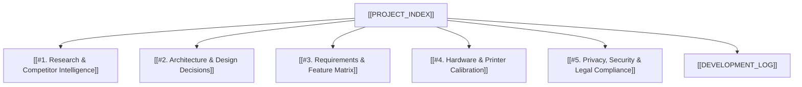

# PVC Studio Pro — Master Knowledge Base Index

Welcome to the centralized engineering and architectural knowledge base for **PVC Studio Pro**, a professional Windows desktop PVC card production suite designed for daily commercial operation in Indian e-Sevai centres and cyber cafés.

> [!NOTE] Purpose of this Knowledge Base
> This repository connects requirements, architectural decisions, hardware calibration profiles, reverse-engineering findings, competitor research, and technical implementations using [[Obsidian Flavored Markdown]] with graph connectivity enabled by Graphify.

---

## 1. Quick Navigation Hub

---

## 2. Document Graph Directory

### 2.1 Research & Competitor Intelligence
- [[research/REVERSE_ENGINEERING_REPORT|Reverse Engineering Report: Real PVC Card Pro]] — Detailed teardown of the existing software, GDI+ limitations, and coordinate fragility.
- [[research/ORIGINAL_APP_SCREEN_INVENTORY|Original Application Screen Inventory]] — Catalog of all screens, dialogs, and controls.
- [[research/ORIGINAL_APP_WORKFLOWS|Original Application Workflows]] — Step-by-step user workflows for Aadhaar, PAN, and Photo Studio.
- [[research/ORIGINAL_APP_FEATURE_MATRIX|Original Application Feature Matrix]] — Detailed capabilities and shortcomings of the incumbent product.
- [[research/ORIGINAL_APP_LIMITATIONS|Original Application Limitations]] — Detailed technical and business flaws.
- [[research/MARKET_RESEARCH|Market Research]] — Indian digital identity landscape, e-Sevai business economics, and tray printing hardware.
- [[research/COMPETITOR_ANALYSIS|Competitor Analysis]] — In-depth analysis of Real PVC Card Pro, PVC2Print, Print Perfect AI, Easy Crop, IDGenius Pro, and PVC Easy Print.
- [[research/COMPETITOR_FEATURE_MATRIX|Competitor Feature Matrix]] — Side-by-side comparison across 30+ capabilities.
- [[research/COMPETITOR_PRICING|Competitor Pricing Models]] — Analysis of annual subscriptions, token models, and customer costs.
- [[research/USER_PAIN_POINTS|User Pain Points]] — Top 10 real-world complaints from shop owners and operators.
- [[research/PRODUCT_OPPORTUNITY_ANALYSIS|Product Opportunity Analysis]] — Strategic differentiation and value proposition pillars.
- [[research/RESEARCH_SOURCE_REGISTER|Research Source Register]] — Verified source registry.

### 2.2 System Architecture & Design Records
- [[ARCHITECTURE_MAP|Architecture Map]] — Visual and functional component relationship map.
- [[docs/SYSTEM_ARCHITECTURE|System Architecture]] — Presentation, Core Services, and Data Layer specifications.
- [[docs/TECHNOLOGY_DECISIONS|Technology Decisions]] — Framework and library selection rationale.
- [[docs/DATABASE_SCHEMA|Database Schema]] — SQLite entity-relationship diagram and DDL tables.
- [[docs/DEPENDENCY_REGISTER|Dependency Register]] — Permissive Software Bill of Materials (SBOM).
- [[docs/ADR/ADR-001-ui-framework-wpf-vs-winui3|ADR-001: WPF .NET 9 vs WinUI 3]] — Justification of WPF for specialized tray printing.
- [[docs/ADR/ADR-002-pdf-engine-selection|ADR-002: Google PDFium Selection]] — High-resolution vector PDF rendering.
- [[docs/ADR/ADR-003-image-processing-and-cv|ADR-003: OpenCVSharp4 and Local ONNX AI]] — Local AI segmentation and perspective rectification.
- [[docs/ADR/ADR-004-local-sqlite-and-privacy|ADR-004: SQLite with DPAPI Encryption]] — Privacy-first persistent data storage.

### 2.3 Product Requirements & Planning
- [[docs/PRODUCT_VISION|Product Vision]] — Core vision and naming evaluation.
- [[docs/PRD|Product Requirements Document (PRD)]] — User personas and module definitions.
- [[docs/SRS|Software Requirements Specification (SRS)]] — IEEE 830 functional and non-functional requirements.
- [[docs/FEATURE_MATRIX|Master Feature Matrix]] — Unified inventory of all features.
- [[docs/DEVELOPMENT_ROADMAP|Development Roadmap]] — Phased implementation plan and gating checkpoints.

### 2.4 Privacy & Regulatory Compliance
- [[docs/SECURITY_AND_PRIVACY|Security & Privacy Architecture]] — Zero-knowledge local execution and in-memory shredding.
- [[docs/INDIA_REGULATORY_RESEARCH|Indian Regulatory Research]] — DPDP Act 2023 and UIDAI Aadhaar masking directives.

---

> [!TIP] Obsidian Graph Navigation
> All documents in this repository are linked via bidirectional wikilinks. When opened in Obsidian, the interactive Graph View displays the entire network of relationships between business requirements, software architecture, and hardware components.
