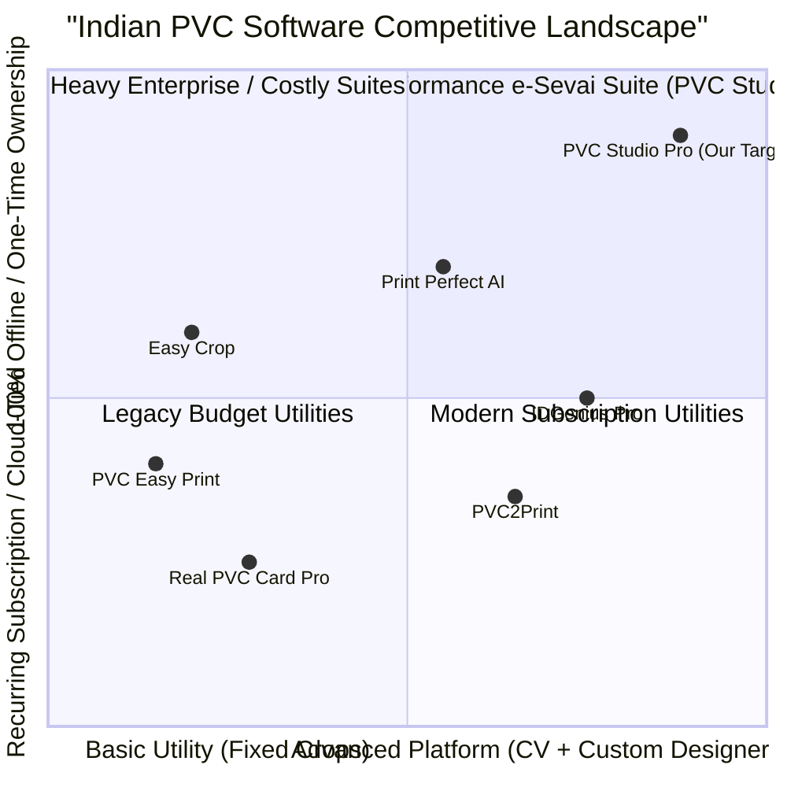

# Competitor In-Depth Analysis — Indian PVC Card Software Market

**Analysis Date:** 2026-11-18  
**Scope:** In-depth technical, functional, and pricing evaluation of the 6 major market competitors  

---

## 1. Competitor Profiles

### 1.1 Real PVC Card Pro (Real Softwares)
- **Website:** https://realsoftwares.in/pvc_card_pro/
- **Architecture:** Windows Forms, .NET Framework 4.5+, GDI+ rendering.
- **Strengths:**
  - Highly recognized brand among Tamil Nadu and South Indian e-Sevai operators.
  - Pre-configured tray settings for Epson L805 and Canon.
  - Simple, dedicated buttons for primary Indian cards (Aadhaar, PAN, Voter, Ayushman).
- **Weaknesses:**
  - Hardcoded crop coordinates that break when government PDF headers change.
  - Aggressive annual machine-locked subscription (₹500/yr).
  - Rudimentary background removal (chromakey flood-fill).
  - No business ledger, customer history, or multi-language interface.
  - Poor vector rendering; rasterizes at fixed low DPI.

### 1.2 PVC2Print (pvc2print.com)
- **Website:** https://pvc2print.com / Microsoft Store
- **Architecture:** Modernized Windows desktop application / WebView2 hybrid.
- **Strengths:**
  - Distributed via Microsoft Store and direct installer.
  - Clean UI compared to legacy WinForms apps.
  - Good support for newly issued central government schemes (ABHA, e-Shram, Vaccine Certificates).
  - Offers cloud backup of templates.
- **Weaknesses:**
  - Push towards cloud sync introduces latency and data privacy questions.
  - Pay-per-credit or annual token model can become expensive for high-volume shops.
  - Requires internet connection for license validation on launch.

### 1.3 Print Perfect AI (printperfectai / PVC Print Software)
- **Website:** https://pvcprintsoftware.in
- **Architecture:** Windows utility with bundled Python/C++ vision modules.
- **Strengths:**
  - Claims "AI-assisted cropping" to handle scanned or slightly misaligned cards.
  - Offers 300 to 900 DPI upscaling/enhancement.
  - Strong emphasis on 100% offline data security.
- **Weaknesses:**
  - Cluttered, dated visual layout reminiscent of Windows XP/7.
  - Installation is heavy (bundles large dependencies).
  - High initial license cost (₹1,500 to ₹2,500 for lifetime keys).
  - Poor documentation and erratic updates.

### 1.4 PVC Cropper Studio / Easy Crop (Team Astha / Astha Tech)
- **Website:** https://yourastha.in
- **Architecture:** C# desktop utility focused on rapid auto-cropping.
- **Strengths:**
  - Extremely lightweight executable; starts in under 2 seconds.
  - Strong community presence on YouTube (Hindi tutorial market).
  - Excellent support for Dragon Sheet (mirror lamination) workflows.
- **Weaknesses:**
  - Very limited feature set: purely a cropper without a true photo studio, card designer, or business ledger.
  - Minimal calibration tooling for non-standard trays.
  - No automated customer management or reporting.

### 1.5 IDGenius Pro (idgeniuspro.in)
- **Website:** https://idgeniuspro.in
- **Architecture:** Full-featured Windows ID card design and print suite.
- **Strengths:**
  - Supports both government ID cards and custom institutional cards (School, College, Corporate ID).
  - Database import from Excel/CSV for batch card generation.
  - Barcode and QR code generation engine.
- **Weaknesses:**
  - Steep learning curve: complex interface that overwhelms basic e-Sevai operators looking for a 1-click print.
  - Expensive commercial license.
  - Overly generic; lacks specialized quick shortcuts for regional Indian state portals (e.g., TN e-PDS Smart Ration, Patta Chitta).

### 1.6 PVC Easy Print / VLE Club Utilities
- **Website:** Various VLE community portals (vleclub.in, datascienceiq.in)
- **Architecture:** Script-based wrappers or basic Visual Basic/.NET wrappers around PDFium/Ghostscript.
- **Strengths:**
  - Extremely cheap or shared among VLE Telegram groups.
  - Minimalist.
- **Weaknesses:**
  - Fragile, unmaintained, and often flagged as false-positives by Windows Defender due to obscure packers.
  - High risk of data loss and system instability.
  - Zero support or calibration diagnostics.

---

## 2. Competitive Landscape Synthesis

