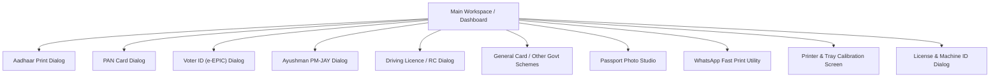

# Original Application Screen Inventory — Real PVC Card Pro

**Target Application:** Real PVC Card Pro (Real Softwares)  
**Analysis Date:** 2026-11-18  
**Reference Sources:** Official Real Softwares user manuals, video training materials, and e-Sevai operator feedback  

---

## 1. Overview of Screen Hierarchy

Real PVC Card Pro utilizes a classic Windows Forms MDI / tabbed dialog architecture. The application is centered around a primary dashboard toolbar that launches modal and non-modal utility dialogs.

---

## 2. Detailed Screen Specifications

### Screen 1: Main Workspace / Dashboard
- **Layout:** Top toolbar with prominent colorful icons for each document type, a central document preview pane, right-side print configuration controls, and a bottom status bar.
- **Controls & Elements:**
  - *Document Type Buttons:* Aadhaar, PAN, Voter ID, Ayushman, Driving Licence, e-Shram, Jan Aadhaar, Custom Card.
  - *Utility Buttons:* Passport Photo Maker, WhatsApp Tool, Printer Setup, Calibration, License Info.
  - *Central Canvas:* Displays loaded card front (Card 1) and back (Card 2) side-by-side.
  - *Quick Action Bar:* Rotate Left, Rotate Right, Enhance Contrast, Zoom In/Out, Clear Canvas.
  - *Print Sidebar:* Printer selector dropdown, Tray type selector (Tray 1/2/Manual), Copies counter, "PRINT NOW" primary button.

### Screen 2: Aadhaar Card Processing Modal
- **Trigger:** Clicking "Aadhaar Card" button.
- **Inputs & Fields:**
  - File picker: Open `.pdf` file.
  - Password Input: Password text box with auto-generated hint: *"First 4 letters of name in capital + Year of birth (e.g. VIGN1990)"*.
  - Aadhaar Version Toggle: "New UIDAI Layout (2023-2024)" vs "Old UIDAI Layout (Pre-2023)".
  - Mask Option: "Mask Aadhaar Number" checkbox (attempts to overlay black/white strip over first 8 digits).
- **Actions:** "Load Document", "Auto Crop", "Cancel".
- **Output:** Transferred onto Main Workspace preview canvas.

### Screen 3: PAN Card Processing Modal
- **Trigger:** Clicking "PAN Card" button.
- **Inputs & Fields:**
  - File picker: Open NSDL or UTIITSL PDF.
  - Provider Radio Buttons: `(o) NSDL` `( ) UTIITSL`.
  - Password field (typically Date of Birth in `DDMMYYYY` format).
  - High Quality Render checkbox (300 DPI vs 600 DPI).
- **Actions:** "Crop & Align", "Cancel".

### Screen 4: Voter ID (e-EPIC) Modal
- **Trigger:** Clicking "Voter ID" button.
- **Inputs & Fields:**
  - File picker: Open e-EPIC PDF from voters.eci.gov.in.
  - Format Selector: `(o) New 2-Page / Horizontal` `( ) Old Vertical Layout`.
  - Signature enhance checkbox (binarize signature).
- **Actions:** "Generate PVC", "Cancel".

### Screen 5: Passport Photo Studio Dialog
- **Trigger:** Clicking "Passport Photo" icon.
- **Inputs & Fields:**
  - Image load: JPEG/PNG/BMP input.
  - Preset Selector: Indian Passport (35×45 mm), Stamp Size (20×25 mm), US Visa (50×50 mm), Custom.
  - Manual Cropping Box: Aspect-ratio locked box over customer photo.
  - Background Replacement Panel:
    - Color picker: Solid White, Light Blue, Dark Blue, Gray, Custom Color.
    - Tolerance slider (chromakey threshold for flood-fill).
  - Photo Sheet Configuration:
    - 4×6 Sheet: 6 photos (2×3) or 8 photos (2×4).
    - A4 Sheet: 32 photos (4×8) or custom grid.
  - Adjustments: Brightness, Contrast, Saturation sliders.
- **Actions:** "Apply BG", "Generate Sheet", "Save Image", "Direct Print".

### Screen 6: WhatsApp Print Utility
- **Trigger:** Clicking "WhatsApp Print" button.
- **Inputs & Fields:**
  - WhatsApp Media Folder Browser (points to user's WhatsApp desktop download directory).
  - Thumbnail gallery of recently received customer images.
  - Instant Crop Preset buttons: "Crop as Card Front", "Crop as Card Back", "Crop as Passport Photo".
  - Quick Print button with predefined printer profile.

### Screen 7: Printer & Tray Calibration Wizard
- **Trigger:** Clicking "Settings" -> "Printer Calibration".
- **Inputs & Fields:**
  - Target Printer: Epson L805 / L8050 / L18050 / Canon G570 / Generic.
  - Paper Tray Mode: `CD/DVD Tray` or `Rear Paper Feed (PVC Sheets)`.
  - Calibration Controls:
    - Horizontal Shift (X): numeric up-down control (in mm / ±10 mm range).
    - Vertical Shift (Y): numeric up-down control (in mm / ±10 mm range).
    - Card 2 Gap (Distance between Card 1 and Card 2): numeric up-down control.
    - Card Dimensions: Fixed width 85.6 mm, Height 53.98 mm, Border radius 3.18 mm.
  - Test Print Button: Prints calibration grid with millimeter rulers onto plain paper cut to tray size.
- **Actions:** "Save Profile", "Print Test Page", "Reset Defaults".

### Screen 8: Machine ID & Activation Dialog
- **Trigger:** App startup if unlicensed, or "About / License" menu.
- **Inputs & Fields:**
  - Read-only Machine ID string (hardware hash).
  - "Copy Machine ID" button.
  - "Send via WhatsApp" button (launches `wa.me` URL to vendor phone number).
  - Activation Key text input.
  - "Activate" button.
- **License Status Display:** Days remaining counter (e.g. "365 Days Remaining", "Expired").
