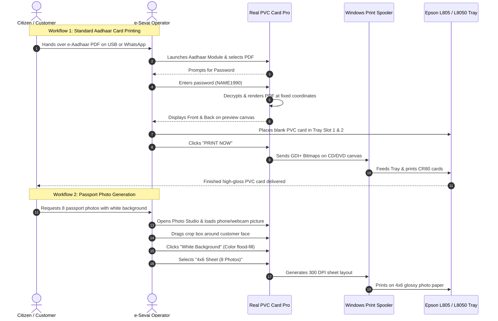

# Original Application Workflows — Real PVC Card Pro

**Target Application:** Real PVC Card Pro  
**Operating Context:** e-Sevai Maiyam (Karur, Tamil Nadu)  
**Date:** 2026-11-18  

---

## 1. Primary Operational Workflows

---

## 2. Detailed Step-by-Step Workflows

### 2.1 Workflow 1: e-Aadhaar PDF to PVC Card
1. **Source:** Citizen downloads e-Aadhaar PDF from UIDAI website or forwards it via WhatsApp.
2. **File Selection:** Operator clicks "Aadhaar Card" on toolbar. File dialog opens.
3. **Password Entry:** Prompt asks for password. Operator derives it from the customer's name and birth year.
4. **Extraction:**
   - Software decrypts the PDF into a temporary raster image.
   - Fixed crop rectangles extract the front identity portion (Name, DOB, Gender, Photo, Aadhaar Number, Hologram).
   - Fixed crop rectangles extract the back address portion (Address in English & Tamil/Regional, QR code, Helpline).
5. **Layout Assembly:** The two extracted halves are placed side-by-side on an Epson CD/DVD tray canvas layout.
6. **Preview Inspection:** Operator checks visually whether text lines are aligned.
7. **Tray Loading:** Operator inserts PVC tray into printer with 2 blank CR80 PVC cards.
8. **Print Execution:** Operator hits Print. Job is dispatched to Epson driver.

### 2.2 Workflow 2: PAN Card (NSDL / UTIITSL) Printing
1. **Source:** e-PAN received via email or downloaded from NSDL/UTIITSL portal.
2. **Password Decryption:** NSDL uses Date of Birth (`DDMMYYYY`) as PDF password.
3. **Cropping:** Software isolates the lower card rectangle, separating the front and back sections.
4. **Contrast Adjustment:** Minor brightness enhancement to ensure father's name and signature are legible.
5. **Print Submission:** Sent to tray printer.

### 2.3 Workflow 3: Passport Photo Creation & Background Replacement
1. **Capture/Import:** Customer photo taken via camera or sent via WhatsApp.
2. **Load Image:** Image imported into Photo Studio.
3. **Face Cropping:** Operator frames the face according to Indian passport specifications (70-80% face coverage).
4. **Background Removal:** Operator selects background replacement mode. Software attempts color keying against existing wall/backdrop.
5. **Color & Lighting:** Quick brightness/contrast adjustments.
6. **Sheet Selection:** Operator picks 4×6 photo paper (6, 8, or 12 copies) or A4 paper.
7. **Cut Guides:** Software optionally overlays light gray hairline cut-guides between photos.
8. **Print:** Output sent to photo paper tray.

### 2.4 Workflow 4: Tray & Printer Offset Calibration
1. **Problem:** Inkjet tray feeds have mechanical tolerances (±0.5 mm to ±1.5 mm drift between printers).
2. **Test Pattern:** Operator clicks "Print Test Pattern".
3. **Measurement:** A test grid with millimeter markers (X-axis 1-10, Y-axis 1-10) is printed on paper cut to tray size.
4. **Offset Correction:** Operator inspects where the card border falls. If printed 1 mm too far right and 0.5 mm too low:
   - Sets X-Offset = `-1.0 mm`.
   - Sets Y-Offset = `-0.5 mm`.
5. **Save:** Profile saved in registry/local configuration file.
