# Product Opportunity Analysis — PVC Studio Pro

**Objective:** Transform market gaps and competitor failures into a definitive market-leading Windows application  
**Date:** 2026-11-18  

---

## 1. Value Proposition Pillars

PVC Studio Pro will outperform Real PVC Card Pro and its competitors across five foundational pillars:

```mermaid
graph TD
    A["PVC Studio Pro"] --> B["1. Production Precision & Quality"]
    A --> C["2. AI & Computer Vision Intelligence"]
    A --> D["3. e-Sevai Business Enablement"]
    A --> E["4. Data Privacy & Zero Lockout"]
    A --> F["5. Operator Ergonomics & Dual Language"]

    B --> B1["600/1200 DPI Vector PDFium Rendering"]
    B --> B2["Millimeter Calibration Wizard with Visual Ruler"]
    B --> B3["Native Tray Profiles: Epson L805, L8050, L18050, Canon G-series, CR80"]

    C --> C1["Local Neural ONNX Background Removal (No Cloud)"]
    C --> C2["Automatic Document Corner & Quad Deskewing"]
    C --> C3["Adaptive Binarization for Signatures"]

    D --> D1["Integrated Daily Cash & Card Transaction Ledger"]
    D --> D2["1-Click Customer Job Receipts (Thermal / PDF)"]
    D --> D3["Reprint Manager with Search"]

    E --> E1["100% Offline Local Processing (Zero Cloud Upload)"]
    E --> E2["1-Click UIDAI Masked Aadhaar (XXXX-XXXX-1234)"]
    E --> E3["In-Memory Temp File Shredding (DPDP Act Compliant)"]
    E --> E4["Permanent Local Ownership (No ₹500 Annual Tax)"]

    F --> F1["Fluent Design Windows 11 UI with Dark/Light Themes"]
    F --> F2["Full English & Native Tamil Language Toggle"]
    F --> F3["Keyboard-First Rapid Workflow (< 15 seconds per card)"]
```

---

## 2. Strategic Differentiators Matrix

| Feature Dimension | Typical Competitor | PVC Studio Pro Innovation | Direct Operator Benefit |
|---|---|---|---|
| **PDF Extraction** | Fixed X/Y bounding box | **Hybrid Vector + Visual Anchor Bounding Engine** | Immune to minor government PDF layout shifts; zero cut-offs. |
| **Scanned Cards** | Fails completely | **OpenCV Contour Quad Detection & Perspective Rectification** | Can print directly from mobile phone photos or scanned photocopies. |
| **Photo Backgrounds** | Rough RGB thresholding | **Embedded ONNX Neural Segmentation (BirefNet/Silueta)** | Studio-quality portraits with pristine hair cutouts in 1.5 seconds locally. |
| **Printing Quality** | GDI+ 150-200 DPI raster | **Native Direct2D / PDFium 600-1200 DPI Rendering** | Needle-sharp micro-fonts and 100% readable QR codes. |
| **Hardware Alignment** | Trial-and-error numeric fields | **Guided 2-Step Interactive Calibration Wizard** | Calibrate any new printer or tray in under 2 minutes with zero wasted cards. |
| **Accounting** | None (paper notebook) | **Embedded SQLite Transaction Register & Analytics** | Instant daily profit report and audit-ready business log. |
| **Language** | English only | **Bilingual English & Tamil (தமிழி / Tamil UI)** | Non-English speaking assistants operate the suite effortlessly. |
| **Security & Privacy** | Plain temporary files on disk | **Zero-Retention In-Memory Decryption + Shredding** | Full compliance with DPDP Act 2023 & UIDAI privacy directives. |
| **Licensing** | Annual ₹500 subscription lockout | **Pure Local-First Perpetual Architecture** | Never stops working during a busy business day. |
