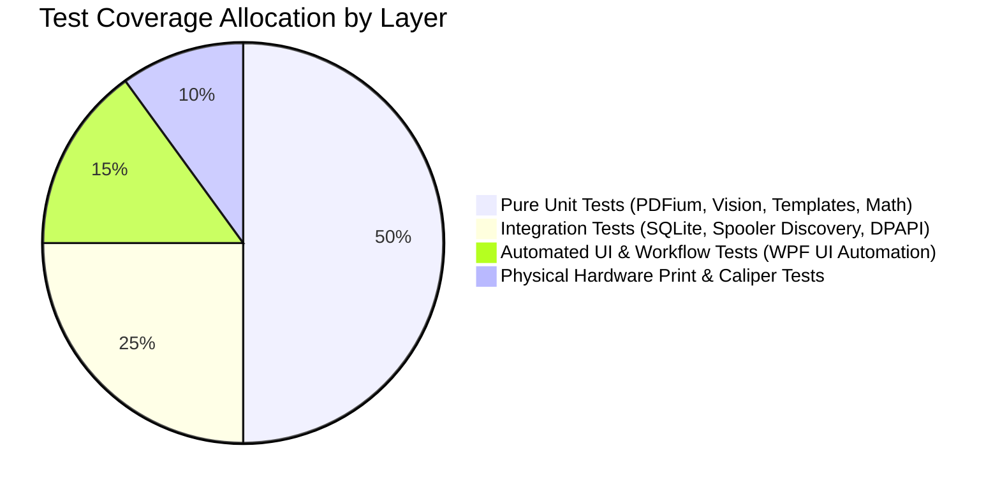

# Test Strategy & Quality Assurance Framework — PVC Studio Pro

**Quality Lead:** Senior Windows Desktop Software Architect & QA Lead  
**Standards:** ISO/IEC/IEEE 29119 Software Testing Standards  
**Date:** 2026-11-18  

---

## 1. Test Pyramid & Methodology

1. **Unit Testing Layer (50%):**
   - Pure, headless C# tests executed with `xUnit` and `FluentAssertions`.
   - Tests: coordinate transforms, JSON template schema validation, password derivation hints, QR payload extraction, Sauvola binarization, memory zeroization assertions.
2. **Integration Testing Layer (25%):**
   - SQLite atomic transaction rollbacks, DPAPI round-trip encryption/decryption, PDFium native DLL loading across threads.
   - Spooler capability discovery tests (verified against virtual spools).
3. **Automated UI Testing Layer (15%):**
   - Tested using Windows UI Automation (`FlaUI` or `Appium.WebDriver`).
   - Verifies navigation view switching, keyboard shortcuts (`Ctrl+P`, `Tab` traversal), drag-and-drop file ingestion, language toggling (English/Tamil).
4. **Physical Hardware Validation Layer (10%):**
   - Executed exclusively on physical hardware with digital caliper measurement.
   - Separate test report generated under `testing/PRINTER_COMPATIBILITY_MATRIX.md`.

---

## 2. Gating Quality Gates

- **Gate 1 (Commit Gate):** 100% unit tests pass; zero memory leaks in native interop tests.
- **Gate 2 (Spooler Gate):** Virtual spooler prints produce 0 errors and exact 85.60 × 53.98 mm dimensions.
- **Gate 3 (Security Gate):** Cryptographic shredding passes zero-byte memory assertions; zero plaintext PII in database.
- **Gate 4 (Physical Release Gate):** Physical print on target hardware (Epson L805 / L8050) passes QR code scanner and caliper tolerance (±0.2 mm).
